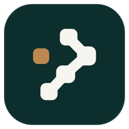

<div align="center">



# DevFathom — Brand Guidelines

_Depth in everything we build._

</div>

---

## 1. Brand essence

DevFathom is a premium software services and consultancy firm. We design,
build, and advise on complex software — pairing hands-on engineering with deep
strategic insight. The name plays on **fathom**: both a unit of _depth_ and the
act of _deeply understanding_ a client's problem.

The brand should always feel **understated, serious, and quietly confident** —
closer to a high-end professional services firm than a flashy startup. We earn
trust by being precise, not loud.

|                  |                                                           |
| ---------------- | --------------------------------------------------------- |
| **Personality**  | Understated · serious · precise · quietly confident       |
| **We sound**     | Clear, considered, human. Never hype-y.                   |
| **We feel like** | Deep, calm water — still on the surface, vast underneath. |

**Tagline:** _Depth in everything we build._
**One-liner:** _A premium software services and consultancy firm — we design, build, and advise on complex software._

---

## 2. The mark

The DevFathom mark is a **connected forward chevron** — a top block descending
to a right-hand tip, then a longer arm stepping down to the lower-left — drawn
as chunky rounded **"bead" segments**, with a **detached node square** resting
in the chevron's mouth. It reads as forward motion descending into depth — a
_fathom_ — and works equally as wordmark mark and standalone app-icon symbol.

```
   [ ]   [#]              node = detached square (brass) sits in the mouth;
            [#]           chevron = rounded "bead" blocks step down to a tip
       [#]               at the right, then a longer arm descends lower-left.
          [#]
```

### Variants

- **Brand** — full-colour app-icon lockup: an **Abyss** rounded-square tile, a
  **Paper** mark, and the node in **Brass**. The default for icons/tiles.
- **White / Dark / Auto** — one-colour silhouettes (no tile) for watermarks,
  reversed-on-dark, monochrome contexts, and `currentColor` usage.

### Rules

- **Clear space:** keep at least one node-width of space around the mark.
- **Minimum size:** 20px for the tile mark; below that use the flat silhouette.
- **Don't** recolour the tile, change the bead rhythm, add gradients or drop
  shadows, rotate, or stretch the mark.

### Wordmark

"**DevFathom**" is set in **Oxanium 600** — uniform weight, no Dev/Fathom
contrast, so brand and product type read as one system. Tight tracking. Pair
the mark + wordmark with `gap: 0.625rem`.

---

## 3. Colour

DevFathom is **deep Abyss teal** over **warm Paper**, with a single muted
**Brass** accent. Warm neutrals — never cold corporate-blue. The product is
**light-first**; the app sidebar is always the dark Abyss command surface.

### Brand ramp

| Token                 | Hex       | Use                                  |
| --------------------- | --------- | ------------------------------------ |
| `--color-brand`       | `#123A38` | Abyss-700 — primary (the helm)       |
| `--color-brand-dark`  | `#0C2E2C` | Abyss-800 — pressed / canvas         |
| `--color-brand-light` | `#245C57` | Abyss-500 — on-dark, mid             |
| `--color-brass`       | `#BC8850` | The single warm accent — used rarely |

### Light theme ("Paper", default)

| Token                              | Hex                     |
| ---------------------------------- | ----------------------- |
| `--background`                     | `#F7F5EF`               |
| `--foreground`                     | `#161A19`               |
| `--card`                           | `#FDFCF8`               |
| `--primary`                        | `#123A38`               |
| `--accent` / `--accent-foreground` | `#EFEBE1` / `#161A19`   |
| `--muted-foreground`               | `#6E7570`               |
| `--border` / `--input`             | `#E3DDD0`               |
| `--ring`                           | `#BC8850` (brass focus) |

### Dark theme ("Abyss")

| Token                  | Hex                 |
| ---------------------- | ------------------- |
| `--background`         | `#08221F`           |
| `--foreground`         | `#EEF1EA`           |
| `--card`               | `#0C2E2C`           |
| `--primary`            | `#3C7A74`           |
| `--muted-foreground`   | `#A8CBC6`           |
| `--border` / `--input` | `#16403D`           |
| `--sidebar`            | `#08221F` (deepest) |

### Semantic (desaturated, restrained)

`success #3E6B52` · `warning #9C7A3A` · `destructive #9A4A40`

> **No gradients, no glow.** Most surfaces sit on hairline borders, not shadows.
> Brass appears rarely — ideally one accent moment per view (a focus ring, an
> active indicator, a short top-rule). Restraint is the brand.

---

## 4. Typography

| Role                   | Family            | Notes                                                            |
| ---------------------- | ----------------- | ---------------------------------------------------------------- |
| **Display / headings** | **Oxanium**       | The logo face — wide, squared-geometric, rounded. `font-display` |
| **UI / body**          | **IBM Plex Sans** | Clean, legible workhorse for long-form. `font-sans`              |
| **Mono / code / data** | **IBM Plex Mono** | Tabular figures, tokens, metadata. `font-mono`                   |

**Scale** (headings tighten as they grow):
`h1 1.875rem / -0.03em` · `h2 1.5rem / -0.022em` · `h3 1.25rem / -0.018em` ·
body `15px / 1.65 / -0.01em`.

Display/heading type is **Oxanium** so brand and product read as one system;
**IBM Plex Sans** keeps dense product UI and long-form text comfortable.

---

## 5. Product interface

- **Navigation:** the role-filtered workspace and firm destinations can live in either the dark
  side rail or a compact top rail. Both layouts keep the same numeric/icon preference and brass
  active marker.
- **Page identity:** standard modules begin with one brass vertical “sounding line”, a mono domain
  eyebrow, an Oxanium title, a plain-language description, and a responsive action slot.
- **Immersive work:** chat, calls, and Kanban keep compact task-specific headers and use the full
  work canvas rather than forcing the standard module header into a dense flow.
- **Data:** KPI groups read as one ledger divided by hairlines. Mono labels and tabular Oxanium
  figures carry the hierarchy; color is reserved for meaning, not decoration.

## 6. Motion

Motion is **calm and confident** — it orients, it never performs.

- **Signature ease:** expo-out `cubic-bezier(0.16, 1, 0.3, 1)` (`easeOutExpo`).
- **Durations:** 0.4–0.9s for entrances; ambient loops 13–16s, `sine.inOut`.
- **Libraries:** **GSAP** (`@gsap/react` / `useGSAP`) for timelines & ambient
  drift (the sign-in hero); **Motion** (Framer Motion) for component reveals,
  the sliding sidebar indicator (`layoutId`), and page transitions.
- **Building blocks:** `Reveal`, `Stagger` / `StaggerItem`, `CountUp`,
  `Magnetic`, `PageTransition` (in `src/components/motion/`).
- **Accessibility:** everything honours `prefers-reduced-motion` — in CSS and in
  every motion component (they render statically when reduced).

> Principle: if an animation doesn't help someone understand _where they are_ or
> _what changed_, cut it. Quiet confidence over spectacle.

---

## 7. Voice & tone

- **Clear over clever.** "Sign in to your DevFathom workspace."
- **Considered and human.** Short sentences. Real verbs. No exclamation marks.
- **Confident, not loud.** We state; we don't sell.
- **Respect the reader's time.** Lead with the point.

---

## 8. Assets

All raster assets are generated from one master SVG:

```bash
bun run scripts/gen-brand-icons.ts
```

`public/favicon.svg` · `favicon-{16,32,192}.png` · `favicon.png` (512) ·
`favicon.ico` · `apple-touch-icon.png` · `images/logo-{mark,dark,white}.svg`.

See the identity live at **`/brand`**.
