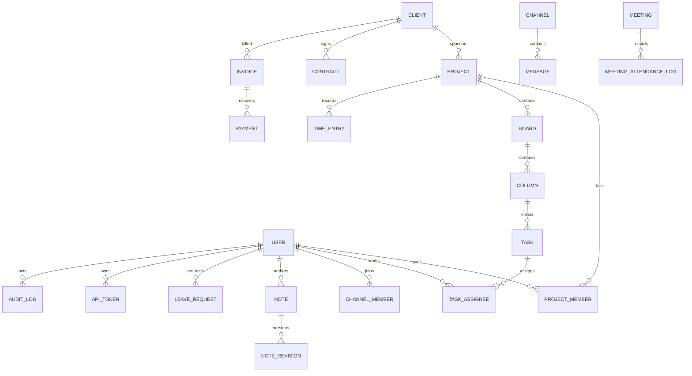

# Data architecture

**System of record:** PostgreSQL through Prisma 7  
**Shape:** single-company relational model, 60 models, 23 enums

## Domain model map

| Domain        | Core models                                                                                                                                    | Purpose                                                     |
| ------------- | ---------------------------------------------------------------------------------------------------------------------------------------------- | ----------------------------------------------------------- |
| Identity      | User, Invitation, PasswordResetToken, TwoFactorRecoveryCode                                                                                    | Accounts, onboarding, recovery, 2FA, revocation             |
| People        | LeaveRequest, LeaveBalance, PerformanceNote, ReviewCycle, Review, Resignation                                                                  | HR workflows, entitlements, performance, separation         |
| Clients       | Client, ClientContact, Contract                                                                                                                | CRM, relationship contacts, commercial agreements           |
| Delivery      | Project, ProjectMember, Board, Column, Task, blockers, assignees, labels, checklists, comments, attachments, TimeEntry, Milestone, ProjectFile | Project execution and work evidence                         |
| Finance       | Invoice, Payment, Transaction, RecurringExpense                                                                                                | Billing, cash tracking, P&L inputs, recurring costs         |
| Collaboration | Channel, ChannelMember, Message, MessageEdit, MessageAttachment, MessageReaction, MessageMention, PinnedMessage, SavedMessage                  | Realtime team communication                                 |
| Knowledge     | Note, NoteShare, NoteLink, NoteMention, NoteRevision, Document                                                                                 | Rich notes, sharing, backlinks, history, files              |
| Meetings      | Meeting, MeetingAttendee, MeetingAttendanceLog                                                                                                 | Scheduling and per-occurrence attendance                    |
| Operations    | Activity, Notification, AuditLog, ApiToken, Webhook, WebhookDelivery                                                                           | User-facing events, audit, automation, integration evidence |
| Email         | Mailbox, EmailMessage                                                                                                                          | Provider-neutral connected mailboxes and cached messages    |

## Core relationship view

## Data ownership and access rules

| Data            | Ownership/visibility rule                                                                                      |
| --------------- | -------------------------------------------------------------------------------------------------------------- |
| User profile    | Company directory with redaction rules; privileged fields/actions limited by HR/admin paths                    |
| Project/task    | Project membership is the object boundary; destructive structure changes require lead/admin in key paths       |
| Channel/message | Channel membership is the boundary, including private DMs; message author and channel role influence mutations |
| Note            | `PRIVATE`, `SHARED`, or `TEAM`; explicit `NoteShare` grants view/edit; revisions preserve prior content        |
| Meeting         | Creator/attendee/admin access depending on operation; attendance is per occurrence                             |
| Mailbox/email   | Every mailbox/message query rechecks owning user ID                                                            |
| Finance         | UI/tRPC admin-only; REST additionally requires an admin-bound token                                            |
| Audit           | Admin-only read surface; actor details are snapshotted to survive user deletion                                |
| API token       | Bound to one user; only hash/prefix persisted; raw value shown once                                            |

## Lifecycle and deletion behavior

- Cascades are common for containment: project → boards/tasks, channel → messages, note → shares/links/revisions, mailbox → messages.
- `SetNull` preserves records where historical meaning should survive removal: client/project links, audit actor, optional relationships.
- User deletion cascades many operational relations; audit actor relation is `SetNull` while snapshot columns remain.
- Soft deletion exists for messages (`deletedAt`) and account status; many other records are hard-deleted.
- Note revision retention is bounded in router logic to the 50 most recent snapshots.
- Audit, email cache, HR, finance, meeting attendance, webhook payloads, and message history have no documented global retention policy.

## Money and reporting

- Monetary fields use `Decimal`, typically `Decimal(12,2)`.
- Supported source currencies are `USD` and `PKR`.
- Invoices, payments, transactions, recurring expenses, contracts, and project budgets can carry currency.
- Reports group values by currency in several current paths; management policy for exchange rates/base-currency conversion is not a schema-level guarantee.
- **Proposed:** publish one metric dictionary that defines recognized revenue, cash received, outstanding value, contract value, expense timing, exchange-rate source, and reconciliation owner.

## Historical and audit records

Three histories have different meanings:

| Record       | Purpose                          | Reliability expectation                                                                                      |
| ------------ | -------------------------------- | ------------------------------------------------------------------------------------------------------------ |
| Activity     | Human-facing summary feed        | Convenient product history; not a compliance ledger                                                          |
| Notification | User delivery/read state         | Ephemeral operational messaging                                                                              |
| AuditLog     | Security/administrative evidence | Detailed actor/action/outcome/context; intended append-only, but DB append-only enforcement is not evidenced |

Message edits, note revisions, and meeting attendance logs provide domain-specific history outside the audit table.

## Database connection behavior

- Prisma Client is generated into `src/generated/prisma`.
- `src/lib/db.ts` creates a `pg.Pool` with `max: 10` per process/instance.
- Development caches the Prisma client across hot reloads.
- Connection and query telemetry are not instrumented.
- Repeated production warnings indicate the TLS connection string should be reviewed and explicitly use full certificate/hostname verification.

## Schema change posture

**Verified gap:** no migration history is checked in. `db push` is convenient for prototyping but is not an auditable production schema deployment mechanism.

### Proposed migration workflow

1. Snapshot and verify production backup/PITR.
2. Baseline the existing production schema into an initial migration.
3. Generate migrations with `prisma migrate dev` in development.
4. Review SQL and data/backfill implications in pull requests.
5. Test forward migration against a production-shaped staging copy.
6. Use expand/contract changes for zero-downtime compatibility.
7. Apply with `prisma migrate deploy` in CI before application promotion.
8. Prefer roll-forward; document any rollback-safe migrations explicitly.

## Backup and recovery requirements

| Asset               | Minimum backup requirement                                      | Restore evidence                                  |
| ------------------- | --------------------------------------------------------------- | ------------------------------------------------- |
| PostgreSQL          | Provider PITR plus documented retention and access              | Quarterly restore to isolated environment         |
| Private objects     | Versioned/replicated object-store policy and deletion lifecycle | Restore sample objects and authorization metadata |
| Environment/secrets | Recoverable from approved secret manager; no plaintext doc copy | Rotation/reconstruction drill                     |
| Audit evidence      | Retention and tamper-resistance policy                          | Export/replay verification                        |
| Source/migrations   | Protected Git repository and release tags                       | Fresh environment rebuild                         |

## Data governance gaps

- No formal classification (public/internal/confidential/restricted).
- No data owner per domain.
- No retention/deletion/export/legal-hold schedule.
- No employee privacy or offboarding data procedure.
- No vendor/subprocessor data-flow register.
- No documented backup region, encryption, or access-review evidence.

See [business continuity](../operations/BUSINESS-CONTINUITY.md) and [security architecture](SECURITY-ARCHITECTURE.md).
