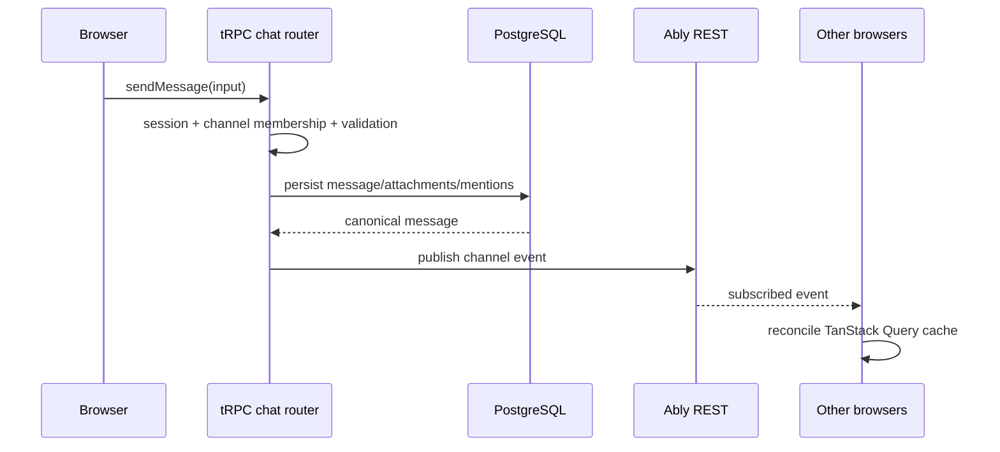
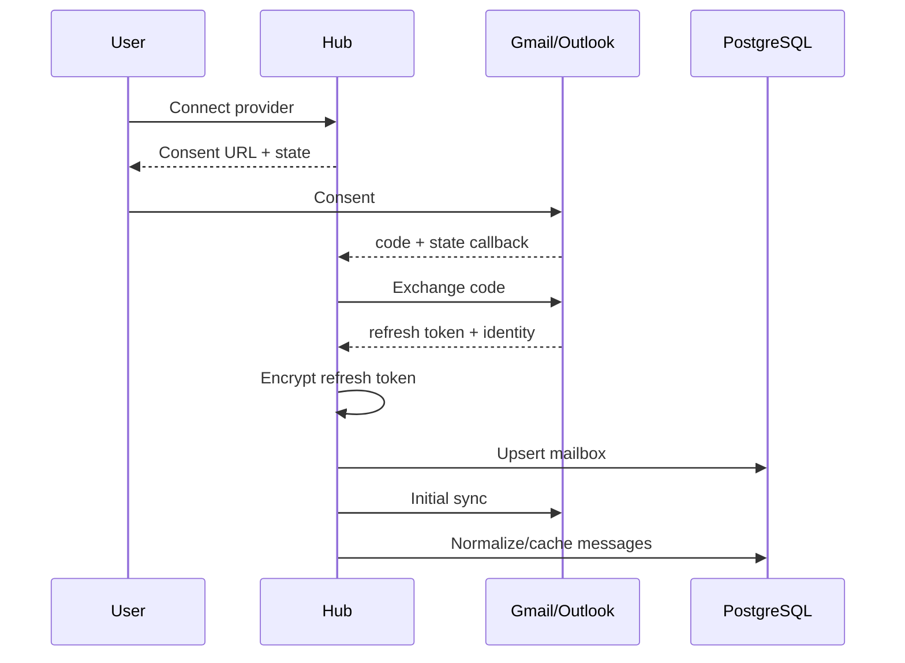
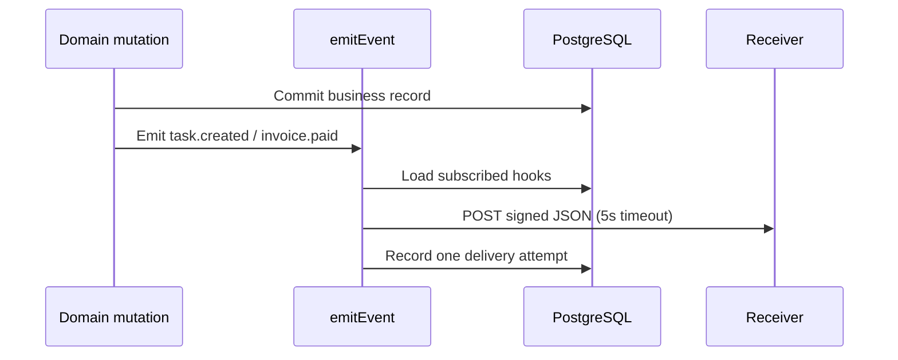

# Integrations and runtime flows

## Integration inventory

| Integration            | Purpose                                        | Authentication/config                          | Data exchanged                          | Degraded behavior                              | Current state                      |
| ---------------------- | ---------------------------------------------- | ---------------------------------------------- | --------------------------------------- | ---------------------------------------------- | ---------------------------------- |
| PostgreSQL             | Primary data store                             | `DATABASE_URL`                                 | All operational records                 | Application largely unavailable                | Production/Preview configured      |
| Vercel                 | Next.js hosting and deployments                | linked project/platform access                 | Requests, logs, code, env               | Full outage if platform unavailable            | Active, `sin1`, Node 24.x          |
| Ably                   | Chat events, typing, presence, personal events | server API key; capability token request       | IDs, memberships, realtime payloads     | App loads; realtime disconnects                | Production/Preview configured      |
| Google AI              | Assistant model                                | `GOOGLE_GENERATIVE_AI_API_KEY`, `GEMINI_MODEL` | Prompts, selected context, tool results | Assistant unavailable; core app remains        | Production configured; Preview gap |
| Groq                   | Historical/alternate AI                        | `GROQ_API_KEY`, `GROQ_MODEL`                   | Potential prompts/context               | No current route dependency verified           | Configured but apparently legacy   |
| Brevo                  | Transactional email                            | API key and sender identity                    | Recipient, subject, template content    | In-app change succeeds; email may fail         | Production/Preview configured      |
| Gmail API              | Connected inbox read/send                      | Google OAuth + encrypted refresh token         | Mail metadata/body/send content         | Provider button disabled if unconfigured       | Not configured on Vercel           |
| Microsoft Graph        | Outlook inbox read/send                        | Microsoft OAuth + encrypted refresh token      | Mail metadata/body/send content         | Provider button disabled if unconfigured       | Not configured on Vercel           |
| 8x8 JaaS               | Embedded video meetings                        | App ID + signed meeting credentials            | Participant/room/media session          | Meeting record remains; call unavailable       | Production configured; Preview gap |
| Outbound webhooks      | Internal event automation                      | per-hook HMAC secret                           | `task.created`, `invoice.paid` payloads | Core write succeeds; delivery failure recorded | Implemented, not durable           |
| Private upload storage | Attachments/files/voice                        | session + resource auth                        | User-uploaded binary content            | Current local disk is not durable              | Production blocker                 |

## Realtime message flow

Clients cannot publish canonical persisted message events. Typing is published by clients on a separate capability channel; identity is stamped from the token `clientId`.

## AI operator flow

1. Browser sends AI SDK UI message history to `/api/assistant`.
2. Route authenticates the session and creates user/role/department/status context.
3. Recent prompt text selects relevant domain toolsets plus core tools.
4. Google model may request a read, write, or approval-gated tool.
5. Tool resolves ambiguous human names/targets.
6. Tool rechecks role and resource access inside execution.
7. Prisma operation returns structured data.
8. Model streams a user response.
9. Material writes should appear in the normal domain/audit histories.

**Operational controls still required:** body validation, size/concurrency/rate/cost limits, provider governance, evaluation gates, and telemetry.

## Email connection and sync flow

**Security note:** the intended state step exists in the diagram, but current code does not persist or verify it. The feature must remain disabled until this is fixed and Vercel variables are configured.

## Meeting/video flow

1. Meeting and attendees are stored in PostgreSQL.
2. Authorized attendee/creator requests a call token.
3. Server signs a JaaS room credential using configured key material.
4. Browser loads the JaaS external API under CSP/permissions-policy allowlists.
5. Join and leave events update `MeetingAttendanceLog` for the computed occurrence.
6. Attendance report derives per-occurrence participation.

## Transactional email flow

Domain routers call one email sender/template layer after actions such as invitations, resets, invoices, leave, resignation, or layoff. Brevo receives recipient and rendered content. Delivery/bounce/suppression monitoring and durable retries are not documented.

## Webhook flow

Current delivery is detached and single-attempt. Target state requires SSRF-safe destination policy, durable queue/workflow, idempotency, retry/backoff, dead letter/replay, schema versioning, and SLOs.

## File flow

### Current

1. Authenticated browser posts multipart file.
2. Route checks size, MIME, extension, and name.
3. Function writes `private-uploads/<uuid>-<safe-name>`.
4. Route returns `/api/files/<name>`.
5. Business record stores URL/name/type/size.
6. Download route requires session; chat files additionally require channel membership.

### Confirmed defects

- Function-local storage is nondurable on Vercel.
- Chat mutation currently expects `/uploads/` while upload returns `/api/files/`.
- Non-chat file ACL is not persisted at the storage record boundary.

### Target

- Private object store with immutable/random object keys.
- Persist uploader, owning resource, classification, checksum, scan status, and deletion state.
- Authenticated server delivery or short-lived signed URL after resource authorization.
- Content sniffing/malware scan, orphan cleanup, retention, and restore procedure.

Vercel documents private Blob as requiring authenticated access and server-mediated delivery for custom authorization: [private Blob storage](https://vercel.com/docs/vercel-blob/private-storage).

## Environment failure behavior

| Missing config              | Expected effect                                          |
| --------------------------- | -------------------------------------------------------- |
| `DATABASE_URL`              | Database operations fail; app not viable                 |
| `AUTH_SECRET` in production | Auth module should fail fast                             |
| `ABLY_API_KEY`              | Token route returns 503; non-realtime app can still load |
| Google AI key/model         | Assistant fails; rest of app remains                     |
| Brevo config                | Transactional email cannot deliver                       |
| JaaS credentials            | In-app video token/call unavailable                      |
| OAuth provider keys         | Corresponding connect button disabled                    |
| `EMAIL_TOKEN_ENC_KEY`       | Mailbox callback refuses credential storage              |

See [environment variable catalogue](../reference/ENVIRONMENT-VARIABLES.md) and [runbooks](../operations/RUNBOOKS.md).
