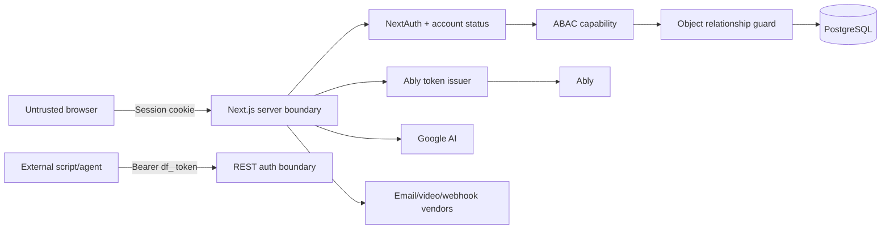

# Security architecture

**Model:** layered identity, capability, relationship, scope, and audit controls  
**Reference target:** OWASP ASVS-aligned internal application controls

## Security principles present in the code

1. Default-deny capability policies.
2. Server-side authentication and authorization; UI visibility is not a security boundary.
3. Object-level checks for records and memberships.
4. User-bound automation identities.
5. Secrets remain server-side.
6. Sensitive tokens are hashed or encrypted.
7. Material operations leave audit evidence.
8. Managed realtime clients receive narrow, expiring capabilities.

## Trust boundaries

## Authentication

### Credentials

- Email/password credential provider.
- Runtime Zod validation before lookup.
- Dummy bcrypt comparison for missing accounts to reduce timing enumeration.
- `ACTIVE` and `ON_LEAVE` may authenticate; inactive/invited accounts may not.
- Password reset and invitation raw tokens are emailed once; only hashes are stored.
- Login callback URLs are restricted to relative same-origin paths.

### Sessions

- JWT sessions with an eight-hour maximum age.
- Token carries user ID, role, department, title, status, and `tokenVersion`.
- Role/status/version are refreshed from the DB approximately every minute.
- Password changes, admin reset, layoff, and sign-out-everywhere bump `tokenVersion`.
- **Risk:** refresh failure keeps prior claims to preserve availability; sensitive operations should fail closed when freshness cannot be established.

### Two-factor authentication

- TOTP enrollment/confirmation/disable and single-use recovery codes exist.
- Recovery codes are hashed.
- **Risk:** TOTP secret is stored reversibly as a database string and MFA is optional, including for privileged roles.
- **Proposed:** envelope-encrypt TOTP secrets and require MFA/step-up authentication for admin/HR/high-risk actions.

## Authorization

### Coarse capability layer

The ABAC catalogue currently covers:

- admin access;
- HR access;
- team view/layoff/role change;
- leave approval;
- finance read;
- resignation request/read/review.

Policies receive subject, resource, and environment attributes and default deny. HR cannot lay off or review an admin in defined paths; users cannot review their own resignations.

### Object-level layer

Relationship checks cover projects/boards/tasks, channel membership, meeting access, note visibility/shares, mailbox ownership, notification ownership, and REST resource access.

**Design rule:** adding an ABAC capability does not replace object-level checks. A role answers “may this class of user perform this kind of action?”; a relationship answers “may this user touch this exact record?”

### Role matrix

| Capability                                   | Employee |  HR | Admin |
| -------------------------------------------- | -------: | --: | ----: |
| Use active workspace                         |      Yes | Yes |   Yes |
| Team directory                               |      Yes | Yes |   Yes |
| Own leave/resignation                        |      Yes | Yes |   Yes |
| HR console / leave approval                  |       No | Yes |   Yes |
| Company resignation queue                    |       No | Yes |   Yes |
| Lay off non-admin                            |       No | Yes |   Yes |
| Lay off/administer admin                     |       No |  No |   Yes |
| Change roles                                 |       No |  No |   Yes |
| Finance                                      |       No |  No |   Yes |
| Audit logs / API and webhooks administration |       No |  No |   Yes |

Project lead/member, channel owner/admin/member, note author/share permission, and meeting creator/attendee add resource-specific roles beneath this table.

## REST API security

- Tokens have `df_` format, high-entropy random payload, display prefix, bcrypt hash, scopes, optional expiry, and user binding.
- Write scope implies corresponding read scope.
- Finance requires an admin user even when token has wildcard scope.
- Per-IP and per-token throttles exist but are process-local.
- Each route is expected to validate payloads and perform relationship checks.
- REST outcomes are recorded through the audit layer.

## AI operator security

- The route requires a valid NextAuth session.
- Tool context is built from the authenticated user, not model-supplied identity.
- Tool domains are selected by prompt hints to reduce cost/context size.
- Approval UI is explicitly not trusted as an authorization boundary.
- Every write tool is expected to re-authorize inside `execute`.
- Tool exceptions are converted to structured failures.

### AI control gaps

- No explicit message/body schema or size limit.
- No distributed per-user rate, concurrency, or cost budget.
- No documented provider data-retention/zero-retention contract.
- No production evaluation gate for model/version changes.
- Large tool factories make authorization review expensive.

## Realtime security

- Browser never receives the Ably API key.
- Token endpoint requires session authentication.
- `clientId` is the verified user ID.
- Capabilities are derived from current channel memberships.
- Persisted channel events are subscribe-only for clients; server publishes after DB writes.
- Typing channels permit publish/subscribe; presence channel permits presence.
- Token TTL is 30 minutes and refresh picks up membership changes.

This matches Ably's recommended use of short-lived token authentication and capability-scoped channel access: [Ably token auth](https://ably.com/docs/auth/token?lang=javascript), [capabilities](https://ably.com/docs/auth/capabilities).

## File security

### Present controls

- Session required to upload/download.
- Size limit.
- MIME and extension allowlists block executable HTML/SVG upload types.
- Randomized, normalized names block traversal/name collisions.
- Chat attachment download rechecks channel membership and returns 404 to nonmembers.

### Gaps

- Local storage is nondurable in Vercel.
- Declared MIME and extension are not equivalent to content/magic-byte validation.
- No malware scan.
- Non-chat downloads use session-only access rather than persisted object ownership/ACL.
- Chat attachment URL validation currently conflicts with the upload URL contract.

## Email integration security

- Mailbox and message ownership rechecked server-side.
- Refresh tokens designed for AES-256-GCM encryption with random IV.
- Credentials never selected to clients.
- Provider scopes are limited to read/send/offline identity needs.

### Gaps before enablement

- State nonce is not persisted/validated/consumed.
- PKCE is not implemented.
- Microsoft ID token payload is decoded without signature/issuer/audience/nonce verification.
- Vercel lacks the provider and encryption variables required to enable the feature.

## Webhook security

- Admin-only management.
- High-entropy secret shown once.
- HMAC-SHA256 signature over raw body.
- Five-second delivery timeout and delivery history.

### Gaps

- SSRF protection absent for private/link-local/loopback/metadata destinations and redirects.
- Secret is stored in plaintext because it must sign future deliveries; no encryption/key-management layer.
- Detached, single-attempt delivery is not durable.
- Payload classification/versioning/retention is undefined.

## Audit architecture

- tRPC mutations and privileged reads, REST calls, and auth events use centralized capture.
- Sensitive keys are redacted and payload depth/length bounded.
- Actor identity is snapshotted.
- Rich context includes IP, user agent, target, status, duration, and outcome.

### Audit gaps

- Many writes are fire-and-forget and may be lost at serverless termination.
- Database role does not enforce append-only behavior.
- Retention, export, immutable archive, access review, and alerting are not defined.

## Browser hardening

Present headers:

- Content-Security-Policy;
- Strict-Transport-Security;
- X-Frame-Options DENY;
- X-Content-Type-Options nosniff;
- strict-origin-when-cross-origin referrer policy;
- camera/microphone/display permissions limited to self and JaaS;
- geolocation denied;
- restricted Next image remote host.

**Gap:** production CSP still includes `'unsafe-inline'`; migrate to nonce/hash enforcement after report-only validation.

## Security verification roadmap

1. Close OAuth state, webhook SSRF, attachment, assistant-limit, durable-audit, and file-storage gaps.
2. Require privileged MFA and encrypt TOTP secrets.
3. Add authorization and abuse tests in CI.
4. Add centralized security events and alerts.
5. Establish data classification/retention and vendor contracts.
6. Run an ASVS-aligned review and external penetration test.
7. Document risk acceptance with expiry and named owners.

The attacker assumptions, abuse paths, and security test cases are expanded in the [threat model](THREAT-MODEL.md).

## Canonical evidence

- `src/lib/auth.ts`
- `src/server/trpc.ts`
- `src/lib/abac`
- `src/lib/authz.ts`
- `src/lib/api-auth.ts`
- `src/server/audit.ts`
- `src/app/api/ably-token/route.ts`
- `src/app/api/upload/route.ts`
- `src/app/api/files/[name]/route.ts`
- `src/lib/email`
- `src/server/routers/email.ts`
- `src/server/routers/webhooks.ts`
- `src/lib/webhooks.ts`
- `next.config.ts`
- `prisma/schema.prisma`

## Related documents

- [Threat model](THREAT-MODEL.md) · [Technical due diligence](../executive/TECHNICAL-DUE-DILIGENCE.md) · [Risk register](../executive/RISK-REGISTER.md) · [Data/privacy governance](../governance/DATA-PRIVACY-GOVERNANCE.md)
