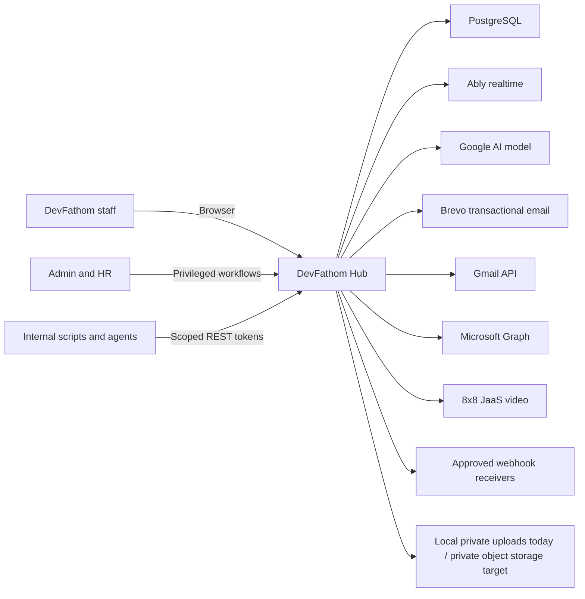
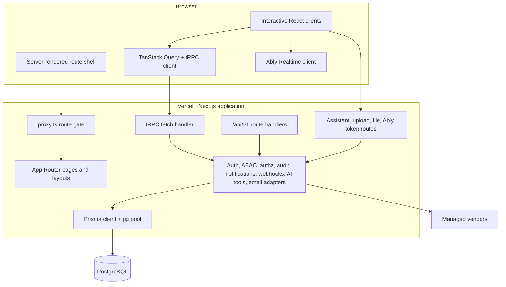
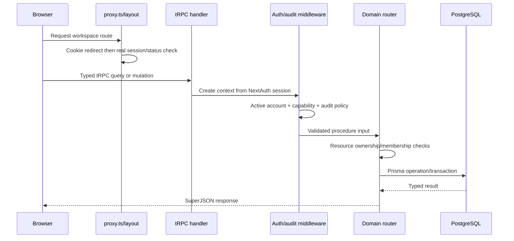
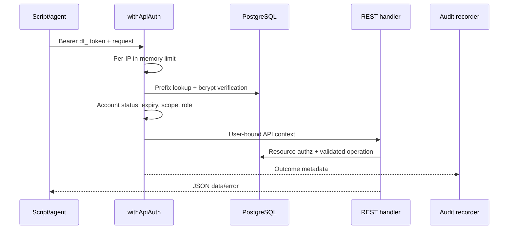
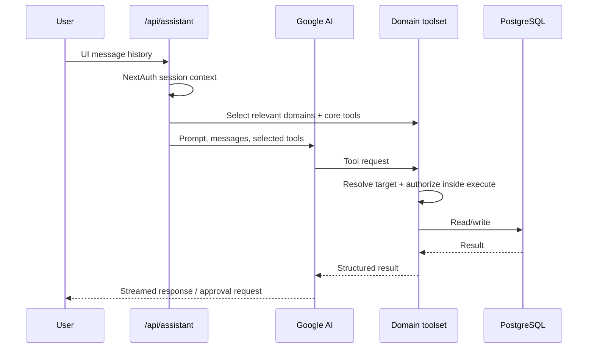

# System architecture

**Status:** Verified current-state architecture with proposed target controls  
**Snapshot:** 2026-07-12

## Architectural style

DevFathom Hub is a **single-tenant modular monolith**:

- one Next.js 16 App Router application;
- one PostgreSQL system of record through Prisma;
- one tRPC application API for the authenticated browser;
- a smaller token-authenticated REST API for scripts and agents;
- managed third-party services for realtime, AI, email delivery, inbox providers, and video;
- one Vercel project deployed in `sin1`.

This shape is appropriate for the current internal-company scope. It minimizes distributed-system overhead while keeping domain boundaries visible in routers, schema groups, and UI routes.

## System context

## Container view

## Layer responsibilities

| Layer                       | Responsibility                                                | Canonical paths                                                                          |
| --------------------------- | ------------------------------------------------------------- | ---------------------------------------------------------------------------------------- |
| Route protection            | Public path allowlist, cookie presence redirect               | `src/proxy.ts`                                                                           |
| Server route authentication | Real session/status check for authenticated workspace         | `src/app/(app)/layout.tsx`                                                               |
| Pages/layouts               | Server composition, metadata, route boundaries                | `src/app/**/page.tsx`, layouts                                                           |
| Client features             | Interactive module screens and optimistic UI                  | `src/app/(app)/**/*-content.tsx`, `src/components`                                       |
| Client data                 | tRPC client, TanStack Query cache, SuperJSON                  | `src/lib/trpc.ts`, `src/lib/trpc-provider.tsx`                                           |
| Application API             | Queries/mutations grouped by business domain                  | `src/server/routers/*.ts`                                                                |
| API middleware              | Context, authentication, ABAC capability gates, auditing      | `src/server/trpc.ts`                                                                     |
| REST API                    | Token-scoped automation surface                               | `src/app/api/v1/**/route.ts`                                                             |
| Domain/security services    | Auth, object authz, ABAC, audit, rate limit, notify, webhooks | `src/lib`, `src/server`                                                                  |
| AI operator                 | Model route, prompt, tool selection, domain tools             | `src/app/api/assistant/route.ts`, `src/lib/ai`                                           |
| Realtime                    | Token issuing, channel contracts, browser subscriptions       | `src/app/api/ably-token`, `src/lib/ably.ts`, `src/components/chat/realtime-provider.tsx` |
| Persistence                 | Prisma schema/client and PostgreSQL pool                      | `prisma/schema.prisma`, `src/lib/db.ts`                                                  |

## Application modules

| Module         | UI routes                               | tRPC domain                                    | Key records                                                               |
| -------------- | --------------------------------------- | ---------------------------------------------- | ------------------------------------------------------------------------- |
| Dashboard      | `/dashboard`                            | `dashboard`                                    | Activity, notifications, projects, tasks, finance aggregates, preferences |
| Projects       | `/projects`, project, board, import     | `projects`, `trelloImport`                     | Project, member, board, column, task, labels, milestones, files, time     |
| Clients        | `/clients`, client detail               | `clients`                                      | Client, contacts, contracts, documents, related projects/invoices         |
| Finance        | `/finance`, invoice print               | `finance`                                      | Invoice, payment, transaction, recurring expense                          |
| Chat           | `/chat`                                 | `chat`                                         | Channel, members, messages, edits, attachments, reactions, pins, saved    |
| Notes          | `/notes`, note detail                   | `notes`                                        | Note, shares, links, mentions, revisions                                  |
| Meetings       | `/meetings`, detail, call               | `meetings`                                     | Meeting, attendee, per-occurrence attendance                              |
| Team/HR        | `/team`, `/hr`, `/reviews`, insights    | `team`, `teamStats`, `resignations`, `reviews` | User, leave, balances, performance notes/reviews, resignations            |
| Settings       | `/settings`, `/api-docs`, `/audit-logs` | `apiTokens`, `webhooks`, `twoFactor`, `audit`  | API tokens, webhooks, 2FA recovery, audit logs                            |
| Email          | `/email`, OAuth callback                | `email`                                        | Mailbox, cached messages                                                  |
| Authentication | login, invite, forgot/reset             | `invitations`, `passwordReset` plus NextAuth   | User, invite, reset token, session claims                                 |

## Request paths

### Authenticated browser query/mutation

### REST automation

### AI operator

## Deployment topology

- **Verified:** Vercel project `dev-fathom-hub`, Node 24.x, region `sin1`.
- **Verified:** Next.js preset; default output; `vercel.json` contains only the region.
- **Verified:** PostgreSQL connection is supplied by `DATABASE_URL`; `pg.Pool` uses `max: 10` per runtime instance.
- **Verified:** Ably maintains persistent realtime connections outside Vercel Functions.
- **Verified:** uploads currently write to the function filesystem and are not production-durable.
- **Proposed:** private Blob/object storage, automated migrations, durable async jobs, structured telemetry, and distributed throttles.

## Architectural strengths

- Domain grouping is understandable and matches business workflows.
- Browser/tRPC/Prisma types reduce contract drift.
- Managed realtime suits serverless hosting.
- Authorization exists at multiple layers, including object relationships.
- Audit and automation are treated as first-class capabilities.
- The single deployment is operationally simpler than premature microservices.

## Architectural pressure points

- Large domain routers, UI components, and AI factories concentrate complexity.
- Process-local throttles and detached promises do not map safely to serverless scaling/termination.
- Schema, files, realtime, AI, and email depend on vendors but lack complete operational contracts.
- The proxy checks cookie presence only; the authenticated layout/API must remain the real security boundary.
- Single-tenant assumptions are pervasive; commercialization would require an organization boundary in every record and policy.

## Target evolution without a microservice rewrite

1. Keep the modular monolith.
2. Extract reusable domain services from oversized routers/tools.
3. Put durable asynchronous work behind a queue/workflow abstraction.
4. Add a storage abstraction with private object storage in production and local adapter in development.
5. Introduce migration, CI, observability, and recovery contracts.
6. Add tenant boundaries only if product strategy changes; do not simulate multi-tenancy prematurely.

## Primary evidence

- `src/app/(app)/layout.tsx`
- `src/proxy.ts`
- `src/server/trpc.ts`
- `src/server/routers/_app.ts`
- `src/lib/db.ts`
- `src/lib/auth.ts`
- `src/lib/abac`
- `src/lib/authz.ts`
- `src/lib/api-auth.ts`
- `src/app/api/assistant/route.ts`
- `src/app/api/ably-token/route.ts`
- `prisma/schema.prisma`
- `next.config.ts`
- `vercel.json`
