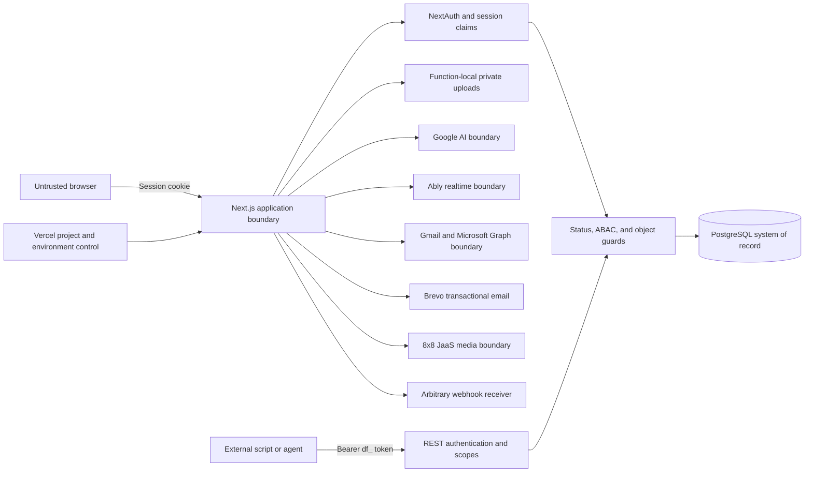

# Threat model

**Internal · Confidential · Snapshot: 2026-07-12**  
**Scope:** DevFathom Hub application, PostgreSQL data, direct and token-authenticated APIs, AI tools, realtime, files, email integrations, video, transactional email, webhooks, and the Vercel deployment boundary.

## Method and limits

This is a repository-grounded design threat model. It identifies assets, trust boundaries, attacker capabilities, abuse paths, existing controls, and residual risk. It is **not** a penetration test, vulnerability scan, compliance certification, or guarantee that every implementation path was reviewed.

Evidence labels:

- **Verified:** directly present in source/configuration or linked-platform inspection.
- **Inferred:** a plausible attacker goal or operational consequence.
- **Proposed:** target mitigation or verification activity.
- **Open decision:** policy/ownership choice not encoded in the system.

Reference baselines: [OWASP ASVS](https://owasp.org/www-project-application-security-verification-standard/) and [NIST Secure Software Development Framework](https://csrc.nist.gov/pubs/sp/800/218/final).

## Security objectives

1. Only authorized active staff and bound automation identities access operational records.
2. Object relationships constrain access below coarse roles.
3. Finance, people, client, communication, and audit data retain confidentiality and integrity.
4. Consequential actions are attributable, reviewable, and recoverable.
5. External vendors receive only the data and permissions necessary for their function.
6. Files, database records, credentials, and event deliveries survive expected runtime lifecycle behavior.
7. AI and automation never become a route around authorization, confirmation, or business rules.

## Assets

| Asset                                                                | Sensitivity                              | Security requirement                                                             |
| -------------------------------------------------------------------- | ---------------------------------------- | -------------------------------------------------------------------------------- |
| User credentials, session tokens, recovery/reset/invite tokens       | Restricted                               | Confidentiality, anti-replay, revocation, audit                                  |
| Personnel profiles, leave, reviews, resignation and termination data | Restricted                               | Need-to-know access, integrity, retention policy, export control                 |
| Client, contract, project, task, time, and document data             | Confidential                             | Relationship-based access, integrity, availability                               |
| Invoices, payments, transactions, budgets, rates, P&L                | Restricted                               | Admin-only access, calculation integrity, currency correctness, audit            |
| Chat, notes, meetings, attendance, connected mailbox data            | Confidential/Restricted                  | Membership/ownership checks, retention, vendor boundaries                        |
| API tokens, OAuth refresh tokens, webhook secrets, vendor keys       | Restricted                               | Hash/encryption where feasible, rotation, least privilege, no client exposure    |
| Audit records                                                        | Restricted integrity evidence            | Completeness, append-only protection, retention, export, monitoring              |
| Uploaded files                                                       | Confidential/Restricted by parent record | Durable storage, malware/content controls, ownership ACL, authenticated delivery |
| AI prompts, context, tool calls, responses                           | Confidential                             | Authorization, minimization, provider governance, cost/abuse control             |
| Availability and deployment control                                  | Critical operational asset               | Controlled release, monitoring, recovery, least-privileged platform access       |

## Trust boundaries

The highest-risk transitions are: browser/session to privileged action, admin-configured webhook to arbitrary network destination, application to AI/mail vendors with business data, local function disk to persistent record references, and deployment control to production/secrets.

## Threat actors

| Actor                                  | Capability assumption                                                                                   |
| -------------------------------------- | ------------------------------------------------------------------------------------------------------- |
| Unauthenticated internet attacker      | Can reach public routes and attempt credential, reset, invite, parsing, and resource-exhaustion attacks |
| Authenticated employee                 | Has a valid session and can manipulate client requests; may attempt IDOR or access beyond membership    |
| Privileged insider                     | Has HR/Admin capabilities; may misuse legitimate access or configure integrations dangerously           |
| Compromised account/session            | Has the victim's session until expiry/revocation; may preserve stale access during gaps                 |
| Compromised API token                  | Can call REST within token scopes and bound-user permissions until revoked/expired                      |
| Malicious/compromised webhook receiver | Receives signed event payloads and may fail, replay, or exfiltrate delivered data                       |
| Compromised vendor/integration         | May access data sent to AI, realtime, email, video, hosting, or database providers                      |
| Operator error                         | May change schema, deployment alias, secrets, or records without repeatable rollback evidence           |
| Malicious content/prompt               | Attempts stored content execution, prompt injection, unauthorized AI actions, or resource abuse         |

## Entry points and security boundaries

| Entry point                        | Authentication      | Authorization                                               | Important residual risk                                                    |
| ---------------------------------- | ------------------- | ----------------------------------------------------------- | -------------------------------------------------------------------------- |
| NextAuth credentials/invite/reset  | Public initiation   | Token and account-state rules                               | Credential abuse; optional MFA; operational rate-limit coverage unverified |
| tRPC                               | Session             | Active status, capability, object checks                    | Distributed test coverage absent; large routers spread rules               |
| `/api/v1`                          | Hashed bearer token | Scope, bound user, object checks; finance admin double gate | Process-local throttles; detached audit                                    |
| `/api/assistant`                   | Session identity    | Tool-specific `execute` authorization                       | No body/schema/rate/cost limits; direct-route status freshness gap         |
| `/api/ably-token`                  | Session identity    | Membership-derived capabilities                             | Direct-route status gap; membership changes bounded by token lifetime      |
| `/api/upload`, `/api/files/[name]` | Session identity    | Session plus chat membership on chat files                  | Nondurable disk, limited ACL model, no malware/magic-byte verification     |
| Mail OAuth callback                | Session/UI workflow | Mailbox ownership after exchange                            | State not consumed; Microsoft ID token unverified                          |
| Admin webhook configuration        | Admin tRPC          | Admin capability                                            | Arbitrary network destinations and redirects create SSRF                   |
| Vercel control plane               | Vercel account/team | Platform RBAC outside repo                                  | Ownership/MFA/access-review evidence absent; alias drift exists            |

## Abuse-case register

| ID    | Abuse path                                                                         | Existing controls                                                            | Residual risk                                                                                     | Required mitigation / test                                                                           | Risk link         |
| ----- | ---------------------------------------------------------------------------------- | ---------------------------------------------------------------------------- | ------------------------------------------------------------------------------------------------- | ---------------------------------------------------------------------------------------------------- | ----------------- |
| TM-01 | Reuse/forge email OAuth flow to link the wrong mailbox                             | Provider code exchange, authenticated callback UI, mailbox ownership records | State is generated but not persisted/consumed; replay/account-linking confusion                   | Session-bound, hashed, expiring, single-use state; negative/replay tests                             | R-005             |
| TM-02 | Supply a forged Microsoft ID token payload                                         | Token returned by Microsoft endpoint is decoded                              | Signature, issuer, audience, expiry, and nonce are not verified                                   | Use a standards-compliant verifier and provider metadata/JWKS; reject every claim mismatch           | R-025             |
| TM-03 | Configure webhook to cloud metadata, loopback, private IP, or redirect target      | Admin-only management, URL scheme check, 5 s timeout                         | Admin compromise becomes network pivot/credential-exfiltration route                              | Resolve DNS, block private/link-local/metadata IPv4/IPv6, restrict redirects and revalidate each hop | R-006             |
| TM-04 | Access another user's project/task/channel/note/mailbox                            | ABAC plus object and membership checks; 404 concealment in some paths        | Coverage depends on resolver discipline; no automated IDOR suite                                  | Parameterized authorization tests for every object surface and role                                  | R-007             |
| TM-05 | Continue using a deactivated account through a direct route                        | JWT refresh and tRPC `assertActive`                                          | Assistant, Ably, upload, and file routes only require session ID                                  | Shared direct-route active-user guard; immediate revocation tests                                    | R-026             |
| TM-06 | Abuse assistant with oversized messages, repeated streams, or expensive tool loops | Authentication, domain tool selection, 6-step cap                            | No explicit body, rate, concurrency, token, or spend budget                                       | Schema/body limit, distributed user limits, cost telemetry/budgets, cancellation                     | R-010/R-011       |
| TM-07 | Prompt-inject assistant to perform unauthorized write                              | Approval UI, authorization inside write tools, typed schemas                 | Approval history is client-supplied; review burden across large factories                         | Preserve execute authorization; authorization regression tests; tool inventory review                | R-010/R-019       |
| TM-08 | Upload executable/malicious content or access orphaned file                        | MIME/extension allowlist, normalized random name, session, channel check     | Client MIME is trusted; no magic-byte/malware scan; non-chat ACL is broad; storage is ephemeral   | Content detection, scan/quarantine, persisted owner/parent ACL, durable private storage              | R-001/R-004       |
| TM-09 | Bypass rate limits across instances                                                | Per-IP and per-token fixed windows                                           | In-memory buckets reset and do not coordinate across instances                                    | Shared limiter or Vercel Firewall rules; multi-instance verification                                 | R-011             |
| TM-10 | Lose or tamper with audit evidence                                                 | Central capture, redaction, actor snapshot                                   | Detached writes can be dropped; append-only not DB-enforced; no archive/alerting                  | Durable queue/transactional outbox, restricted DB role, archive and completeness monitoring          | R-029             |
| TM-11 | Exfiltrate secrets from repository, logs, docs, or browser                         | `.env*` ignored, sanitized example, server-only keys, redaction              | Operational access/rotation evidence absent; plaintext webhook/TOTP secrets exist                 | Secret scanning in CI, rotation ownership, encryption/key hierarchy, access review                   | R-027             |
| TM-12 | Cause financial misstatement through currency mixing or invalid transition         | Server totals, state machine, Decimal, overpayment checks                    | Client revenue/budget reports have currency ambiguity                                             | Signed finance policy and reconciliation tests                                                       | R-016             |
| TM-13 | Lose data through deploy/schema/operator error                                     | PostgreSQL and Ready deployments                                             | No migrations, backup contract, restore test; local files disappear                               | Migration gate, PITR/backup evidence, restore drill, durable files                                   | R-001/R-002/R-003 |
| TM-14 | Use compromised platform account to change secrets/deploy alias                    | Vercel team/project controls outside repository                              | Platform MFA/RBAC/access-review evidence absent; canonical alias is older than newer Ready builds | Named platform owners, mandatory MFA, least privilege, quarterly review, release record              | R-030             |
| TM-15 | Dependency compromise or inconsistent installation                                 | Bun lockfile, manual audit                                                   | Critical/moderate advisories; stale npm lock; legacy dependencies                                 | One lockfile, dependency policy, CI audit/SBOM/provenance                                            | R-012/R-013/R-022 |

## Existing defense-in-depth strengths

1. Missing accounts still incur a bcrypt comparison, reducing simple timing enumeration.
2. Session claims include `tokenVersion`; sensitive lifecycle paths bump it.
3. tRPC procedure variants centralize session/status/capability middleware.
4. Project, board, task, channel, note, meeting, mailbox, and notification relationships have server-side guards.
5. API tokens are high-entropy, shown once, stored hashed, scope-bound, user-bound, expirable, and finance-double-gated.
6. Assistant identity comes from the session, not the model; write tools are expected to authorize inside `execute`.
7. Ably API keys stay server-side; client tokens are narrow and short-lived.
8. Upload type/extension allowlists exclude HTML/SVG and filenames are normalized/randomized.
9. OAuth refresh tokens are designed for AES-GCM encryption and are never selected to the client.
10. Webhook bodies are HMAC-signed and delivery outcomes are recorded when the detached work completes.
11. Security headers provide HSTS, frame denial, nosniff, referrer, permission, image-host, and CSP controls.
12. Audit capture redacts sensitive keys and snapshots actor context.

## Security verification plan

### P0 automated tests

- Login, invalid user timing tolerance, inactive user, token-version revocation, and recovery-code replay.
- Employee/HR/Admin matrix plus cross-user/project/channel/note/meeting/mailbox IDOR cases.
- Direct-route denial immediately after deactivation.
- OAuth missing/wrong/expired/replayed state and Microsoft token claim/signature failures.
- Webhook SSRF matrix: IPv4, IPv6, DNS rebinding, redirects, metadata, loopback, link-local, private ranges.
- Upload MIME/extension/magic-byte mismatch, traversal names, unauthorized fetch, restart durability.
- Assistant oversized body, malformed message, rate/concurrency exhaustion, and unauthorized tool execution.
- REST scope implication, finance admin binding, expired/revoked token, multi-instance limiting.
- Audit and webhook delivery durability during response termination/retry.

### Operational security evidence

- CI secret/dependency/static checks and reviewed exceptions.
- Quarterly privileged access and Vercel/vendor access review.
- Annual or material-change external penetration test after P0 remediation.
- Incident tabletop covering account compromise, webhook SSRF, database loss, and vendor outage.
- Restore drill and audit-completeness/replay exercise.
- Model/provider change evaluation with privacy, authorization, prompt-injection, and cost cases.

## Open security decisions

| Decision                    | Recommended default                                                                     | Owner role               |
| --------------------------- | --------------------------------------------------------------------------------------- | ------------------------ |
| Privileged MFA              | Mandatory for ADMIN/HR and platform/vendor consoles                                     | Security + Leadership    |
| TOTP/webhook secret storage | Encrypt under a rotatable application key; keep recovery/API tokens hashed              | Security + Platform      |
| Direct-route freshness      | Re-read status/token version for sensitive direct routes; fail closed when unverifiable | Auth/Security            |
| AI provider data handling   | Approved model list, retention stance, prohibited data, evaluation and change gate      | AI + Legal/Privacy       |
| Webhook destinations        | Default deny private networks; optional organization allowlist                          | Platform/Security        |
| Audit retention/archive     | Policy-owned duration plus immutable export for material evidence                       | Legal/Privacy + Security |

## Review triggers

Re-run this model when any of the following changes: authentication/session design, roles/capabilities, tenant model, external customer access, storage, AI provider/tools, mailbox scopes, webhook destinations/payloads, database provider, hosting region, or a security incident.

## Related documents

- [Security architecture](SECURITY-ARCHITECTURE.md) · [Technical due diligence](../executive/TECHNICAL-DUE-DILIGENCE.md) · [Risk register](../executive/RISK-REGISTER.md) · [Data/privacy governance](../governance/DATA-PRIVACY-GOVERNANCE.md) · [Release checklist](../governance/RELEASE-CHECKLIST.md)
