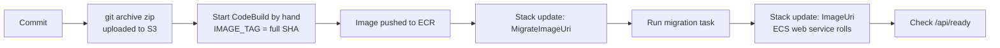

# AWS staging

> **Staging only.** There is no production environment yet.
> Checked against `infra/aws/*` and `docs/deploy/aws.md` on `origin/main` 6e425380 (2026-10-22). The AWS path matches `infra/aws` as of 2026-10-22 (CTO, review of #525).
> **The step-by-step procedure lives in [`docs/deploy/aws.md`](../deploy/aws.md).** This page is the overview; it does not repeat commands, and it never names account IDs, hostnames or ARNs.

**Audience:** engineers, ops and security reviewers.
**Related:** [Runbook](runbook.md) · [Environment variables](environment-variables.md) · [Security overview](security-overview.md) · [Local setup](../LOCAL_SETUP.md)

---

## At a glance

| Item | Value |
|---|---|
| Environment | Staging only. No production yet. |
| Region | `ap-southeast-1` |
| Compute | ECS on Fargate. The web service uses `FARGATE_SPOT` by default (`WebCapacityProvider`; `FARGATE` is the on-demand fallback). |
| Database | RDS PostgreSQL 16 (`DbEngineVersion` default 16.12, `infra/aws/environment.yaml`), encrypted, not public, TLS enforced |
| Infrastructure as code | CloudFormation in `infra/aws/` |
| Build | CodeBuild project defined in `shared.yaml`, running `infra/aws/buildspec.yml` |
| Image | ECR, tagged with the **full 40-character commit SHA** (`IMAGE_TAG`); tags are immutable |
| Secrets | AWS Secrets Manager, generated at stack creation (see [Security overview](security-overview.md#5-secrets-handling)) |
| Not used | CDK, GitHub Actions for deploys, Azure, a database in docker-compose |

## What lives in `infra/aws/`

| File | Role |
|---|---|
| `shared.yaml` | Shared stack: ECR repository, build-source bucket, CodeBuild project |
| `environment.yaml` | The environment stack: VPC, RDS PostgreSQL 16, secrets, uploads bucket, ECS cluster and services, load balancer, DNS records, optional jobs schedule |
| `certificate.yaml` | ACM certificate for the staging domain |
| `dns.yaml` | Route 53 zone for the staging domain |
| `buildspec.yml` | Build only: validates `IMAGE_TAG`, builds the repo `Dockerfile`, adds the RDS CA layer (`Dockerfile.rds-ca`), pushes to ECR and prints the image digest |
| `build-remote.yaml` | Optional build in a second region, for a region with no CodeBuild capacity. **Not used** today. |
| `rds-global-bundle.pem` (+ `.sha256`) | Amazon RDS CA bundle. The build checks its checksum and bakes it into the image; connection strings verify the server against it. |

The image is built from the repo's own `Dockerfile` plus `infra/aws/Dockerfile.rds-ca`, not from `Dockerfile.aws`. TODO(confirm): what `Dockerfile.aws` is still used for.

TODO(confirm): who may update the stacks, and how stack changes are reviewed.

## Deploy pipeline

1. **Source.** A zip of the commit (`git archive`) is uploaded to the build-source bucket.
2. **Build.** Someone **starts the CodeBuild project by hand**, with the zip as source override and `IMAGE_TAG` set to the full commit SHA. Nothing triggers it automatically: no branch push, no schedule. `buildspec.yml` only builds and pushes; it does **not** migrate or deploy.
3. **Migrate.** A stack update sets `MigrateImageUri` to the new image, then the migration ECS task is run once and must exit 0. It runs `prepare-extensions` → `prisma migrate deploy` → `prepare-runtime-role` → `sync-catalog`, then whatever `MigrationMode` selects (staging: `seed`, which re-runs the seed and staging demo data on every release).
4. **Roll.** A second stack update sets `ImageUri` to the new image (and clears `MigrateImageUri`). The ECS web service rolls. The deployment circuit breaker rolls back a task that will not start or fails `/api/live`.
5. **Check.** `/api/ready` must return 200 with `{"status":"ok","schema":"current"}`.

Nothing enforces "migrate before roll" except following these steps. `/api/ready` detects unfinished migration records and drift in its sampled client query; it does not compare the image's migration files with the database or prove that every migration ran. Always verify the migration task exited 0 before rolling. See [`docs/deploy/aws.md` § Deploy an image](../deploy/aws.md#deploy-an-image) for the exact commands.

TODO(confirm): who may run a staging deploy, and which branch or commit is deployed. Branch names alone do not establish what is running; verify the deployed image digest.

### What `prepare-runtime-role` does

In the migration task, `DATABASE_URL` is the admin connection and `APP_DATABASE_URL` is the restricted app login. The script:

- creates the app login **without** create-database or create-role rights;
- sets its password from `APP_DATABASE_URL` (on AWS that URL comes from Secrets Manager);
- grants connect, schema usage, read/write on tables and sequences (including future ones), and execution of the medicine-search similarity function;
- **fails** if the login's checked role attributes remain incorrect, if `APP_DATABASE_URL` names a different login, or if it targets a different server or database from `DATABASE_URL`.

The script connects through the admin URL; it does **not** test an app-login connection. It can continue after a password-change permission denial when the role attributes are correct. Confirm the web task can connect with the app secret using `/api/health` and `/api/ready` after the roll.

The running web service then gets the **app** URL as its `DATABASE_URL`, so it cannot bypass RLS. See the [Security overview](security-overview.md#1-tenant-isolation).

### Rollback

Update the stack's `ImageUri` back to the previous image digest. **Migrations only go forward**, so roll back only to an image whose schema expectations are still met by the current database. There is no automated down-migration.

## Idle and wake

"Idle by default" is an operating rule, not something the template does on its own:

- The web service's task count is the `DesiredCount` stack parameter (0–4, template default 1; 0 when no image is set). **Idle = `DesiredCount=0`; wake = `DesiredCount=1`.** See the [Runbook](runbook.md#1-wake-staging).
- The template does **not** stop RDS when staging is idle. The database keeps running (and costing) while the web service is at zero.
- The optional jobs schedule (`EnableJobsSchedule`, default `false`) runs a small Lambda every 5 minutes. TODO(confirm): whether it is left on while staging is idle.
- Spot capacity can be reclaimed by AWS. Expect occasional interruptions on staging.

## Not part of the AWS path

- **Azure is DEPRECATED. Never deploy to Azure.**
  - `.github/workflows/deploy-staging.yml` is Azure-only and manual-dispatch. It is DEPRECATED. **Never start it.**
  - `.github/workflows/promote-production.yml` targets Azure. Do not run it.
  - `infra/*.bicep`, `infra/*.bicepparam`, `infra/deploy-staging.sh`, `infra/configure-github-oidc.sh` and `docs/azure-deployment.md` are legacy Azure material, kept for reference and not deleted.
- `vercel.json` is the old Vercel setup; the AWS jobs schedule replaces its cron. TODO(confirm): whether it can be removed.
- There is no AWS GitHub Actions workflow. `qa.yml` and `image-build.yml` are CI checks, not deploys.

## Production

There is no production environment. `environment.yaml` supports `EnvironmentName=production`, but no production stack exists. Before one does:
- production needs Saad's approval;
- DRAP and controlled-register content needs legal sign-off.

Do not describe or build a production path in these docs until the CTO confirms one.
