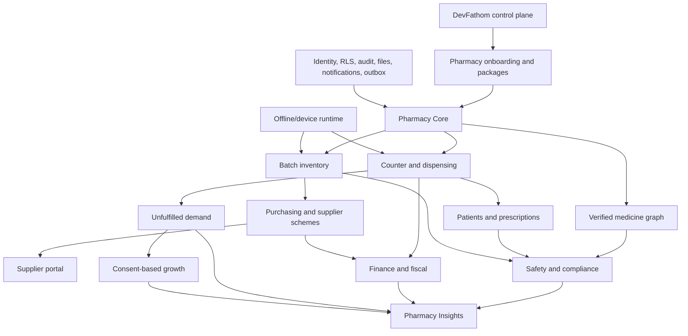

# DevFathom Pharmacy Operating System

| Field | Value |
| --- | --- |
| Document version | `1.2` |
| Document status | `PRODUCT STRATEGY BASELINE — PHASE 0 FIELD AND LEGAL VALIDATION REQUIRED` |
| Industry | Community pharmacies, medical stores, and retail pharmacy chains |
| Initial geography | Pakistan, one validated launch jurisdiction first |
| Product | DevFathom Commercial |
| Delivery surface | Keyboard-first counter application, responsive pharmacy command centre, and a separate supplier portal; dedicated device helpers only where browser constraints require them |
| Last updated | 2026-09-02 |
| Current implementation status | Shared DevFathom and Restaurant foundations exist; Pharmacy-specific product scope in this document is planned, not proven implemented |
| Competitive basis | Public evidence for Abuzar/WASEELA, Candela, MARS, Ailaaj One, Tejarify, PharmaPro, and international pharmacy platforms; hands-on competitor validation remains Phase 0 work |

## 1. Purpose and authority

This document defines the Pakistan-first Pharmacy vertical for DevFathom. It is the product, domain, delivery, and acceptance baseline for planning the vertical. It is not a claim that the Pharmacy product already exists.

The objective is not to reproduce Abuzar/WASEELA in a browser. DevFathom must preserve the things that make established local systems difficult to displace—counter speed, offline reliability, accounting depth, familiar workflows, local implementation support, and years of operational trust—then exceed them materially in medicine-data quality, dispensing safety, batch economics, multi-branch control, migration, interoperability, auditability, and user experience.

Where this document conflicts with a future BA PRD, mock-up, seed dataset, competitor claim, or implementation shortcut, this plan governs until an accepted ADR or formally approved product decision supersedes the affected section. Pakistani counsel and the relevant regulator must validate legal interpretations before production launch.

### 1.1 Scope boundary

The initial product is for:

- independent community pharmacies and medical stores;
- busy multi-counter pharmacies;
- owner-operated groups of one to three branches;
- retail pharmacy chains with central purchasing and branch controls;
- front-shop retail sold alongside regulated medicines.

The following are separate editions or later extensions, not reasons to bloat the retail release:

- hospital inpatient pharmacy, wards, medication administration, and formulary governance;
- wholesale distribution, primary sales, route sales, and manufacturer ERP;
- compounding and sterile preparation;
- insurance adjudication patterns copied from foreign markets;
- vaccination, diagnostics, consultations, and telemedicine;
- consumer marketplace, financing, or prescribing.

The domain model must preserve clean seams for these editions without implementing them prematurely.

## 2. Product thesis and win condition

### 2.1 Positioning

> **The fastest offline pharmacy counter in Pakistan, backed by a verified medicine graph, controlled dispensing, complete financial control, and a cloud command centre—with reconciliation-backed migration from legacy pharmacy software.**

The competitive sequence is deliberate:

```text
Reliability → Migration → Data integrity → Pharmacy safety → Chain control → Explainable automation
```

“Cloud” and “AI” are not the product. They are implementation and assistance layers. A pharmacy will not switch if a trained cashier becomes slower, an internet outage stops billing, opening stock does not reconcile, or supplier and customer balances change.

### 2.2 Non-negotiable parity

DevFathom does not earn the right to claim superiority until it can provide:

- sub-200 ms local medicine search at the 95th percentile on supported counter hardware;
- barcode and keyboard/F-key workflows without requiring a mouse;
- billing, receipt printing, cash movement, permitted returns, and closing during an internet outage;
- exact carton, box, pack, strip, blister, bottle, and loose-unit conversion;
- batch, printed MRP, landed cost, expiry, supplier, and source-invoice traceability;
- automatic FEFO allocation with an attributable override path;
- purchases, purchase returns, expiry claims, bonuses/free units, discounts, and supplier ledgers;
- customer/corporate credit, cash/bank ledgers, and complete double-entry posting;
- physical counts, adjustments, transfers, and immutable audit history;
- thermal and A4 documents, Pakistani payment methods, and FBR integration where applicable;
- branch-scoped roles, pharmacist controls, and owner-level consolidated reporting;
- migration and reconciliation from Abuzar, Candela, MARS, or structured spreadsheets.

### 2.3 Defensible lead

The sustainable lead comes from capabilities that are hard to bolt onto a generic POS:

1. **Verified Pakistan medicine graph** — provenance-backed registration, ingredient, strength, form, pack hierarchy, manufacturer, barcode, price history, storage, prescription class, controlled schedule, and recall data.
2. **Safe-dispensing workflow** — prescription capture, responsible-pharmacist verification, patient medication history, allergy and licensed clinical checks, high-alert/LASA warnings, documented overrides, and controlled-drug governance.
3. **Loss-prevention inventory** — exact batch movement, FEFO, near-expiry supplier claims, dead-stock balancing, cold-chain excursions, recall traceability, shrinkage signals, and stock-count discipline.
4. **Offline-first chain operation** — independent counter continuity, deterministic reconciliation, centrally visible device/branch health, and no silent inventory conflicts.
5. **Explainable procurement intelligence** — recommended quantities backed by demand, seasonality, lead time, stockouts, schemes, credit terms, and expiry risk rather than an opaque “AI order.”
6. **Migration as a product** — profiling, mapping, exception handling, parallel run, financial reconciliation, immutable archive, rollback, and a signed go-live report.
7. **Open, trustworthy platform** — customer-controlled exports, documented APIs, integration status, release notes, security documentation, SLAs, and auditable automation.
8. **Demand-recovery growth system** — captures explicit unfulfilled medicine demand, explains why it was lost, turns it into purchasing/transfer action, contacts only consented customers after restock, and proves recovered sales and marketing margin rather than reporting message-volume vanity metrics.

### 2.4 Definition of “beat Abuzar by a large distance”

Success is not a longer feature list. DevFathom must win all six tests below in a reference-customer pilot:

| Test | Minimum proof |
| --- | --- |
| Counter test | Experienced legacy cashier completes common bills no slower after a defined training period; novice staff are materially faster to competency |
| Outage test | Four-hour simulated connectivity loss completes sales and closing without data loss, duplicate documents, or fabricated fiscal acknowledgements |
| Migration test | Products, units, batches, parties, balances, stock value, cash, and ledgers reconcile with zero unexplained material variance |
| Safety test | Expired, recalled, quarantined, unauthorized, and restricted medicines fail closed; pharmacist overrides are attributable and reviewable |
| Owner test | One owner can see branch margin, cash, expiry exposure, stockouts, receivables, overrides, and pharmacist coverage without requesting a custom report |
| Inspection test | A branch produces licence, qualified-person, purchase warranty, controlled register, batch trace, recall, fiscal, and audit evidence in minutes |

Phase 0 must replace every relative phrase in this table with a pre-registered benchmark protocol before implementation: supported hardware, catalog/stock size, exact scenario corpus, incumbent version, operator sample and experience, training hours, repetitions, time/keystroke/error thresholds, outage workload, reconciliation tolerances, and inspection evidence/time limit. Results without that protocol do not count as competitive proof.

## 3. Competitive strategy

Public competitor pages are treated as vendor claims unless independently tested. Absence of public documentation is an uncertainty, not proof that a competitor lacks a capability.

### 3.1 Abuzar/WASEELA baseline

Abuzar is a broad local inventory, accounting, and ERP platform with long-standing pharmacy deployments. Public material supports or claims billing, expiry alerts, stock control, purchasing, supplier/customer accounts, general ledger, consolidated reporting, user permissions, payroll, barcode operation, backup, multi-godown workflows, and extensive reports.

Its moat is:

- installed base and local trust;
- experienced cashiers trained on dense keyboard workflows;
- accounting and trading depth;
- customization accumulated at individual customers;
- implementation, training, and support relationships;
- low perceived change risk.

Public evidence leaves important questions unanswered. These must be tested in a real demo and migration workshop rather than turned into marketing claims:

- exact pack/strip/tablet integrity after a pack is opened;
- multi-batch FEFO and split allocation;
- pharmacist approval and prescription governance;
- controlled-drug registers and running balances;
- clinical safety checks;
- modern offline/cloud synchronization semantics;
- DRAP registration, price, recall, and distributor synchronization;
- cold-chain excursions and quarantine;
- API, export, security, SLA, release-note, and disaster-recovery evidence.

### 3.2 Market benchmark

| Product | Publicly visible strength | DevFathom response |
| --- | --- | --- |
| Abuzar/WASEELA | Incumbency, accounting, local-network counter familiarity, customization | Preserve speed/accounting; win on migration, safety, cloud command, data provenance, and transparency |
| Candela Pharmacy | Deep Pakistan pharmacy retail, medicine master, batch/expiry, loose units, controlled restrictions, chain functions | Match operational depth; win on offline-chain architecture, safety, open integrations, and migration experience |
| MARS | Offline medical-store workflow, accounting, pack/loose sales, large report set | Match low-friction counter and ledgers; win on chain control, governance, safety, and device independence |
| Ailaaj One | Modern positioning, catalog, distributor claims, forecasting, managed purchasing, financing, integrations | Demand evidence; win on explainability, portability, safety, offline proof, and transparent product claims |
| Tejarify | Cloud/offline retail, transparent pricing, ecommerce, direct Abuzar migration message | Match migration clarity; win on genuine pharmacy domain depth |
| PharmaPro | Explicit FEFO, unit hierarchy, patient/prescription basics, offline operation | Match safety basics; win on multi-branch, scalable operations, support, and cloud ownership |
| PrimeRx/PioneerRx/Liberty/BestRx | Prescription workflow, patient care, inventory automation, customizable queues, clinical checks, engagement | Adapt relevant patterns to Pakistan; do not copy US insurance or regulatory assumptions |

### 3.3 Abuzar competitive attack map

| Capability | Abuzar public evidence | DevFathom target | Required proof |
| --- | --- | --- | --- |
| Counter speed | Strong incumbent keyboard familiarity; detailed current benchmark unavailable | Equal or faster for trained cashiers, much easier for new staff | Timed same-scenario comparison after training |
| Offline/local continuity | Installed/local-network history; modern sync semantics unclear publicly | Full defined offline action matrix plus cloud reconciliation | Multi-counter four-hour outage and reconnect |
| Accounting | Deep historical inventory/accounts/ledger/report positioning | Exact operational-to-double-entry postings and full statements | Legacy and DevFathom close reconcile |
| Purchasing/trading | Strong purchasing, suppliers, godowns, bonuses, returns | Add exact schemes, landed cost, batch/MRP/expiry, claims, and explainable orders | Purchase-to-ledger E2E with reconciliation |
| Users/customization | Granular groups and implementation customization historically documented | Clear capabilities, branch/location scope, configurable workflows without unsafe custom forks | Denial tests and customer configuration demo |
| Medicine search/master | Brand/generic/strength/form/quantity fields observed; data governance unclear | Provenance-backed medicine graph, aliases, structured strengths, pack/barcode, registration and review | Data-quality sample and pharmacist sign-off |
| Pack/strip/tablet | Current public precision unclear | Exact immutable hierarchy, opened packs, canonical units, pro-rata MRP | Property tests plus physical-stock reconciliation |
| Batch/expiry/FEFO | Expiry/batch claimed; automated FEFO behavior requires demo | Mandatory batch allocation, hard blocks, automatic FEFO, override evidence | Concurrent sale/expiry/override tests |
| Prescription/pharmacist | Public evidence is limited | Structured prescriptions, physical-original custody, partial/repeats, pharmacist queue and audit | Counsel-approved browser scenarios |
| Controlled/safety | Public detail insufficient | Running register, dual control, licensed checks, privacy and inspection pack | Reconciliation, role, and negative-path evidence |
| Recall/cold chain | Public detail insufficient | Instant batch block, patient/stock trace, branch closure, excursions/quarantine | Recall and temperature-incident drills |
| Multi-branch owner control | Consolidated/godown capabilities claimed | Real-time command centre, central purchasing, exact transfers, branch health, offline state | Chain pilot and isolation tests |
| Migration | Custom implementation history; public export contract unclear | Read-only connectors, mapping, exception workbench, parallel run, archive and rollback | Signed zero-unexplained-variance report |
| Openness/trust | Public API/SLA/security/export evidence limited | Documented APIs/exports, security pack, SLA, release notes, DR/exit procedure | Contract and operational evidence |
| Automation | Not the core public proposition | Explainable recommendations and OCR only after deterministic correctness | Model evaluation and human-control proof |

Unknowns remain unknown until hands-on validation; this table must never be marketed as a factual deficiency list for Abuzar.

### 3.4 Buyer-weighted product scorecard

The team must maintain a hands-on scorecard during Phase 0. Recommended weights:

| Dimension | Weight |
| --- | ---: |
| Counter speed and offline resilience | 20% |
| Medicine, unit, batch, and expiry integrity | 20% |
| Procurement, accounting, and margin control | 15% |
| Clinical and regulatory safeguards | 15% |
| Multi-branch and owner visibility | 10% |
| Migration and integrations | 8% |
| Support, maturity, and recoverability | 7% |
| Transparent total cost of ownership | 5% |

No competitor or DevFathom receives a score from a marketing page alone. Each score records source, test date, scenario, version, evidence, and confidence.

### 3.5 Switching offer

DevFathom's commercial promise should be stronger than “we can import Excel”:

> **Your first DevFathom close becomes final only after the agreed legacy totals reconcile.**

The exact financial threshold and exclusions belong in the contract. The product must support a safe parallel run and must not require a pharmacy to destroy or surrender its legacy archive.

## 4. Target segments, editions, and personas

### 4.1 Initial segments

| Segment | Primary pain | Initial fit |
| --- | --- | --- |
| Independent medical store | Fast billing, loose units, expiry, supplier credit, offline reliability | P0 |
| Professional community pharmacy | Prescription records, pharmacist supervision, patient history, controlled records | P0 |
| One-to-three branch group | Central visibility, transfers, price governance, owner control | P0 |
| Retail chain | Central purchasing, distribution, branch audit, replenishment, permissions | P1 |
| Hospital outpatient pharmacy | Patient/prescriber links and clinical workflow | P1 edition after retail core |
| Hospital inpatient pharmacy | Wards, formulary, medication administration, unit dose, clinical governance | Separate edition |
| Wholesale/distribution | Primary/secondary sales, route sales, credit exposure, scheme management | Separate edition |

### 4.2 Personas

| Persona | Needs |
| --- | --- |
| Owner/director | Profit, cash, stock value, expiry exposure, branch comparison, fraud signals, recoverability |
| Responsible pharmacist | Licence coverage, prescriptions, restricted medicines, safety review, controlled registers, recalls |
| Counter dispenser/cashier | Instant search, clear pack choices, fast tender, no ambiguous alerts, outage continuity |
| Branch manager | Opening/closing, staff, approvals, counts, exceptions, cash and shift accountability |
| Procurement lead | Demand, supplier quotes, schemes, lead times, credit, shortages, near-expiry returns |
| Inventory controller | Receiving, rack/bin, batch, FEFO, transfers, counts, quarantine, write-off |
| Finance user | Ledgers, tax, AP/AR, bank/cash, journals, reconciliations, financial statements |
| Compliance/audit user | Licences, pharmacist coverage, restricted sales, inspections, audit trail, exports |
| Delivery coordinator | Validated order, patient identity, prescription/cold-chain restrictions, chain of custody |
| Patient/customer | Correct medicine, understandable receipt, privacy, refill convenience, transparent credit |
| Platform administrator | Package, modules, jurisdiction rules, tenant safety, integrations, support and incident response |

### 4.3 Jobs to be done

- “When a customer presents a medicine name or prescription during a rush, find the correct product, unit, and permitted batch immediately without unsafe guessing.”
- “When stock arrives, record every commercial and regulatory fact once and make purchases, ledgers, stock, MRP, tax, and expiry correct together.”
- “When a product is recalled or expires, stop it everywhere and prove where every affected unit went.”
- “When the internet fails, keep the counter operating without losing fiscal, cash, patient, or stock integrity.”
- “When I replace my old system, carry forward the truth of my business and prove that nothing material changed.”

## 5. Core product principles

1. **Patient safety outranks conversion.** No sales target suppresses a safety block.
2. **Batch is the stock truth.** Product-level quantity is a projection of batch/location ledgers, never an independently editable number.
3. **Canonical base units prevent drift.** Every movement is stored in an integer canonical unit with versioned exact conversion factors.
4. **FEFO is default, not folklore.** The system selects the earliest safe expiry and requires a reason for an override.
5. **Printed MRP and provenance travel with the batch.** A loose-unit price is derived from its parent pack and rounding policy; it is not an unrelated manual price.
6. **Regulated records are append-only.** Corrections are linked reversals or amendments, not edits that erase history.
7. **Offline is a defined operating mode.** Every permitted and forbidden offline action is explicit, testable, and visible.
8. **Human clinical authority remains human.** AI may organize, explain, and flag; it does not diagnose, prescribe, or silently substitute.
9. **Rules are effective-dated configuration.** Province, licence, schedule, tax, and retention behavior never lives in scattered UI conditionals.
10. **A public catalog is not automatically authoritative.** Every medicine fact carries source, retrieval time, confidence, review status, and provenance.
11. **No customer lock-in.** Data export, archive access, documented APIs, and exit procedures are product features.
12. **No second design system.** Pharmacy uses DevFathom Studio's operating canvas, shared shells, states, accessibility, and interaction language.

## 6. Vertical, organization, and branch model

Pharmacy becomes the third real organization vertical:

```ts
enum OrganizationVertical {
  AGENCY
  RESTAURANT
  PHARMACY
}
```

Do not introduce a generic low-code vertical builder. Vertical selection chooses compatible packages, onboarding, navigation, terminology, role templates, and readiness checks. Entitlements and server-side capabilities still control access.

### 6.1 Hierarchy

```text
Organization: Example Pharmacy Group
├── Central office / optional central store
├── Branch: Gulberg Pharmacy
│   ├── Licensed premises
│   ├── Counters and enrolled devices
│   ├── Storage zones, fridge, safe, racks and bins
│   ├── Responsible pharmacist coverage
│   └── Operational ledgers
└── Branch: DHA Medical Store
    └── Its own licence profile, permitted schedules and staff scope
```

Every branch-owned record contains `organizationId` and `branchId`. Inventory records also contain an inventory location. Organization RLS remains the tenant boundary; branch assignment and explicit organization-wide capabilities form the operational boundary.

### 6.2 Branch regulatory profile

Every branch stores an effective-dated profile containing:

- province or territory;
- premises and any attached godown/storage location;
- licence category, form, number, issue date, expiry date, status, and scanned evidence;
- permitted therapeutic-good classes and restricted schedules;
- proprietor/legal entity and address;
- qualified/responsible person, Pharmacy Council registration, validity, and displayed-certificate status;
- supervision/coverage roster and temporary replacement history;
- inspection book, inspections, observations, corrective actions, renewals, and material changes;
- NTN, STRN, fiscal integration status, and accountant-approved tax profile;
- cold-chain and restricted-storage readiness;
- applicable record-retention policy and legal holds.

The runtime fails closed when an action requires a valid licence, qualified person, restricted-class permission, registered product/MRP exception, or fiscal state and the required state is absent or invalid. A dashboard warning is insufficient.

### 6.3 Onboarding flow

1. **Organization type** — select Pharmacy and show only compatible packages.
2. **Legal business** — entity, proprietor, NTN/STRN, addresses, contacts, ownership.
3. **Launch jurisdiction** — province/territory and branch licence category.
4. **Premises and licences** — documents, expiry, qualified person, permitted schedules, storage.
5. **Branches and inventory locations** — default branch, counters, stock rooms, fridge, safe, racks.
6. **Commercial package** — package, branches, counters, users, integrations, support tier.
7. **Owner and role templates** — owner, pharmacist, manager, cashier, procurement, inventory, finance, auditor.
8. **Medicine catalog** — verified seed selection, legacy import, review queue, aliases, barcodes, units.
9. **Opening stock** — mandatory batch, expiry, printed MRP, cost, location, source, physical count.
10. **Parties and balances** — suppliers, customers/corporate accounts, AP/AR, cash/bank opening balances.
11. **Devices and documents** — scanners, printers, drawers, fiscal connection, offline enrollment.
12. **Readiness and parallel run** — reconciliation, test bills, pharmacist gates, outage drill, sign-off.

An organization cannot activate Pharmacy operations until all P0 readiness gates pass. Seed data must never make an incomplete branch look production-ready.

## 7. Platform reuse and build boundary

An earlier exploratory estimate suggested roughly 40% of a production Pharmacy product might be reusable. That estimate is not a delivery baseline. Reuse must be proven against the current canonical code, data model, authorization, and browser behavior.

### 7.1 Reuse direction

| Area | Direction |
| --- | --- |
| Organizations, tenancy, RLS, sessions, invitations, seats | Reuse after Pharmacy vertical compatibility and negative authorization tests |
| Packages, modules, contracts, limits, overrides | Reuse with Pharmacy packages and server-owned capability catalog |
| Audit, notifications, files, webhooks, scheduler/outbox | Reuse infrastructure; regulated ledgers remain domain-specific sources of truth |
| Restaurant branches, staff profiles, shared terminals, devices | Generalize reusable primitives without leaking Restaurant semantics |
| Restaurant POS payments, drawers, daily close, order numbering | Reuse proven primitives where domain-neutral; Pharmacy sale/dispense remains a separate domain |
| Restaurant inventory, purchasing, suppliers, transfers, wastage | Reuse patterns and infrastructure; replace recipe/menu assumptions with medicine/batch/unit rules |
| Customer/loyalty and reports | Reuse generic identity, ledger, and presentation infrastructure; add patient/privacy/pharmacy measures |
| Finance/accounting | Reuse the financial engine if postings and reversals satisfy Pharmacy acceptance; do not duplicate ledgers |
| Medicine graph, prescriptions, dispensing, pharmacist verification | New Pharmacy domains |
| Controlled registers, recalls, quarantine, pharmacovigilance | New regulated Pharmacy domains |
| Offline counter synchronization | Reuse device/event foundations only after Pharmacy-specific safety and conflict design |

### 7.2 Reuse rules

- No Pharmacy router may be a copied Restaurant router with renamed nouns.
- No general primitive is extracted until at least two verticals have the same invariant and security model.
- Domain-specific source ledgers remain separate even when they post into shared finance or audit infrastructure.
- Any reused procedure receives Pharmacy branch-scope, entitlement, RLS, idempotency, and negative tests.
- UI reuse means shared Studio components and patterns, not forcing pharmacy work into restaurant information architecture.

## 8. Product architecture and module map



The implementation remains a modular monolith. Internal bounded contexts are separated by APIs, services, and owned tables rather than separate deployments.

### 8.1 Pharmacy Core

Owns:

- organization/branch Pharmacy settings;
- branch regulatory profile and readiness;
- inventory locations and storage zones;
- counters, registers, devices, document templates, and sequences;
- business date, timezone, opening/closing, and operational status;
- branch staff assignments and responsible-pharmacist coverage;
- configurable jurisdiction/effective-date rules;
- Pharmacy navigation, dashboard composition, and setup checklist.

### 8.2 Medicine Graph and Catalog

Owns:

- ingredient/substance and combination definitions;
- brand/product, dosage form, route, strength components, and presentation;
- manufacturer, marketing authorization holder, importer, and country;
- DRAP registration/enlistment identifiers and status snapshots;
- prescription/restricted/controlled classifications by jurisdiction;
- pack hierarchy and exact unit conversions;
- GTIN, manufacturer barcode, internal barcode, aliases, Urdu/English search terms;
- storage range, cold-chain flag, high-alert, LASA, and handling metadata;
- printed MRP and price history references;
- source provenance, confidence, review, merge, and supersession workflow.

The catalog has three explicit ownership layers:

1. **Platform graph** — shared identity and licensed/redistributable source assertions; only the platform catalog team may publish it.
2. **Organization overlay** — lawful customer aliases, local codes, review decisions, commercial defaults, and source evidence; never visible to another tenant.
3. **Branch inventory** — receipts, lots, batches, MRP/cost, locations, quantities, and dispositions owned by branch-scoped operational ledgers.

Global regulator recalls and withdrawals override organization/branch enablement. Every source connector records acquisition, cache, transformation, redistribution, attribution, and deletion rights; data without the required rights may be used only within its authorized boundary. P0 needs verified coverage of the pilot pharmacy's active inventory, not a speculative complete national catalog.

### 8.3 Procurement and Supplier Management

Owns:

- licensed suppliers, distributors, manufacturers, contacts, licences, credit terms, and service areas;
- requisitions, quotations, price comparison, purchase orders, approvals, and expected delivery;
- schemes, bonus units, free goods, discounts, rebates, tax, freight, and landed cost allocation;
- electronic/manual supplier orders and acknowledgements;
- goods receipt, purchase invoice matching, shortages, overages, damage, and discrepancies;
- purchase return, expiry claim, debit note, supplier credit, settlement, and reconciliation;
- explainable reorder recommendations and procurement performance.

### 8.4 Batch Inventory and Chain Operations

Owns:

- manufacturing batches/lots and global recall identity, separated from receipt-specific inventory lots carrying supplier, source invoice, received expiry precision, MRP, cost, and provenance;
- stock ledger by branch, location, batch, status, and canonical unit;
- FEFO allocation and attributable overrides;
- receiving, put-away, transfers, reservations, adjustments, counts, write-offs, destruction, and returns;
- saleable, quarantined, recalled, damaged, expired, in-transit, and pending-review states;
- racks/bins, cold-chain zones, temperature readings/excursions, and disposition;
- central purchasing, branch replenishment, transfer suggestions, and dead-stock balancing;
- low stock, stockout, near expiry, expiry value-at-risk, and shrinkage controls.

### 8.5 Pharmacy POS and Dispensing

Owns:

- retail medicine and front-shop sales;
- prescription-linked and permitted OTC dispensing;
- brand/generic/ingredient/strength/form/barcode search;
- pack/strip/loose-unit selection and price derivation;
- FEFO batch assignment, multi-batch fulfillment, and safe substitution handoff;
- discounts, promotions, complimentary items, and manager/pharmacist approvals;
- cash, card, bank transfer, JazzCash/EasyPaisa-style wallet, online, credit/khata, and split tender;
- hold/resume, quotation, sale, receipt, refund, return, void, exchange, and credit note;
- cash drawer, shift/session, opening float, paid-in/out, closing and daily close;
- offline queue, fiscal status, print/reprint, and duplicate prevention.

### 8.6 Patients, Prescriptions, and Pharmacist Workflow

Owns:

- minimal patient identity, contacts, guardian/minor relationships, privacy preferences, and consent;
- medication, allergy, adverse-event, and relevant condition history;
- prescriber and healthcare-facility directory;
- paper prescription image, structured transcription, physical-original custody, validity, repeats, and partial fills;
- pharmacist review queue, verification, clarification, refusal, override, counseling, and notes;
- refill schedule, adherence support, reminders, pickup/delivery, and patient communication;
- patient/corporate account, loyalty, khata/credit, limits, and statements;
- privacy-scoped access and sensitive-read audit.

### 8.7 Safety, Controlled Medicines, and Compliance

Owns:

- licence and qualified-person enforcement;
- restricted/controlled schedule rules and immutable registers;
- prescription requirements, emergency path, running balances, signatures, and dual controls;
- allergy, interaction, duplicate-therapy, high-alert, LASA, dose-range, and contraindication decision support when licensed data is available;
- quarantine, recall ingestion, affected-stock/sale trace, acknowledgements, returns, and closure;
- adverse drug reaction, medication error, and product-quality complaint workflow;
- inspection packs, evidence exports, retention, legal hold, and compliance exceptions;
- regulatory-source monitoring and effective-dated policy updates.

### 8.8 Finance, Tax, and Fiscalization

Owns or integrates with the shared finance engine for:

- perpetual inventory valuation and cost of goods sold by batch;
- sales, discounts, tax, returns, refunds, write-offs, schemes, rebates, and expiry claims;
- accounts payable/receivable, customer/supplier subledgers, cash/bank, journals, and statements;
- gross margin by branch/product/batch/channel and price/margin leakage;
- effective-dated tax profiles, PCT/HS, SRO/serial, exemption, inclusive/exclusive handling;
- FBR integration status, acknowledgements, QR/reference, offline outbox, retries, credit/debit notes, and reconciliation;
- immutable closing, reopening controls, and linked reversal.

### 8.9 Pharmacy Insights and Reports

Owns:

- owner command centre and role-specific dashboards;
- sales, gross margin, inventory, procurement, expiry, stockout, cash, receivable, patient, safety, compliance, and workforce measures;
- branch/date/supplier/manufacturer/ingredient/category/medicine/batch filters;
- scheduled delivery, export, saved views, and audit of sensitive exports;
- source, freshness, definition, drill-through, and permission for every metric.

### 8.10 Integrations and Devices

Owns:

- scanners, thermal/A4/label printers, drawers, customer display, and optional weighing devices;
- local encrypted counter runtime and device enrollment;
- FBR/PRAL or licensed integrator adapters;
- DRAP data/recall/price sources where officially available;
- supplier/distributor ordering and invoice feeds;
- accounting exports, payment providers/terminals, SMS/WhatsApp, ecommerce, and delivery;
- documented APIs, webhooks, idempotency, retry, dead-letter, and integration health.

### 8.11 Pharmacy Workforce

Reuses shared People/HR foundations and owns Pharmacy-specific operation for:

- employee and non-email counter-operator profiles;
- branch/location assignments and role/capability templates;
- rosters, shifts, attendance, breaks, leave, overtime, and time clock;
- responsible-pharmacist and qualified-person coverage versus actual presence;
- shift handoff, cash/control responsibilities, and unresolved exceptions;
- credential, training, SOP, licence, and certification expiry;
- payroll/time export or shared payroll integration;
- safe performance measures based on service, accuracy, compliance, and operational outcomes—not sales pressure on regulated medicines.

Pharmacist qualification and current coverage remain verified credentials/states; neither job title nor an owner-assigned role can manufacture clinical authority.

### 8.12 SOP and Quality Operations

Reuses a neutralized SOP engine where its invariants match and owns Pharmacy templates for:

- opening and closing checks;
- fridge/room temperature and power-backup checks;
- controlled-stock opening/closing counts;
- expiry pull, quarantine-area, recall, and returns checks;
- receiving, put-away, cleaning, pest-control, hygiene, and equipment checks;
- prescription filing/original custody, privacy, and daily exception review;
- incident, medication-error, adverse-event, and corrective/preventive actions;
- staff training, read-and-understood attestation, competency, and licence/credential reminders;
- assigned staff, branch/department, due time, recurrence, evidence, verification, missed/late escalation, score, and audit history.

Published SOP versions are immutable, and each generated occurrence snapshots the version it must follow. Editing a template never rewrites completed or in-flight evidence.

### 8.13 Growth, CRM, and Demand Intelligence

Owns the smallest complete loop from an unfulfilled request to a measurable recovered sale:

- one-key counter capture of the requested medicine/generic, strength, form, presentation, sale unit, quantity, and reason it was not fulfilled;
- an inventory/rule snapshot proving whether the cause was stockout, not-carried item, unavailable pack, quarantined/expired stock, price rejection, prescription/licence/pharmacist restriction, declined substitute, or search/service failure;
- anonymous demand by default, with customer/contact linkage only for a consented restock or service purpose;
- top missing medicines/generics, estimated demand value/margin, stockout duration, root cause, branch/time, supplier opportunity, substitution outcome, and recovery analytics;
- restock-interest lists, reservations where offered, and WhatsApp/SMS notifications after safe stock becomes available;
- permissioned segments, campaigns, approved templates, quiet hours, frequency caps, delivery/opt-out state, and receipt-level attribution;
- transactional receipts, khata statements/reminders, refill-service reminders, front-shop campaigns, and customer feedback without mixing marketing and protected clinical contexts.

The primary production channel is the official WhatsApp Business Platform Cloud API, accessed directly or through an approved provider. DevFathom may use or publish open-source connector/orchestration code around the official API, but it does not use unofficial WhatsApp Web session automation. Meta-hosted transport, account verification, templates, policy enforcement, pricing, rate limits, and customer controls remain external facts visible in integration health.

### 8.14 Supplier Portal and Smart Stock Action Centre

The supplier portal is a secure collaboration surface for a pharmacy and the licensed wholesalers/distributors it already buys from. It is not a public marketplace and does not turn DevFathom into a wholesale ERP.

Supplier users may, only for their linked pharmacy relationship:

- maintain their business contacts, service areas, warehouses, licence evidence, payment/credit terms, and notification preferences;
- answer RFQs with pack/barcode, availability, price, MRP, scheme/bonus, minimum order, lead time, expiry band, tax, freight, and validity;
- accept, reject, or partially acknowledge a PO, give an ETA, and propose a clearly identified substitution for pharmacy approval;
- submit an advance shipping notice and invoice/document set with line, batch, expiry, quantity, bonus, cost, tax, and source evidence;
- respond to shortage, damage, short-expiry, price, invoice, return, rebate, and claim cases with replacement, return authorization, or credit-note evidence;
- see only its own orders, deliveries, disputes, claims, invoices, credits, payment allocations/status, and score inputs;
- exchange auditable messages and attachments against those records.

The portal is optional for the supplier. The pharmacy can send a PDF or expiring secure action link, record a phone/WhatsApp acknowledgement with source evidence, or use the controlled direct-purchase path. A wholesaler declining an account never blocks lawful purchasing or receiving.

The internal stock action centre turns deterministic inventory truth into a short, ranked work queue:

- current low stock and stockout, projected stockout date, days of cover, demand spike, lead-time/ETA risk, overdue replenishment, and reservation pressure;
- near-expiry/dead-stock value, supplier-return deadline, inter-branch surplus/shortage, recall/quarantine, cold-chain, and count/shrinkage exceptions;
- suggested quantity and timing using sales/demand velocity, approved safety stock, pack rounding, open PO/transfer quantities, supplier lead time/fill history, expiry risk, storage/cash constraints, and unfulfilled demand;
- a plain-language explanation, data window, freshness, confidence, assumptions, expected stockout avoided, cash tied up, and expiry risk for every suggestion;
- one approved action from an alert: dismiss/snooze with reason, create a draft requisition/transfer/RFQ/claim, assign an owner, or escalate.
- in-app alerts and role dashboards first, with configurable owner/procurement digest or critical email/official-WhatsApp notification, quiet hours, acknowledgement SLA, escalation, and no patient/clinical content.

Signals deduplicate by product/location/cause, close or suppress when available plus approved inbound/transfer stock covers the need, and become visibly stale or unusable when source data exceeds its freshness policy. Forecasts and internal stock/margin data are not disclosed to a supplier; only an approved RFQ/PO leaves the pharmacy boundary.

P0 uses deterministic thresholds and exact ledger facts. Predictive forecasting, supplier optimization, and anomaly models remain P1 until they beat an agreed baseline on real pilot data. A recommendation never places an order, accepts a supplier substitution, changes price/medicine truth, receives stock, or posts finance without the pharmacy's authorized approval.

## 9. Domain model and invariants

### 9.1 Regulatory and organization entities

| Entity | Purpose |
| --- | --- |
| `PharmacyBranchProfile` | Effective-dated jurisdiction, licence, premises, legal, storage, tax, and readiness state |
| `PharmacyLicence` | Licence category/form, identifier, validity, permitted schedules/classes, evidence, and lifecycle |
| `QualifiedPersonCredential` | Pharmacist/qualified-person registration, validity, jurisdiction, evidence, and verification |
| `QualifiedPersonCoverage` | Scheduled/actual physical or approved remote coverage for one branch and interval |
| `RegulatoryRuleSet` | Versioned, approved rules by jurisdiction, licence type, effective date, and source |
| `InspectionCase` | Visit, observations, requested evidence, corrective actions, deadlines, and closure |

### 9.2 Medicine graph entities

| Entity | Purpose |
| --- | --- |
| `MedicineIngredient` | Canonical active ingredient/substance identity and aliases |
| `MedicineProduct` | Brand/product linked to ingredients, form, route, manufacturer/MAH, and registrations |
| `MedicineStrengthComponent` | One normalized ingredient strength with numerator/denominator and units |
| `MedicineRegistration` | DRAP or other authority identifier, state, source snapshot, effective interval, and review |
| `MedicinePresentation` | Marketed presentation such as 20 tablets, 60 ml bottle, or 5 ampoules |
| `PackLevel` | Ordered hierarchy such as carton → box → blister/strip → tablet/capsule |
| `PackConversion` | Exact integer/rational conversion between adjacent levels with effective dates |
| `MedicineBarcode` | GTIN/manufacturer/internal barcode scoped to presentation/pack level and validity |
| `MedicineAlias` | Brand, generic, spelling, Urdu/transliteration, legacy code, and search alias |
| `MedicineClassification` | Rx/OTC, controlled/restricted schedule, high-alert, LASA, cold-chain, and category tags by jurisdiction |
| `MedicineDataAssertion` | Field-level source, retrieved time, confidence, reviewer, status, and supersession |

### 9.3 Commercial and stock entities

| Entity | Purpose |
| --- | --- |
| `Supplier` / `SupplierLicence` | Authorized supplier identity, licence, territory, terms, and evidence |
| `SupplierRelationship` / `SupplierPortalUser` | Pharmacy-to-supplier agreement, approved scope/locations/terms, external identity, role, invite, MFA, suspension, and revocation |
| `QuoteRequest` / `SupplierQuote` | Requested lines and a supplier's versioned availability, price, MRP, scheme, expiry band, MOQ, lead time, freight, tax, and validity response |
| `PurchaseOrder` / `PurchaseOrderLine` | Approved expected purchase and commercial terms |
| `SupplierOrderAcknowledgement` | Immutable accept/reject/partial response, ETA, proposed substitution, reason, and version |
| `AdvanceShippingNotice` / `SupplierInvoiceSubmission` | Supplier-declared shipment/invoice lines, batches, expiries, quantities, prices, tax, documents, and reconciliation state |
| `GoodsReceipt` / `GoodsReceiptLine` | Physical receipt, discrepancy, invoice/warranty, batch, expiry, MRP, cost, and schemes |
| `ManufacturingBatch` | Manufacturer lot identity, product/presentation, expiry precision, global recall identity, and storage requirements |
| `InventoryLot` | Receipt-specific stock slice linked to a manufacturing batch, supplier/source invoice, received expiry, printed MRP, cost, provenance, and pack state |
| `InventoryLocation` | Branch store, rack, bin, fridge, safe, quarantine, transit, or returns area |
| `StockMovement` | Append-only signed canonical-unit movement with source and exact batch/location |
| `LotDispositionBalance` | Derived available/reserved/quarantined/damaged/expired balance per inventory lot/location, supporting partial disposition |
| `PackStateProjection` | Derived sealed-pack and open-unit buckets by batch/location; changed only by auditable break-pack/repack movements |
| `StockCount` | Frozen scope, expected quantity, observed quantity, variance, approval, and postings |
| `Transfer` | Requested, allocated, dispatched, received, disputed, or cancelled batch movement |
| `SupplierClaim` | Near-expiry, damage, shortage, rebate, or return claim and settlement |
| `InventoryActionSignal` | Deduplicated stock/expiry/lead-time/demand exception, explanation, severity, owner, due time, acknowledgement, action, and outcome |
| `PriceRecord` | Effective-dated printed MRP, wholesale/trade/purchase/sale price, source, and approval |

### 9.4 Sale and dispensing entities

| Entity | Purpose |
| --- | --- |
| `PharmacySale` | Commercial transaction, branch, counter, operator, patient/customer, status, totals, and fiscal state |
| `PharmacySaleLine` | Product/presentation, selected sale level, quantity, unit price, discount, tax, and dispensing context |
| `SaleBatchAllocation` | Exact batch and canonical units fulfilled for a sale line, including FEFO/override reason |
| `Prescription` | Source, prescriber, patient, issue/expiry, physical-original custody, status, and evidence |
| `PrescriptionLine` | Prescribed medicine/ingredient, strength, form, dose, frequency, duration, quantity, repeats, and substitutions |
| `DispenseEvent` | Immutable partial/full/refused/reversed fulfillment against one prescription line |
| `PharmacistReview` | Safety findings, clarification, approval/refusal, counseling, override, and signature |
| `ControlledRegisterEntry` | Jurisdiction-specific serial, prescription, patient, prescriber, batch, quantity, running balance, and sign-off |
| `Tender` / `Refund` | Payment and reversal records allocated to sale/bill with provider and reconciliation state |
| `FiscalDocument` | Invoice/credit/debit note, local/fiscal identifiers, QR/reference, acknowledgement, retry, and source snapshot |

### 9.5 Patient and safety entities

| Entity | Purpose |
| --- | --- |
| `Patient` | Protected patient identity separate from ordinary retail-customer profile |
| `PatientIdentifier` | Phone, MRN, CNIC or other identifier with masking and purpose restrictions |
| `PatientAllergy` / `PatientCondition` | Structured clinical context with provenance and verification status |
| `PatientMedicationHistory` | Dispensed and declared medicines without conflating sale and clinical truth |
| `ClinicalAlert` | Licensed-rule output, severity, evidence, acknowledgement, action, and override |
| `RecallCase` / `RecallImpact` | Source notice, product/batches, branch stock, affected dispensings, contacts, and closure |
| `QuarantineDisposition` | Reason, evidence, pharmacist/manager decision, return/destruction/release, and approval |
| `AdverseEventCase` | ADR, medication error, quality complaint, patient/product/batch/reporter, seriousness, and submission state |
| `TemperatureExcursion` | Device/manual reading, range breach, affected batches, quarantine, assessment, and disposition |

### 9.6 Demand, consent, and marketing entities

| Entity | Purpose |
| --- | --- |
| `UnfulfilledDemandEvent` | Explicit requested item/generic/strength/form/pack/unit, quantity, reason, branch/counter/visit, stock/rule snapshot, and estimated value |
| `RestockInterest` | Purpose-specific customer consent to be notified for one requested item or acceptable generic scope, with expiry and channel |
| `DemandRecovery` | Later reservation/sale linked to the original event with recovery time, quantity, value, and attribution confidence |
| `CommunicationConsent` | Versioned opt-in/opt-out evidence by customer, channel, purpose, source, jurisdiction, and time |
| `Campaign` | Owner-approved purpose, audience rule, content/template, schedule, caps, budget, status, and accountable actor |
| `CampaignAudienceSnapshot` | Immutable recipients and qualifying consent/rule evidence at send time |
| `OutboundMessage` | Idempotent provider/template request, delivery/read/failure/opt-out state, cost, and redacted audit data |
| `MarketingAttribution` | Campaign/message to visit/receipt link with defined window, method, value, margin, and limitations |

### 9.7 Hard invariants

1. Stock quantity is stored and posted as an integer number of canonical base units. Decimal display never becomes the stock source of truth.
2. Pack conversion is exact, effective-dated, acyclic, and immutable after stock references it. A correction creates a new version and migration/reconciliation event.
3. A sale line cannot complete without exact batch allocations totaling the canonical quantity sold.
4. A normal sale cannot allocate expired, recalled, quarantined, damaged, destroyed, unreceived, or unauthorized stock.
5. FEFO selects the earliest safe expiry with sufficient stock. An override records actor, reason, selected batch, recommended batch, time, and approval policy.
6. Negative stock is forbidden. An emergency workflow may create a pending discrepancy, never a hidden negative balance.
7. A loose-unit price is derived from the batch's parent printed-MRP pack using the approved rounding rule and cannot exceed the permitted pro-rata ceiling.
8. A receipt, fiscal document, dispense event, controlled entry, stock movement, cash movement, and close are never hard-deleted.
9. Refunds and returns reference the original sale. Restocking requires exact product/batch identity and a documented integrity decision; otherwise stock moves to quarantine or disposal.
10. Controlled-register running balance reconciles to the controlled-stock ledger. Any difference opens an incident and blocks unapproved continuation.
11. A prescription fill cannot exceed remaining authorized quantity/repeats. Partial fills are cumulative immutable events.
12. A substitution never occurs silently. It records requested/prescribed product, supplied product, equivalence basis, authorized actor, patient communication, and jurisdiction rule.
13. Every regulated product assertion has provenance. A scraped or user-entered value cannot silently replace a regulator- or manufacturer-verified value.
14. Sensitive patient reads and exports are audited, not only mutations.
15. Financial postings are balanced and traceable to the operational source. Reversal is linked and additive, not destructive.
16. Sequence allocation is unique within its documented scope even across offline devices; reconciliation never renumbers a receipt already issued to a customer.
17. Breaking a sealed pack is an explicit stock movement. The system reconciles both total canonical units and the physical sealed/open arrangement without serializing every strip.
18. A manufacturing batch may have multiple inventory lots with different suppliers, invoices, costs, MRPs, received expiry precision, and dispositions. Recall state applies globally at batch/product scope; quarantine and damage can apply to only part of one inventory lot/location.
19. A search, empty result, or abandoned cart is not automatically a lost customer. Unfulfilled demand requires an explicit event or a deterministic customer request; a fulfilled alternate in the same visit closes it as recovered rather than lost.
20. Demand is anonymous by default. Contacting a customer requires current purpose/channel consent; opt-out takes effect immediately and messaging is idempotent, capped, and auditable.
21. Protected prescription, condition, allergy, and medicine details never enter a marketing audience or message unless a separately approved service purpose, minimum-necessary template, and explicit consent allow it.
22. Estimated lost revenue, margin, customer risk, and campaign attribution are labelled estimates with method, window, exclusions, and confidence. They are never presented as certain causation.
23. No marketing rule promotes restricted/controlled medicine, rewards unnecessary medicine use, or creates prescriber-referral incentives. Regulated-item outreach fails closed until P19 is approved.
24. External supplier access is scoped to one active `SupplierRelationship`. A supplier cannot see another supplier, another tenant, unlinked branches/orders, pharmacy margins, patients, prescriptions, customers, clinical records, staff, or internal approvals.
25. A supplier submission is a proposal or evidence record. It cannot directly change medicine/regulatory truth, sale price, available stock, a goods receipt, a financial posting, or the pharmacy's final discrepancy/claim decision.
26. A supplier cannot approve its own substitution, commercial exception, receipt discrepancy, return, claim, credit allocation, or licence verification. Required pharmacy approval remains a separate actor and event.
27. Transmitted RFQs, quotes, POs, acknowledgements, ASNs, invoices, claims, and credits are versioned and auditable; correction creates a linked version rather than rewriting accepted history.
28. Supplier uploads, APIs, and webhooks are idempotent, malware/file-type checked, size-limited, and fail closed on relationship, document, product, pack, batch, or price mismatch.
29. Stock alerts and recommendations never create an order or stock movement silently. Their source data, effective policy, explanation, human decision, dismissal/snooze reason, and resulting action remain auditable.

### 9.8 State machines

#### Sale

```text
DRAFT → HELD → READY_FOR_REVIEW → APPROVED → PAYMENT_PENDING → COMPLETED
  └──────────────→ CANCELLED
COMPLETED → PARTIALLY_REFUNDED → REFUNDED
```

Regulated lines may require `READY_FOR_REVIEW`/`APPROVED`; ordinary front-shop items may progress directly under policy. A completed sale is not reopened.

#### Prescription

```text
CAPTURED → TRANSCRIBED → REVIEW_REQUIRED → VERIFIED → PARTIALLY_DISPENSED → DISPENSED
                         ├──────────────→ CLARIFICATION
                         ├──────────────→ REFUSED
                         └──────────────→ EXPIRED/CANCELLED
```

#### Batch

```text
PENDING_RECEIPT → RECEIVED → SALEABLE
                              ├→ QUARANTINED → RELEASED
                              │               ├→ RETURNED
                              │               └→ DESTROYED
                              ├→ RECALLED → RETURNED/DESTROYED
                              ├→ EXPIRED → RETURNED/DESTROYED
                              └→ DEPLETED
```

#### Fiscal document

```text
LOCAL_PENDING → SUBMISSION_QUEUED → ACKNOWLEDGED
                     ├→ RETRYING
                     ├→ REJECTED_REVIEW
                     └→ EXPIRED_SLA_INCIDENT
```

#### Unfulfilled demand

```text
CAPTURED → VALIDATED → OPEN → NOTIFIED → RECOVERED
                         ├────────────→ EXPIRED
                         ├────────────→ CUSTOMER_DECLINED
                         └────────────→ DISMISSED/ERROR
```

`OPEN` means demand remains unfulfilled; it does not mean the customer has permanently left the pharmacy.

#### Supplier order collaboration

```text
RFQ_OPEN → QUOTED → AWARDED/CLOSED
PO_SENT → ACKNOWLEDGED/PARTIAL/REJECTED → ASN_SENT → RECEIVING_REVIEW → RECEIVED/DISPUTED → CLOSED
```

The pharmacy owns award, receiving, saleability, claim disposition, and financial posting. Supplier-declared shipment or invoice state never proves physical receipt.

## 10. Verified medicine graph and data acquisition

### 10.1 Source hierarchy

The medicine graph separates identity from assertions and ranks sources by purpose:

1. **Regulator sources** — DRAP registration, pricing, recall, safety, and official notices.
2. **Manufacturer/MAH sources** — label, pack, barcode, storage, approved product information, and price communication.
3. **Licensed supplier/distributor feeds** — live availability, commercial price, schemes, lead time, batch/expiry on invoice.
4. **Authorized commercial catalog sources** — discovery and enrichment with explicit permission and provenance.
5. **Legacy customer data** — operational aliases, barcodes, local codes, units, prices, and opening stock requiring review.
6. **Branch/user assertions** — temporary or local facts pending approval.

No source is universally authoritative. DRAP's public product index itself carries a provisional-data disclaimer, so the system preserves source snapshots and exception evidence rather than presenting a single unexplained “verified” badge.

### 10.2 Required medicine record

P0 activation requires the applicable fields below. Pharmaceutical/biological products use the complete regulated record; devices, alternative/health products, and unregulated front-shop goods use product-family schemas that require only legally and operationally relevant fields. A front-shop item is never forced to invent an ingredient, strength, registration, batch, expiry, or medicine classification.

- canonical display name and local aliases;
- brand/generic/ingredient identity;
- one or more separately structured strength components;
- dosage form and presentation;
- product family such as pharmaceutical, biological, medical device, alternative/health product, or unregulated front-shop retail item, with the correct rule path rather than one universal medicine model;
- manufacturer/MAH/importer where applicable;
- registration/enlistment identifier or approved exception/NOC state;
- exact pack hierarchy down to the smallest permitted sale unit;
- barcode(s) and barcode scope;
- Rx/OTC/restricted/controlled classification by launch jurisdiction;
- storage requirements and cold-chain flag;
- batch and expiry for all stock;
- printed MRP per received batch/pack and price provenance;
- review status, reviewer, sources, retrieval dates, and conflicts.

### 10.3 Pack, strip, and loose-unit model

Example:

```text
Carton: 20 boxes
└── Box: 5 strips
    └── Strip: 10 tablets
        └── Tablet: canonical base unit
```

Stock is stored as tablets in this example while the UI displays any exact higher level. Buying two cartons posts `20 × 5 × 10 × 2 = 2,000` base units. Selling three tablets decrements three units from exact batch allocations. A small physical-state projection separately records sealed packs and open loose units by batch/location, so 57 tablets can distinguish five sealed strips plus seven loose tablets. Opening a pack posts a break-pack movement; the system does not serialize every strip. It can print a label or receipt with medicine, strength, batch, expiry, and derived unit price.

Rules:

- every adjacent conversion uses positive integers unless counsel and product approve a rare measurable-unit case;
- no inferred strip count from free text becomes active without review;
- unit price derives from the parent pack/MRP and approved rounding;
- multiple pack presentations of the same medicine remain distinct;
- a barcode points to a specific presentation and level, never an ambiguous generic product;
- conversion changes do not rewrite historical sales or stock movements.

### 10.4 Import and review workflow

```text
Acquire → Parse → Normalize → Match → Validate → Human review → Publish → Monitor → Supersede
```

The review workbench must:

- group likely duplicates while preserving source rows;
- compare brand, ingredient, strength, form, manufacturer, registration, pack, barcode, and MRP;
- expose confidence and source side-by-side;
- forbid automatic merge on name similarity alone;
- support accept, correct, split, merge, reject, defer, and request evidence;
- produce a reversible publication batch and audit report;
- notify branches of material changes without rewriting received-batch truth.

The existing Healthwire crawl may contribute authorized discovery data, but it is incomplete and does not establish authoritative registration, complete pack hierarchy, per-unit price, or regulatory classification. It must enter this pipeline as a provenance-labelled source, never as production truth by default.

### 10.5 Catalog freshness

- Registration, recall, and safety sources: monitored at least daily where an official feed or deterministic check exists.
- Price sources: ingested on effective date with manufacturer/supplier/regulator provenance and human conflict review.
- Supplier availability/schemes: near real time or on demand per connector.
- Branch aliases/barcodes: continuous, approval-scoped.
- Every automated acquisition has rate limits, checkpoints, deduplication, source terms, retention, and observable failures.

## 11. End-to-end workflows and acceptance

### 11.1 Pharmacy onboarding and legacy migration

Flow:

1. Create Pharmacy organization and branch regulatory profile.
2. Verify owner, licence, qualified person, permitted schedules, and tax/fiscal requirements.
3. Profile legacy export/database read-only.
4. Map products, packs, barcodes, batches, locations, parties, balances, users, accounts, and history.
5. Resolve exceptions and perform physical stock count.
6. Import opening ledgers with signed reconciliation totals.
7. Enroll devices, printers, drawers, and offline runtime.
8. Run seven to fourteen days in parallel or an approved risk-based alternative.
9. Compare daily sales, tax, cash, stock, AP/AR, and general ledger.
10. Sign go-live, preserve legacy archive, and retain rollback path.

Acceptance:

- source is never modified;
- every imported row has source key and import batch;
- duplicates, missing units, negative quantities, missing batches/expiry, and balance mismatches are visible exception buckets;
- opening stock value and canonical-unit quantity reconcile by branch/location/product/batch;
- unexplained material variance is zero at sign-off;
- rollback does not lose transactions created during the cutover window;
- legacy reports remain searchable or exportable under retention policy.

### 11.2 Medicine creation and publication

Flow:

1. Search verified graph before creating.
2. Select existing medicine/presentation or create a candidate.
3. Add registration evidence, strength components, form, pack hierarchy, barcode, MRP source, storage, and class.
4. Resolve potential duplicates and regulatory conflicts.
5. Pharmacist/catalog reviewer approves.
6. Publish centrally; branches enable only permitted items.

Acceptance:

- name-only creation cannot become saleable medicine stock;
- duplicate candidates are shown before approval;
- controlled/restricted class is derived from an effective rule and can only be changed with authorized evidence;
- publication is reversible by supersession, not destructive edit;
- search finds brand, generic, ingredient, strength, form, barcode, alias, and legacy code.

### 11.3 Purchase to saleable stock

Flow:

1. Generate requisition or explainable recommendation.
2. Compare suppliers on price, availability, scheme, lead time, credit, historical fulfillment, and expiry risk.
3. Approve and send purchase order.
4. Receive against PO/invoice; scan or enter product, batch, expiry, printed MRP, pack level, quantity, bonus, cost, tax, and warranty/source.
5. Record shortages, overages, damage, price/pack conflict, or unregistered product as review exceptions.
6. Put away to correct location; cold-chain/restricted items require validated storage.
7. Post stock and balanced finance entries once receipt rules pass.

Acceptance:

- required medicine stock cannot become saleable without batch, expiry, source invoice/warranty, pack conversion, MRP, and authorized supplier;
- bonus/free units affect quantity and landed cost correctly without hiding supplier economics;
- one receipt can split different batches/expiries/MRPs;
- rejected/quarantined goods never enter available stock;
- three-way discrepancies remain visible until resolved;
- reversal creates linked movements and postings.

Independent pharmacies also have an authorized **direct purchase** path for phone/WhatsApp orders, emergency supply, cash-and-carry, or an invoice arriving without a prior PO. It begins at goods receipt, requires an authorized supplier and invoice/warranty, captures the same batch/expiry/MRP/pack/cost/tax facts, records the bypass reason and approver, and posts the same stock and finance ledgers. It is not a shortcut around medicine, supplier, or receiving validation.

### 11.4 Fast OTC/front-shop sale

Flow:

1. Open counter session and identify operator.
2. Scan or search.
3. Select presentation/sale unit; system derives price and allocates safe FEFO batch.
4. Resolve only actionable warnings.
5. Apply permitted discount and customer/khata if needed.
6. Tender, fiscalize or queue under permitted offline policy, print/share receipt.
7. Post stock, cash/payment, finance, loyalty, and audit once.

Acceptance:

- common keyboard bill is executable without a mouse;
- search p95 is below 200 ms on the supported offline catalog size/hardware;
- repeat scan increments the correct unit, not an ambiguous product;
- expired/recalled/quarantined/unauthorized stock is impossible to complete;
- price, discount, tax, tender, stock, and finance reconcile to the receipt;
- retry/reload cannot duplicate a sale or tender.

### 11.5 Prescription dispensing

Flow:

1. Attach existing patient or create minimum necessary record.
2. Capture paper/electronic source and physical-original custody state.
3. Transcribe prescriber, medicines, strength, form, dose, frequency, duration, quantity, repeats, and directions.
4. Run licence, prescription, classification, duplicate-dispense, and deterministic workflow checks. Licensed clinical decision support runs only when its intended use, content licence, validation, governance, and any DRAP medical-device obligations are approved.
5. Resolve stock and substitution through pharmacist workflow.
6. Pharmacist verifies, clarifies, refuses, or records an authorized override.
7. Allocate FEFO batches, dispense partial/full quantity, counsel, label, tender, and retain records.

Acceptance:

- each dispensed unit traces to prescription line, pharmacist review, sale, and batch;
- repeat/remaining quantity cannot go below zero;
- partial fill preserves the unfilled balance and history;
- alert acknowledgement is not approval; high-severity override requires pharmacist capability and reason;
- a cashier cannot self-approve a pharmacist-required line;
- physical-original requirements are represented explicitly until counsel accepts an electronic alternative.

### 11.6 Controlled/restricted medicine

Flow:

1. Validate branch licence and schedule permission.
2. Validate current responsible qualified person and prescription/original custody.
3. Verify patient/prescriber and required structured fields.
4. Allocate exact locked-location batch stock.
5. Require pharmacist and any jurisdictional second approval.
6. Complete immutable controlled-register entry and running balance.
7. Reconcile opening/closing controlled stock and investigate discrepancy.

Acceptance:

- unavailable/expired licence, missing qualified person, invalid prescription, insufficient permission, or unresolved discrepancy blocks completion;
- controlled stock cannot become negative;
- register and inventory balance reconcile after every entry;
- emergency path is explicit, narrowly permissioned, immediately escalated, and reviewable;
- adjustment, transfer, destruction, and return maintain dual-control chain of custody.

### 11.7 Return, refund, and exchange

Flow:

1. Find original sale/receipt or enter documented no-receipt exception.
2. Select exact line, quantity, reason, tender route, and physical item/batch state.
3. Evaluate return eligibility, integrity, temperature, recall, tampering, and prescription restrictions.
4. Refund through original/permitted tender and create linked fiscal credit/debit note.
5. Patient-returned or no-receipt medicines default to non-saleable quarantine/return/destruction. Release is allowed only for a counsel-approved category with provable custody and integrity; supplier/inter-branch returns and ordinary front-shop goods follow separate policies.

Acceptance:

- original sale is never edited or deleted;
- cumulative return cannot exceed quantity sold;
- cash/card/wallet/credit refund rules are deterministic and reconcile;
- returned medicine never silently re-enters saleable stock;
- fiscal note references original acknowledged invoice where required.

### 11.8 Near-expiry supplier claim

Flow:

1. Identify batches inside supplier return window by value and urgency.
2. Reserve/remove selected quantity from saleable stock.
3. Create claim/return with source invoice, batch, expiry, quantity, and expected credit.
4. Dispatch with chain of custody.
5. Receive supplier credit/replacement, match, post, and close.

Acceptance:

- claim quantity cannot be sold or double-claimed;
- expected versus actual supplier credit is visible;
- replacement batch is received through normal controls;
- expiry loss, recovered value, and supplier performance are reportable.

### 11.9 Recall and quarantine

Flow:

1. Ingest/enter recall notice with source and affected products/batches.
2. Immediately block connected branches; push the notice through the service and out-of-band escalation paths. An offline branch applies a signed/manual emergency block or fails medicine sales closed when its approved safety lease expires.
3. Find on-hand, in-transit, returned, sold, and dispensed quantities.
4. Notify branches and, where lawful/appropriate, affected patients.
5. Acknowledge physical quarantine and reconcile counted stock.
6. Return/destroy, record evidence, close each branch and overall case.

Acceptance:

- a recalled batch becomes unsellable within the pre-registered connected and offline ingestion-to-block SLAs;
- the system distinguishes product-wide from specific-batch recalls;
- every branch has explicit acknowledgement/closure state;
- affected sale/patient export respects privacy and permission;
- closure reconciles received, sold, on-hand, returned, destroyed, and unresolved quantities.

### 11.10 Inter-branch transfer

Flow:

1. Request product/quantity or accept recommended rebalance.
2. Allocate exact safe batches under destination licence/storage constraints.
3. Approve, pick, dispatch, and create in-transit custody.
4. Destination receives/scans by batch, records discrepancy, and puts away.
5. Both ledgers and finance/intercompany policy reconcile.

Acceptance:

- stock is never available at both branches simultaneously;
- recalled/expired/quarantined/restricted-incompatible batches cannot dispatch;
- partial receive and discrepancy remain explicit;
- offline origin/destination events reconcile idempotently.

### 11.11 Daily close

Flow:

1. Freeze the business-date scope and late-event policy.
2. Count cash and controlled stock where required.
3. Reconcile tenders, fiscal acknowledgements, refunds, paid-in/out, credit, and open exceptions.
4. Review sales, tax, stock/COGS, gross margin, overrides, and unresolved offline events.
5. Approve close; corrections happen through authorized reopen/reversal policy.

Acceptance:

- close is reproducible from immutable sources;
- cash variance and unresolved fiscal/offline/controlled exceptions are explicit;
- closed totals cannot drift when reports are rerun;
- branch timezone/business date is correct across midnight and outages;
- manager/pharmacist/finance sign-offs follow configured policy.

### 11.12 Pharmacovigilance and quality complaint

Flow:

1. Capture patient/reporter, suspected event, product/batch, timing, seriousness, outcome, and consent.
2. Link sale/dispense and source evidence where available.
3. Triage privacy, urgency, product quality, medication error, or ADR.
4. Generate DRAP-compatible handoff/export and track submission/reference.
5. Follow up and close without overwriting the original report.

Acceptance:

- minimum mandatory information is clear without forcing unknown values;
- sensitive access/export is audited;
- report state and external submission/reference are distinct;
- a safety case can trigger quarantine/recall review without silently doing so.

### 11.13 Unfulfilled demand to recovered customer

Flow:

1. A requested medicine/presentation/unit cannot be fulfilled, or the customer rejects a lawful available option.
2. The cashier records the demand with one shortcut; the requested item and current stock/rule cause are prefilled where known.
3. The system closes false demand when the same visit completes with the requested or accepted alternative product.
4. Anonymous events immediately feed availability/procurement analytics. A customer may separately opt in to a restock alert, reservation, or relevant service message.
5. The owner/procurement view ranks missing demand by verified frequency, value/margin estimate, stockout duration, supplier/transfer opportunity, and safety/commercial reason.
6. When safe stock becomes available, the system sends one approved, purpose-specific WhatsApp/SMS notification to eligible opted-in recipients, subject to caps and quiet hours.
7. A reservation or later receipt links back to the event and records recovered quantity/value/margin; non-return remains an at-risk estimate, not proof of churn.

Acceptance:

- the counter action takes one shortcut and does not require customer identity;
- searches and abandoned carts alone never inflate lost-demand counts;
- unavailable, quarantined, expired, licence-blocked, price-rejected, and declined-substitute reasons remain distinct;
- patient/medicine details do not leak into generic marketing segments or message logs;
- message template, consent, recipient, provider result, cost, opt-out, and attribution are auditable;
- retries never send the same notification twice, and opt-out suppresses all later non-required outreach;
- dashboard totals drill through to events and reconcile to recovered receipts;
- demand signals may draft a transfer or purchase recommendation but never order automatically.

### 11.14 Supplier collaboration from quote to settlement

Flow:

1. Pharmacy procurement links a verified supplier relationship and invites named supplier users with minimum roles.
2. The pharmacy sends an RFQ or approved PO; the supplier sees only records addressed to that relationship.
3. The supplier submits a versioned quote or acknowledges the PO as accepted, partial, rejected, or delayed, with ETA and any proposed substitution.
4. Before dispatch, the supplier submits an ASN and invoice evidence with product/pack/barcode, batch, expiry, MRP, quantity, bonus, price, tax, and documents where known.
5. Pharmacy receiving independently scans/counts the physical delivery, validates licence/product/pack/batch/expiry/MRP/storage, and records mismatches. Portal data may prefill but never confirms receipt.
6. Approved receipt posts saleable/quarantined stock and finance through the ordinary controlled workflow.
7. Shortage, damage, short-expiry, price/invoice, rebate, or return cases route back to the supplier; replacement, return authorization, debit/credit note, and settlement are reconciled to the original documents.
8. Each side sees its own outstanding actions and shared document history; only the pharmacy sees internal costing, margins, allocation rules, and unrelated suppliers.

Acceptance:

- an invited supplier user cannot enumerate or open another tenant, supplier, branch, RFQ, PO, shipment, invoice, claim, or attachment by changing an ID;
- expired/suspended relationship, licence, invitation, user, or session loses portal access under the defined revocation SLA;
- a supplier cannot mutate available stock, medicine truth, selling price, receipt, ledger posting, approval, or final claim decision through UI, API, upload, or replay;
- duplicate, delayed, out-of-order, amended, or conflicting documents are idempotently linked and routed to review rather than silently overwriting accepted history;
- substitutions, short-dated stock, pack/price/MRP mismatches, and over/under delivery remain explicit and require the correct pharmacy approval;
- receiving reconciles PO/acknowledgement/ASN/invoice/physical count and shows every unresolved difference before saleability/finance posting;
- claims, returns, replacements, debit/credit notes, supplier payments, and outstanding balances reconcile to the original relationship documents;
- every external login, read, export, message, upload, acknowledgement, correction, and download is attributable and auditable;
- common accept/partial/ETA/document/claim actions work on desktop and mobile web without exposing internal Pharmacy navigation.

## 12. Offline-first counter architecture

### 12.1 Promise

Supported counters continue permitted sales during weak connectivity or a complete internet outage. “Offline” does not mean every action is allowed or that the cloud and branch may both modify the same truth without conflict.

Each enrolled counter has:

- encrypted local database and keys protected by device enrollment;
- signed catalog, barcode, price, tax, rule, licence, staff, batch-balance, and customer-credit snapshot;
- local append-only command/event log;
- idempotency keys and device-scoped document number allocation;
- print support and visible offline/fiscal state;
- durable outbox, retry/backoff, conflict queue, and supervisor review;
- remote revocation/expiry policy with a defined emergency grace period.

### 12.2 Offline action matrix

| Action | Default policy |
| --- | --- |
| Search catalog and scan barcode | Allowed from signed snapshot |
| Cash sale of permitted OTC/front-shop item | Allowed within stock/rule freshness limits |
| Card/online tender | Only if provider's certified offline mode exists; otherwise unavailable |
| Khata/credit sale | Allowed only within cached customer limit and branch policy |
| Prescription medicine | Allowed only with locally verifiable prescription/pharmacist/rule state and policy |
| Controlled/restricted medicine | Denied by default; allow only after counsel-approved offline design and stronger local controls |
| Refund | Limited to locally known original sale and permitted tender; otherwise queue for connected review |
| New medicine, pack conversion, tax, price, licence, or role change | Denied |
| Purchase receiving | May be captured as pending; cannot become saleable until required validation/reconciliation |
| Inter-branch transfer completion | Captured as pending; final availability waits for reconciliation |
| Daily close | Local provisional close allowed; final close requires reconciliation of required external states |

### 12.3 Conflict policy

- Sales never merge by last-write-wins; unique immutable events reconcile once.
- Multi-counter offline release requires exactly one proven stock-ownership strategy per branch: a branch-local coordinator that atomically owns batch availability, or pre-issued per-device batch quotas whose sum never exceeds reconciled saleable stock. Independent full-stock snapshots are not sufficient for release.
- Local reservations or device quotas reduce available stock immediately. A counter exhausts its quota safely; it cannot issue medicine and defer an unavoidable oversell conflict until reconnect.
- Price/rule snapshot version travels with the sale.
- Customer credit uses cached reserved allowance or denies when safe limit cannot be proven.
- Revoked users/devices/licences invalidate at next contact and within the approved maximum offline lease.
- Fiscal documents remain locally pending until the external authority acknowledges them; no unauthorized number or QR is fabricated.
- A local provisional close may count and hand off cash during an outage, but the business date is not final until device events, stock ownership, tenders, fiscal states, and required external acknowledgements reconcile.

### 12.4 Offline verification

The release gate includes:

- abrupt loss before, during, and after tender;
- browser/device crash and restart;
- duplicate retry and delayed acknowledgement;
- four-hour outage with multiple counters;
- urgent recall arriving during the outage, out-of-band local block, and safety-lease expiry;
- stale price, rule, licence, and batch snapshot;
- clock skew and date rollover;
- exhausted local sequence block;
- concurrent sale of the last units;
- reconnect with rejected fiscal document;
- remote device revocation;
- database corruption and recovery from backup/outbox.

## 13. Identity, authorization, privacy, and audit

### 13.1 Role templates

| Role | Typical authority |
| --- | --- |
| Pharmacy owner | Organization-wide commercial control, package/admin, consolidated reports; no automatic clinical override |
| Responsible pharmacist | Clinical verification, restricted/controlled workflows, recalls, safety, pharmacist coverage |
| Branch manager | Branch opening/closing, cash, stock, staff, routine approvals; controlled authority only if separately qualified |
| Dispenser/cashier | Search, draft sale, permitted OTC/front-shop completion, receipt; no protected override |
| Procurement manager | Supplier, requisition, PO, quote, scheme, purchase approval within limit |
| Receiving/inventory staff | Receive, put away, count, transfer, quarantine actions within policy |
| Supplier portal user | External principal bound to one organization + supplier relationship; only issued RFQs/POs and that supplier's quotes, shipments, invoices, claims, credits, messages, and statement status |
| Finance user | Ledgers, fiscal reconciliation, journals, statements, period close within scope |
| Compliance/auditor | Read/export evidence, inspections, exceptions; no ordinary mutation |
| Delivery operator | Assigned orders and minimum custody/patient data only |
| Platform support | Time-bound, audited support access with no implicit tenant data visibility |

Roles are starting templates. Capabilities and branch/location scope are the enforcement source. Clinical qualification is a credential and current coverage state, not merely a role name.

A supplier portal user is not a pharmacy tenant member and never inherits pharmacy branch roles. Authorization requires both an active external identity and the exact active `organizationId + supplierId` relationship on every read, download, export, upload, mutation, webhook, and realtime subscription.

### 13.2 High-risk authorization

The following require explicit capabilities and may require co-authorization:

- controlled/restricted sale, adjustment, transfer, return, destruction, or emergency path;
- pharmacist-required alert override or substitution;
- price/MRP or pack-conversion approval;
- backdated stock or financial posting;
- stock count variance above threshold;
- no-receipt/high-value refund;
- reopening a closed business date;
- changing licence, qualified-person, tax, fiscal, retention, or jurisdiction rules;
- exporting patient, controlled, or organization-wide sensitive data;
- device-secret rotation, offline lease exception, or support impersonation.
- creating/revoking supplier portal access, accepting a supplier-proposed substitution/price/pack/scheme change, or resolving a supplier discrepancy/claim.

### 13.3 Privacy model

Pakistan's privacy framework must be revalidated before launch; the plan does not claim compliance with a not-yet-verified enacted comprehensive data-protection statute. DevFathom nevertheless implements privacy by design:

- patient and ordinary retail-customer records are separate contexts;
- minimum necessary fields and purpose are recorded;
- dispensing basis is separate from optional loyalty, reminders, marketing, and research/model-use consent;
- consent and notices are versioned, revocable where applicable, and channel-specific;
- CNIC, phone, prescription, conditions, allergies, and medication history are masked and access-scoped;
- sensitive reads, searches, bulk operations, and exports are audited;
- patient access/correction/export and retention-aware deletion/anonymization workflows exist;
- legal hold overrides ordinary deletion without hiding the hold;
- subprocessors, hosting region, backups, breach response, and cross-border transfers are documented;
- patient data is never used to train a model or target therapeutic advertising without explicit lawful approval.

### 13.4 Audit design

Regulated and financial audit records include:

- organization, branch, location, counter/device, actor, acting credential, and session;
- action, source record, before/after or linked reversal, reason, approval, and evidence;
- client event time, trusted server time, offline sequence, sync time, and clock-skew metadata;
- source integration/request and idempotency keys;
- immutable hash/linking appropriate to the threat model;
- export/inspection identifiers and legal-retention classification.

The generic audit stream mirrors important domain actions for search and governance. It does not replace stock, controlled, dispensing, fiscal, cash, or accounting ledgers.

## 14. Pakistan compliance architecture

This section is product guidance, not legal advice. Before launch, counsel and the relevant authorities must validate every jurisdiction profile and operating procedure.

### 14.1 Federal core

The rules engine and operating procedures must account for:

- Drugs Act 1976 and DRAP Act 2012 controls over therapeutic goods and records;
- Pharmacy Act 1967 pharmacist registration/supervision requirements and displayed credentials, subject to verified jurisdictional application;
- DRAP registration/enlistment, labeling/packing, MRP, pricing, recalls, pharmacovigilance, and official notices;
- controlled-substance law and lawful licence/record pathways;
- FBR electronic/POS invoicing for entities to which current provisions apply;
- Electronic Transactions Ordinance record accessibility/integrity considerations;
- PECA and privacy/confidentiality obligations plus any later enacted data law.

### 14.2 Jurisdiction profiles

DRAP's official rules hub lists distinct rules for Punjab, Sindh, Khyber Pakhtunkhwa, Balochistan, ICT, and AJK. GB and all later amendments require separate validation. Profiles may vary in:

- licence form/category, duration, renewal, premises, and godown rules;
- qualified-person category and physical supervision;
- permitted schedules and product classes;
- prescription form/original custody, repeats, partial fill, emergency supply, and registers;
- storage, display, inspection book, notification of changes, and record retention;
- online/delivery/remote-pharmacist requirements.

The first production pilot selects one jurisdiction—Punjab is the recommended research starting point because primary materials and licensing workflow are comparatively well documented. Multi-jurisdiction launch is not one toggle.

### 14.3 DRAP product/MRP controls

- Saleable medicines require a reviewed registration/enlistment or explicit lawful exception/NOC state.
- Received batches store printed MRP, parent pack, effective source, and exact unit derivation.
- A retail/loose-unit price cannot exceed the permitted pro-rata MRP ceiling.
- Recall/quarantine blocks sale and transfer by product/batch across branches.
- Public DRAP indices are source inputs with their stated limitations, not sole legal proof.

### 14.4 FBR/fiscal controls

- Applicability is entity- and date-specific; do not hardcode that every pharmacy is integrated or exempt.
- Fiscal profiles store approved invoice fields, PCT/HS, SRO/serial, tax/exemption, document sequence, endpoint/integrator, and effective interval.
- Offline receipts are clearly marked and queued only under a currently validated legal/integration path.
- External acknowledgement/reference is distinct from local receipt identity.
- Rejection, aging, outage, and tampering incidents are visible and escalated.
- Returns/refunds create linked credit/debit notes, not deleted invoices.
- Fiscal records retain at least the verified statutory period; current research indicates six years for relevant electronic invoice/note records.

### 14.5 Retention and inspection

Record-class policy applies the longest applicable federal, provincial, fiscal, contractual, and legal-hold period. Current research confirms common three-year provincial drug-record examples and longer fiscal retention; exact classes require counsel matrix.

Inspection packs must be reproducible for a selected date range and include:

- branch licence, premises, qualified person, coverage, and changes;
- authorized supplier, invoices/warranties, purchases, batches, expiry, MRP, and stock;
- prescriptions and controlled registers with running balance;
- sale, return, credit/debit note, fiscal acknowledgement, and cash close;
- recalls, quarantine, returns, destruction, adverse events, and corrective actions;
- user/role changes, approvals, overrides, exports, and audit history;
- source provenance and report definitions.

### 14.6 Serialization readiness

Build GS1 DataMatrix/serial and aggregation/deaggregation fields and adapters, but keep legal enforcement feature-flagged until a final applicable gazette, product scope, deadline, and retail event duties are confirmed. A draft notification is not a production mandate.

## 15. Finance and commercial control

### 15.1 Accounting model

The operational ledgers post balanced entries into one shared financial engine. At minimum:

- purchase receipt: inventory/GRNI/AP/tax as configured;
- supplier bonus/free units: quantity and effective landed cost without false revenue;
- sale: cash/receivable/tender, revenue, tax, COGS, and inventory;
- refund/return: linked revenue/tax/COGS/inventory reversal under disposition policy;
- expiry/damage/shrinkage/destruction: approved expense/loss and stock reduction;
- supplier expiry claim: stock/claim receivable, then credit/replacement settlement;
- transfer: in-transit and branch/location postings without duplicate organization inventory;
- loyalty/discount/promotion: explicit commercial treatment rather than hidden price rewrite;
- khata/corporate account: customer subledger, limit, aging, receipt, adjustment, and statement;
- cash drawer and daily close: counted versus expected with variance posting/approval.

Bookkeeper workflows are P0, not an inferred by-product of journal entries:

- supplier payments allocated across invoices, debit/credit notes, advances, withholding/tax treatment, and unapplied balances;
- customer/khata receipts, advances, write-offs, adjustments, allocation, aging, and statements;
- expenses and petty cash with category/account, evidence, approval, paid-from source, and replenishment;
- bank deposits and cash-in-transit from branch drawer to bank;
- card, wallet, online, and delivery-partner settlement batches with fees, withholding, short/late settlement, and dispute state;
- receipt, payment, contra, expense, debit/credit, adjustment, and journal vouchers with approval, evidence, allocation, and reversal;
- cheque and post-dated-cheque lifecycle from receipt/issue through deposit, clearance, return, replacement, and reconciliation;
- bank statement import/manual entry, matching, reconciliation, and signed unexplained-item queue;
- period close with checklist, cut-off, accrual/adjustment approval, locked period, controlled reopen, and financial statements.

Acceptance requires end-to-end operational source → balanced posting → allocation/reconciliation → period close evidence, including reversals and partial payments. A balanced journal alone does not prove the workflow.

### 15.2 Pharmacy economics

Reports and recommendations must distinguish:

- printed MRP, normal selling price, actual selling price, and effective discount;
- purchase/trade price, invoice discount, scheme/free units, rebate, freight, tax, and landed cost;
- gross margin at sale time using the exact allocated batch cost;
- realized supplier claim versus expiry/write-off loss;
- stockout lost demand and missed sales;
- dead-stock carrying value and transfer/return opportunity;
- receivable/credit cost and overdue exposure;
- branch/operator overrides, leakage, and unexplained variance.

### 15.3 Tax rules

There is no single hard-coded “Pakistan medicine tax rate.” Tax profiles are effective-dated and product/service specific, containing:

- classification/PCT/HS where applicable;
- federal/provincial authority and source;
- SRO/serial/exemption and evidence;
- rate, inclusive/exclusive calculation, rounding, and document behavior;
- cash/card/online treatment only where law actually distinguishes it;
- delivery, consultation, platform, or other service treatment separate from medicine supply;
- accountant/counsel approval and future effective changes.

## 16. Dashboard, analytics, and reports

### 16.1 Role-specific command centre

The default owner dashboard prioritizes action, not vanity cards:

- today's sales, gross margin, cash/tender position, refunds, and open shifts;
- low stock, stockouts, missed sales, and recommended orders;
- explicitly captured unfulfilled demand, estimated lost value/margin, leading missing medicines/generics, restock recovery, and root-cause trend;
- expiry value at 30/60/90/180 days and supplier-return deadlines;
- recalled/quarantined/cold-chain stock requiring action;
- outstanding supplier claims, AP, AR/khata, and overdue accounts;
- pharmacist coverage, pending prescriptions, controlled discrepancy, and safety queue;
- fiscal/offline/integration/device exceptions;
- branch comparison and anomalies with drill-through.
- supplier responses awaiting decision, delayed/partial POs, ASNs due to arrive, invoice/receipt mismatches, claims/credits awaiting action, and supplier licence expiries;
- ranked stock actions with projected stockout, days of cover, inbound coverage, suggested quantity, cash/expiry trade-off, explanation, confidence, freshness, owner, and due time.

Every widget has show/hide, size/order, branch/date scope, freshness, source, permission, empty/loading/error/stale/denied state, and Restore defaults. Customization is per user unless an administrator publishes a role default.

### 16.2 Report catalog

#### Sales and margin

- sales by branch/counter/operator/hour/channel/payment;
- product/ingredient/manufacturer/category/prescription-class mix;
- gross margin by line/batch/product/branch and margin bridge;
- discounts, promotions, complimentary items, overrides, refunds, and voids;
- missed sales, substitutions, and unavailable-request log;
- average bill, basket, repeat customer, and front-shop attachment.

#### Demand, customers, and marketing

- explicit unfulfilled requests by item/generic/strength/form/pack/unit, branch, time, cause, and stock/rule state;
- estimated lost units/revenue/margin with confidence and exclusions, separated from proven recovered sales;
- stockout-to-restock time, restock-interest queue, notification delivery, reservation, recovery rate, and recovery time;
- customers at risk of not returning as a labelled cohort signal, never a factual “lost customer” count;
- consent and opt-out coverage by purpose/channel, template health, send/delivery/read/failure/block/report rates, and messaging cost;
- campaign audience, attributed visits/receipts/revenue/margin, redemption, repeat behavior, and attribution window;
- front-shop, refill-service, khata, and transactional outcomes reported separately so regulated medicine demand is not treated as ordinary promotion.

#### Inventory and expiry

- batch balance and valuation by status/location;
- FEFO compliance and overrides;
- near expiry, expired, recall, quarantine, damage, and cold-chain exposure;
- stock movement, counts, variance, shrinkage, negative-attempt, and genealogy;
- stockout duration, service level, days on hand, turnover, dead/slow stock;
- supplier-return window and recovered versus written-off value;
- inter-branch transfer fill, transit time, discrepancy, and rebalance opportunity.

#### Procurement and suppliers

- PO cycle time, fill rate, discrepancy, lead time, price variance, and on-time delivery;
- scheme/bonus/rebate value and effective landed cost;
- recommended versus ordered versus sold;
- purchase deviation and emergency buying cost;
- expiry claim aging, expected/received credit, and supplier scorecard;
- AP aging, credit utilization, and settlement.
- RFQ response rate/time, PO acknowledgement/partial/rejection, ETA accuracy, ASN completeness, invoice/receipt match, portal/document error rate, and claim/credit turnaround;
- alert-to-action time, duplicate/suppressed/stale signals, recommended versus approved quantity, forecast error, stockouts avoided, excess stock created, and expiry loss attributable to accepted recommendations.

#### Dispensing and safety

- prescription volume, partial fills, refusals, clarifications, and turnaround;
- pharmacist verification SLA and coverage;
- alert volume/severity/action/override without exposing unnecessary patient data;
- controlled-register movement/reconciliation/discrepancy;
- recall impact/closure and adverse-event/quality-complaint states;
- high-alert/LASA and substitution review.

#### Finance and compliance

- daily close, tender, cash variance, khata/AR, tax, fiscal acknowledgement, and retry aging;
- trial balance, P&L, balance sheet, cash flow, ledgers, journals, AP/AR;
- licence/credential expiry, inspection actions, retention/legal hold, sensitive exports;
- override and approval history by actor/branch/reason.

### 16.3 Metric contract

Every metric defines:

- business question and owner;
- exact numerator/denominator and inclusion/exclusion;
- source ledger/table and event time;
- business date/timezone;
- branch and permission scope;
- refresh/freshness/stale behavior;
- drill-through reconciliation path;
- handling of refunds, reversals, offline events, and late fiscal acknowledgements;
- test fixtures and known limitations.

No live dashboard may display fabricated, seeded, or client-calculated business values as production truth.

## 17. User experience and information architecture

Pharmacy uses the DevFathom Studio design contract. It must feel like a calm operating instrument under pressure, not a generic card dashboard and not a second visual system.

### 17.1 Primary navigation

Recommended top-level Pharmacy navigation:

```text
Dashboard
Counter
Prescriptions
Medicines
Inventory
Purchasing
Patients
Growth & Customers
Safety & Compliance
Finance
Reports
People
Settings
```

Navigation is capability- and package-aware. A user never sees a link that predictably ends in an unauthorized or unconfigured dead end. Hidden navigation does not replace server authorization.

The Supplier Portal has its own minimal external shell and sign-in/action-link entry. It does not expose or visually imitate the pharmacy staff navigation. Its home shows only that supplier's actions due, orders, shipments, invoices, claims/credits, messages, documents, and relationship status.

### 17.2 Counter workspace

The counter is a dedicated high-density operational surface:

- persistent scan/search focus with configurable keyboard shortcut;
- brand, generic, ingredient, strength, form, barcode, alias, and legacy-code results;
- result row shows presentation, saleable units, nearest safe expiry, stock, printed MRP, price, restriction, and storage marker without visual noise;
- quick pack/strip/unit toggle with exact quantity and price preview;
- cart shows FEFO allocation and only exposes batch override when needed;
- patient/prescription panel opens beside the cart rather than navigating away;
- safety blocks are visually distinct from advice and commercial warnings;
- tender panel supports cash, card, wallet, credit, split payment, change, and provider state;
- connectivity, fiscal, device, catalog freshness, and operator/pharmacist state are always visible but compact;
- hold/resume and multiple-counter workflow preserve speed;
- receipt/reprint never duplicates the sale.

The product must ship with an optional **Legacy Speed keymap** so an Abuzar/Candela/MARS cashier can map familiar actions during migration. Shortcuts are discoverable and configurable, not hardcoded folklore.

### 17.3 Safety interaction contract

| Level | Behavior |
| --- | --- |
| Hard block | Cannot continue; explains condition and exact authorized remedy |
| Pharmacist review | Cashier may prepare, but qualified approval is required |
| High-risk override | Pharmacist reason and possibly co-authorization required |
| Advisory | Non-blocking evidence-based guidance with clear source |
| Commercial warning | Margin, price, stock, or customer-credit issue; never styled as clinical safety |

Alerts are deduplicated, ranked, keyboard-addressable, and specific. “Are you sure?” is not an approval design.

### 17.4 Operational boards

The product includes queue-oriented boards rather than static form pages:

- prescriptions awaiting transcription, clarification, pharmacist review, pickup, or delivery;
- near-expiry batches grouped by supplier return window and value at risk;
- purchase exceptions and receiving discrepancies;
- supplier quote/acknowledgement/shipment/invoice/claim actions and licence/access exceptions;
- deduplicated stock actions ranked by urgency/value with explanation, freshness, owner, snooze/dismiss reason, and draft requisition/transfer/RFQ/claim action;
- recalls/quarantine by branch and closure state;
- controlled-register discrepancies and overdue reviews;
- fiscal/offline/integration/device exceptions;
- licence, credential, inspection, and corrective-action deadlines;
- migration/import exceptions and catalog review.
- unfulfilled-demand queue with root cause, restock action, consented customer interest, notification state, and recovered-sale evidence;
- campaigns with audience/consent preview, approved template, schedule/caps, delivery health, opt-out, cost, and receipt/margin attribution.

### 17.5 Responsive and accessibility requirements

- Counter is optimized for desktop and supported tablet landscape; mobile provides owner/manager tasks, not a cramped full counter promise.
- Back-office pages work at 375, 768, 1024, and 1440 px without hidden essential actions or horizontal page scroll.
- Full keyboard operation, visible focus, correct labels, headings, landmarks, dialogs, errors, and status announcements.
- Touch targets and scanner-enter behavior do not conflict.
- Light/dark modes preserve semantic status contrast; color is never the only signal.
- Reduced motion is respected; no decorative motion in critical workflows.
- Loading, empty, error, stale, offline, denied, limit, and partial-data states are designed for every route.
- Urdu and future regional-language support account for script direction and mixed English medicine names; no machine translation is published without review.

### 17.6 Documentation and training

The product ships with role-based, versioned guidance:

- owner go-live and daily control;
- cashier fast-counter and outage operation;
- pharmacist prescription, safety, controlled, recall, and ADR workflows;
- receiving/inventory, FEFO, counts, claims, transfers, and cold chain;
- procurement and supplier reconciliation;
- supplier invitation/action-link/portal, quote, acknowledgement, shipment/invoice, discrepancy, claim/credit, access-revocation, and no-account fallback;
- finance, fiscal exceptions, close, and reports;
- branch administration, roles, devices, backup, and recovery;
- migration parallel-run checklist;
- regulator inspection evidence guide.

Guides use the final UI and are acceptance-tested; draft screenshots and nonexistent controls are not published.

## 18. Automation and AI policy

### 18.1 Useful automation

High-value automation should be introduced only after deterministic workflows and data quality exist:

- invoice and prescription OCR with field confidence and human confirmation;
- duplicate medicine and pack-mapping suggestions;
- explainable reorder and branch-rebalance recommendations;
- near-expiry return prioritization;
- projected stockout/lead-time/demand-spike signals and supplier quote comparison using approved deterministic commercial rules before model ranking;
- draft RFQs/POs, supplier follow-ups, claim packs, and receiving-match summaries for authorized human review;
- anomaly detection for shrinkage, discount/override, cash, purchase price, and stock patterns;
- natural-language query over authorized reports with visible metric definitions and source links;
- draft supplier orders, patient reminders, and inspection packs;
- unfulfilled-demand grouping, root-cause explanation, and draft restock/campaign audiences from deterministic consented data;
- regulatory-source change detection routed to human approval;
- support assistant grounded in versioned product documentation.

### 18.2 Prohibited or gated automation

- no autonomous diagnosis, prescription, dosage change, or therapeutic substitution;
- no silent dismissal of allergy, interaction, recall, controlled, licence, MRP, or fiscal rules;
- no generative medicine facts presented as regulator/manufacturer truth;
- no purchasing autopilot until recommendation accuracy, approval limits, and expiry risk are proven;
- no autonomous supplier award, negotiation, substitution acceptance, order placement, receiving, claim settlement, or disclosure of internal stock/forecast/margin data;
- no patient-data model training or external model disclosure without explicit lawful approval;
- no employee punishment or clinical judgment based solely on an anomaly score;
- no claim that a customer was lost, a campaign caused a sale, or stockout demand is exact without the defined evidence/confidence;
- no “AI confidence” used as a substitute for pharmacist/catalog review.

### 18.3 Model governance

Each model/automation has:

- documented purpose, owner, inputs, outputs, exclusions, and human decision point;
- offline behavior and safe fallback;
- evaluation dataset representative of Pakistan medicines, units, languages, invoices, and branches;
- precision/recall or business-error thresholds by risk class;
- version, prompt/configuration, source, and decision audit;
- drift, bias, hallucination, privacy, and security monitoring;
- kill switch and deterministic manual path;
- user-facing explanation where a recommendation changes workflow.

## 19. Migration and adoption product

Migration is a permanent product capability, not a one-off professional-services script.

### 19.1 Supported sources

Prioritize read-only adapters or repeatable imports for:

1. Abuzar/WASEELA;
2. Candela Pharmacy;
3. MARS;
4. common Pakistani pharmacy Excel/CSV formats;
5. database backup/export formats that customers are legally entitled to provide;
6. later competitors based on pipeline demand.

No connector circumvents access controls, licensing, or vendor rights. When a source has no safe export, provide a documented physical-count/opening-balance path.

### 19.2 Migration workbench

The workbench profiles:

- product/medicine identity, duplicates, generic/brand mapping, strength/form, barcodes, and legacy codes;
- pack/strip/unit conversion, opened packs, and ambiguous loose stock;
- batch, expiry, printed MRP, price/cost history, and missing provenance;
- branches/godowns/locations and quantities;
- suppliers/customers, credit, opening AP/AR, cash/bank, and journals;
- purchase/sale/return history, custom documents, and sequences;
- users, roles, permissions, and inactive accounts;
- prescriptions, controlled records, and patient history only under lawful scope;
- custom reports, fields, and business rules that may otherwise be lost.

Every issue lands in an owned exception queue with severity, business impact, recommended resolution, evidence, and sign-off.

### 19.3 Cutover controls

- immutable source archive and checksum;
- repeatable import manifest and mapping version;
- test migration into isolated tenant/database;
- physical stock count and batch reconciliation;
- parallel-run daily comparisons;
- printer/scanner/drawer/network and outage test;
- cashier shortcut training and measured task timing;
- branch-by-branch cutover window;
- rollback decision, responsibility, and maximum window;
- signed owner/finance/pharmacist go-live report;
- post-go-live hypercare and daily reconciliation until exit criteria pass.

Every rehearsal names one system of record for each interval. The preferred parallel run is single entry into the incumbent plus read-only comparison imports until the cutover rehearsal proves DevFathom; dual entry is allowed only as a documented, staffed exception with transaction-level matching. The cutover plan defines document/fiscal sequence ownership, delta extraction, late/incumbent transactions, and the exact time at which DevFathom becomes authoritative. Rollback defines how every post-cutover sale, receipt, stock movement, tender, and journal is exported/re-entered and reconciled into the incumbent without duplicate fiscal documents.

Missing batch, expiry, MRP, pack, or provenance is never silently defaulted. Each exception is resolved by source evidence, pharmacist/finance-approved physical verification, quarantine, or a documented sell-down/non-saleable decision. The migration guarantee remains conditional until P05 defines lawful source access, materiality thresholds, exclusions, and rollback mechanics.

### 19.4 Adoption moat

DevFathom should compete on implementation trust:

- transparent written scope and pricing;
- named implementation owner;
- Urdu/English role training;
- documented support SLA and escalation;
- health dashboard for backups, devices, integrations, and sync;
- customer-controlled full export and exit pack;
- release notes and safe upgrade policy;
- quarterly value review using expiry loss, stockout, margin, close, and safety metrics.

Before sale, the customer receives one service schedule covering implementation and data-cleanup fees, onsite/remote training, supported hardware and replacement responsibility, catalog/clinical-data licences, fiscal/payment integration charges, support channels/hours, severity response and resolution targets, upgrades, backup/restore, exit/export costs, and post-termination access. A competitive promise without these boundaries is not an offer.

## 20. Commercial packaging

Legal and patient-safety controls are never removed merely to create an upsell. Package gates may limit scale, automation, integrations, and advanced insight—not the integrity required for the customer's licensed operation.

### Pharmacy Essentials

For an independent pharmacy or medical store:

- one branch and defined counters/users;
- verified catalog access and local review;
- fast POS, pack/strip/unit sale, batch/expiry/FEFO;
- purchases, suppliers, stock counts, returns, expiry claims;
- cash/drawer/closing, customer credit/khata, core ledgers;
- applicable tax/fiscal integration;
- offline counter and backup/recovery;
- every prescription, pharmacist, restricted/controlled, record, and safety control legally required for the product classes the licensed branch sells; these controls are included rather than upsold;
- essential reports, roles, audit, and support;
- legacy import tooling.

### Pharmacy Professional

For professional community pharmacies and small groups:

- multiple branches within limits;
- richer patient history, licensed decision support, adherence and professional-service workflows beyond the legally required Essentials baseline;
- chain-wide recall/incident command, richer pharmacovigilance, and sensor-integrated cold-chain workflow beyond the legally required Essentials baseline;
- loyalty, reminders, delivery controls, corporate accounts;
- central purchasing, transfers, price governance, advanced reports;
- more integrations, automation, and support coverage.

### Pharmacy Chain

For larger retail chains:

- higher/unlimited contracted branch/counter/user scale;
- central warehouse/purchasing and branch replenishment;
- owner command centre, benchmark, anomaly, and audit operations;
- advanced identity/SSO/SCIM, API/webhook, data warehouse/export;
- custom distributor, ecommerce, payment, fiscal, and hardware adapters;
- dedicated environments/support/SLA options;
- controlled rollout, disaster-recovery, and compliance services.

Separate future editions: Hospital Pharmacy and Pharmacy Wholesale/Distribution.

## 21. Prioritized product requirements

### 21.1 P0 — required for the first production pharmacy

P0 is validated against one named pilot archetype in one jurisdiction: an independent professional community pharmacy with one branch, two counters, one responsible pharmacist, retail medicines/front-shop goods, purchasing, loose-unit sale, customer credit, and applicable fiscal obligations. Other customer types do not enlarge this first release. Requirements marked “where sold/applicable” activate only for the pilot's licensed product and workflow scope; when active, they are mandatory and included.

- Pharmacy organization vertical, package compatibility, roles, branches, readiness, and SuperAdmin controls.
- One counsel-validated launch jurisdiction profile.
- Branch licence, premises, qualified-person, permitted-schedule, storage, and fiscal gates.
- Verified medicine graph with source/review, exact strength components, presentation, barcode, and pack hierarchy.
- Legacy migration, opening stock/balances, physical reconciliation, and archive.
- Authorized suppliers, PO, receiving, invoice/warranty, batch, expiry, printed MRP, schemes, and landed cost.
- Append-only batch/location stock ledger, FEFO, hard expiry/recall/quarantine blocks, counts, transfers, returns, and claims.
- Deterministic, deduplicated low-stock/stockout/inbound-coverage/near-expiry/return-window/recall/quarantine alerts with owner, due time, explanation, freshness, acknowledgement, and draft requisition/transfer/claim actions; no automatic order.
- Keyboard/barcode POS, pack/strip/loose units, discounts/approvals, payments, refunds, drawers, receipt, and close.
- Patient/prescription capture and pharmacist verification for medicine classes that require it in launch scope.
- Controlled/restricted register and chain of custody where sold by the pilot customer.
- Staff/branch assignments, counter operators, shifts, responsible-pharmacist coverage, credential expiry, and operational handoff.
- Versioned SOPs and recurring opening/closing, temperature, controlled-count, expiry/quarantine, and exception-review tasks with evidence, escalation, and audit.
- Effective-dated tax and production fiscal integration where applicable, including offline/retry/reconciliation.
- Balanced finance postings, AP/AR, cash/bank, customer/supplier ledgers, core financial statements.
- Owner/branch dashboards and sales, margin, stock, expiry, purchase, cash, fiscal, and compliance reports.
- One-key explicit unfulfilled-demand capture, root-cause dashboard, and linkage to later recovered receipts; anonymous operation remains available.
- Offline runtime for the approved action matrix; printer/scanner/drawer support.
- Tenant/branch isolation, least privilege, sensitive-read audit, encryption, backup/restore, retention, legal hold, and incident procedures.
- Role-based product documentation, migration guide, support runbook, and inspection export.

### 21.2 P1 — differentiation after P0 stability

- Multi-jurisdiction rule profiles and expansion.
- Licensed interaction/allergy/duplicate/high-alert/LASA decision support.
- Refill/adherence, reminders, counseling, delivery, and patient portal/communications.
- Central purchasing, distributor connectors, electronic invoices/orders, supplier price comparison.
- Secure relationship-scoped Supplier Portal for RFQ/quote, PO acknowledgement, ETA, ASN/invoice evidence, discrepancies, returns, claims/credits, messages, and the supplier's own statement status; begin with expiring PO action links and add persistent accounts/dashboard when pilot wholesalers adopt it.
- Explainable forecasting/replenishment, projected stockout/lead-time risk, demand spikes, dead-stock balancing, supplier comparison, and expiry-return optimization with approval-based draft actions.
- Temperature sensor integration and automated excursion quarantine.
- Automated DRAP source monitoring and recall ingestion.
- Advanced chain analytics, anomaly detection, workforce integration, and mobile owner experience.
- Attendance, leave, overtime, payroll export/integration, training and compliance scorecards beyond the P0 coverage/shift baseline.
- Expanded SOP quality library, corrective/preventive actions, competency programs, audits, and chain benchmarking.
- Ecommerce/WhatsApp order intake with prescription, privacy, stock, price, and delivery controls.
- Official WhatsApp Business Platform integration for consented receipts, restock/refill/khata service messages, owner-approved campaigns, delivery health, opt-out, and receipt-level attribution; an open-source connector may wrap the official API.
- Permissioned customer segmentation and campaign analytics focused on recovery, margin, retention, message cost, and opt-out—not message-volume vanity metrics.
- GS1 DataMatrix/serialization enforcement if and when applicable law is final.

### 21.3 P2 — expansion options

- Hospital outpatient edition and clinic/prescriber integrations.
- Hospital inpatient/formulary/unit-dose edition.
- Wholesale/distribution edition.
- Compounding workflows.
- Consumer app and broader health-service journeys.
- Advanced data collaboration/financing only with explicit governance and commercial validation.

### 21.4 Explicit non-goals for retail v1

- autonomous diagnosis or prescribing;
- copying US insurance claims or e-prescribing infrastructure without a Pakistan partner/need;
- generic low-code vertical builder;
- microservice decomposition before proven scaling/ownership need;
- mandatory new hardware when common scanners/printers can work;
- unsupported nationwide legal configuration on day one;
- scraped catalog marketed as a verified national drug database;
- full hospital, manufacturer, or distributor ERP hidden inside the retail MVP.
- public supplier marketplace, competitor-visible bidding, group buying, vendor financing, AI negotiation, autonomous supplier award/order, or mandatory EDI before contracted demand;
- making supplier portal adoption a precondition for phone/WhatsApp/direct-invoice purchasing or lawful goods receipt.

## 22. Delivery plan and phase gates

Phases are outcome gates, not calendar promises. Staffing and dates are estimated after Phase 0 decisions and current Restaurant/platform baseline integration are confirmed.

### Phase 0 — field, legal, accounting, and competitor truth

Deliverables:

- observe at least three independent pharmacies, one busy multi-counter branch, and one chain operation;
- shadow owner, pharmacist, cashier, purchasing, receiving, finance, and closing;
- hands-on Abuzar, Candela, MARS, and Ailaaj demonstrations using one scripted scorecard;
- obtain anonymized legacy exports, invoices, receipts, stock sheets, expiry claims, prescriptions/registers, and reports;
- select the first jurisdiction and obtain counsel-signed rule/retention matrix;
- accountant-approved tax, MRP, fiscal, finance, and rounding decisions;
- decide pack/unit, FEFO, returns, controlled, prescription, offline, numbering, and device policies;
- identify launch partners for medicine data, fiscal integration, suppliers, payments, and hardware;
- observe at least two wholesalers/distributors and validate their PO, invoice/warranty, scheme, batch/expiry, return/claim, licence, communication, device, and support practices; identify one willing portal/action-link pilot without making it a P0 dependency;
- validate marketing/communications law and pharmacy ethics, WhatsApp account/number ownership, consent purposes, regulated-item promotion policy, approved-template workflow, retention, and attribution baseline;
- decide and document the product's clinical intended use, whether any function qualifies as regulated medical-device software, and the validation/QMS/labeling obligations or explicit non-clinical boundary;
- define medicine-graph ownership/data rights, multi-counter offline authority, recall/rule/licence leases, one-writer migration/rollback, and patient-return policy;
- define pilot segment, service model, package, support SLA, and measurable baseline.

Gate:

- P01–P14, P19, and the P20 external-identity/data boundary have an accepted launch-scope outcome before schema/API design; later phases may refine only backward-compatible expansion behavior;
- all high-risk open decisions have named owner, evidence, and accepted outcome;
- competitor gaps are demo-proven, not assumed;
- pilot pharmacy signs data/migration/testing participation terms;
- no engineering starts on legally ambiguous controlled, fiscal, or online-delivery behavior.

### Phase 1 — vertical foundation and neutral platform seams

Deliverables:

- add `PHARMACY` to server-owned vertical catalog, packages, limits, roles, navigation, onboarding, and SuperAdmin;
- Pharmacy branch/regulatory profile and readiness engine;
- reuse existing primitives in place where invariants match; extract a neutral seam only after Restaurant and the Pharmacy walking slice prove the same invariant and security model;
- deliver one thin non-production walking slice on approved pilot data: one medicine presentation, receipt-specific lot, sealed-to-loose break, FEFO cash sale, balanced posting, receipt print, crash/restart, and reconnect;
- tenant/branch RLS, capabilities, audit, outbox, scheduler, files, notifications, and tests;
- shared Studio shells and all route states.

Gate:

- fresh organization can onboard only into compatible packages;
- crafted cross-vertical, cross-tenant, cross-branch, and denied-capability requests fail server-side;
- no Pharmacy data is stored in `Restaurant*` tables;
- SuperAdmin lifecycle, activation, suspension, package change, and audit work end to end.
- the walking slice proves the highest-risk unit/lot/money/offline path before broad catalog or inventory construction and leaves one runnable E2E check.

### Phase 2 — medicine graph and migration workbench

Deliverables:

- medicine identity, ingredient/strength/form/presentation, pack hierarchy, barcode, registration, MRP/source, and review domains;
- regulator/manufacturer/supplier/commercial acquisition adapters with provenance;
- duplicate/match/review/publication workbench;
- Abuzar/common spreadsheet source profiling and mapping;
- opening stock/balance import, physical count, reconciliation, and legacy archive.

Gate:

- pilot-active inventory reaches 100% owned/reviewed identity, pack, batch-opening, and saleability disposition; any broader catalog uses separately pre-registered quality thresholds;
- pack/strip/tablet conversions and price derivation pass property-based tests;
- no unreviewed scraped assertion becomes regulated truth;
- a rehearsal migration produces a signed exception and reconciliation report.

### Phase 3 — procurement and batch inventory

Deliverables:

- supplier licences/terms, requisition, quotes, PO, approvals, receiving, invoice match, schemes/bonus, landed cost;
- versioned supplier relationship, quote, acknowledgement, ASN/invoice-submission and claim-response seams that support manual evidence first without requiring an external portal;
- batch/location stock ledger, FEFO, reservations, counts, transfer, quarantine, recall, expiry, damage, return, claim, destruction;
- cold-chain manual workflow and sensor seam;
- inventory and procurement reports/alerts.
- deterministic stock action centre with deduplication, inbound suppression, freshness, explanation, ownership, escalation, and draft requisition/transfer/RFQ/claim actions.

Gate:

- purchase-to-stock, transfer, count, expiry claim, recall, and destruction pass real PostgreSQL and browser E2E;
- concurrent receiving/selling/counting never produces double stock or negative balance;
- exact batch value and finance postings reconcile after every reversal scenario.

### Phase 4 — counter, money, finance, fiscal, and offline

Deliverables:

- scanner/keyboard counter, search, pack/unit selection, FEFO allocation, cart, pricing, discounts, tenders, receipt;
- drawer, refunds/returns, credit/khata, close, finance postings, tax and production fiscal adapter;
- enrolled-device offline runtime, signed snapshots, outbox, conflict/review, printer/scanner/drawer support;
- owner dashboards and commercial reports.
- unfulfilled-demand capture and deterministic demand/recovery dashboard; no external campaign dependency is required for the core counter release.

Gate:

- benchmark cashiers meet counter task targets;
- fresh-DB end-to-end sale through close and financial statements reconciles;
- four-hour multi-counter outage and reconnect passes with no duplicate sale/tender/document or silent stock conflict;
- external payment/fiscal certification and failure modes are proven; a mock adapter does not satisfy release.

### Phase 5 — prescriptions, pharmacist safety, and compliance

Deliverables:

- protected patient/prescriber/prescription/dispense domains;
- pharmacist review, partial/repeat fill, substitution, counseling, and documentation;
- controlled registers, running balance, dual controls, inspection exports;
- licensed clinical checks where contracted;
- pharmacovigilance, quality complaint, recall/patient trace, retention/legal hold.
- versioned Pharmacy SOP library, durable recurring occurrences, evidence, verification, escalation, training, and corrective actions.

Gate:

- counsel-approved scenarios and forbidden paths pass browser, API, DB, and audit tests;
- patient/customer separation and sensitive-read audit pass privacy/security review;
- missing licence/coverage/prescription/permission/stock blocks rather than warns;
- controlled stock/register and recall quantities reconcile exactly.

### Phase 6 — chain control, integrations, and explainable intelligence

Deliverables:

- central purchasing, price governance, replenishment, transfer/rebalance, chain audit;
- distributor, ecommerce, delivery, payment, fiscal, accounting, DRAP, and communication integrations selected by demand;
- relationship-scoped Supplier Portal: expiring PO action links first, then verified accounts/dashboard, quote/acknowledgement, ETA, ASN/invoice, discrepancies, claims/credits, messages, documents, and own-statement status when pilot adoption justifies it;
- advanced dashboards, scheduled reports, anomaly signals, and explainable recommendations;
- official WhatsApp messaging, consent/segment/campaign tooling, restock recovery, and marketing attribution selected by pilot demand;
- service health and integration operations console.

Gate:

- branch isolation and organization-wide access are both proven for correct roles;
- integration retries, duplicate events, timeouts, partial failure, and recovery pass chaos tests;
- recommendations meet agreed quality/business thresholds and retain manual control;
- supplier portal/action-link authorization, revocation, document versioning, idempotency, receiving separation, and no-account fallback pass cross-tenant/cross-supplier tests;
- no sensitive data crosses integrations beyond approved purpose/scope.

### Phase 7 — pilot, hardening, and controlled rollout

Deliverables:

- production-like migration, parallel run, user training, support rehearsal, and rollback drill;
- load, endurance, offline, concurrency, accessibility, security, backup/restore, DR, and incident exercises;
- final docs, SLAs, release notes, data export/exit pack, legal approvals, and operational ownership;
- one-branch pilot, multi-counter pilot, then controlled branch waves.

Gate:

- every P0 requirement has exact commit/build/database/browser/role/device evidence;
- zero unexplained migration or financial variance outside signed, ledger-specific tolerances and accepted exception classes;
- zero unresolved high or critical safety, security, financial-integrity, privacy, or fiscal defects;
- pilot exit metrics meet thresholds for four consecutive agreed business weeks;
- production deployment and rollback are explicitly authorized.

## 23. Product and business metrics

### 23.1 Counter and reliability

- search p50/p95/p99 and scan-to-cart latency;
- time and keystrokes for top billing scenarios;
- training time to benchmark competency;
- successful offline transaction and reconnect rate;
- duplicate/rejected/conflicted event rate;
- counter uptime, device health, print failure, and support resolution time.

### 23.2 Inventory and procurement

- inventory accuracy by product/batch/location;
- FEFO compliance and override rate;
- expired-sale attempts blocked;
- expiry value at risk, expiry loss, and supplier-claim recovery;
- stockout rate/duration, missed sales, service level, days on hand, and turnover;
- receiving discrepancy, supplier fill/on-time rate, purchase-price variance, and scheme realization;
- count variance and shrinkage by branch/operator/category.
- low-stock signal precision, inbound-suppression rate, time-to-action, suggested-versus-approved quantity, stockouts avoided, excess created, and expiry loss after accepted recommendations;
- supplier invite/action-link activation, RFQ response and PO acknowledgement time, ETA accuracy, ASN/invoice match, external document error/replay, claim/credit turnaround, and portal-versus-manual order adoption.

### 23.3 Safety and compliance

- pharmacist verification time and queue age;
- prescription clarification/refusal/partial-fill/override rates;
- controlled-register reconciliation and discrepancy closure time;
- recall ingestion-to-block and branch closure time;
- ADR/quality-case completeness and submission state;
- licence/credential coverage gaps and overdue corrective actions;
- sensitive-access/export exceptions and security incidents.

### 23.4 Commercial and adoption

- gross margin and leakage by batch/product/branch;
- cash/tender/close variance;
- AP/AR/khata aging and collection;
- migration exception count, reconciliation variance, and time to go-live;
- active counters/branches/users, feature adoption, support burden, retention, and expansion;
- customer-reported hours saved, expiry recovered, stockouts avoided, and close effort.

### 23.5 Demand recovery and marketing

- explicit unfulfilled-demand events per 1,000 visits/receipts and capture completion rate;
- leading missing item/generic, requested units, stockout duration, root-cause mix, and estimated value/margin with confidence;
- transfer/purchase action rate and time from demand signal to safe availability;
- restock-interest opt-in, notification delivery, reservation, recovered-sale conversion, time to recovery, and recovered margin;
- at-risk customer cohort return rate versus matched baseline; never label an individual definitively lost from inactivity alone;
- transactional versus marketing consent, opt-out/block/report rate, template rejection, message cost, and frequency-cap violations;
- attributed campaign visits, receipts, revenue, gross margin, repeat rate, and defined-window conversion; incremental lift requires a pre-approved comparison/holdout design.

Metrics have baselines, targets, owner, source, and review cadence before pilot. A percentage without a reconciled denominator is not evidence.

## 24. Global release and quality requirements

### 24.1 Automated evidence

- migrations apply from empty and supported previous schemas to real PostgreSQL;
- all new tables receive organization RLS from the creating migration and fail closed;
- unit, integration, property, contract, and regression suites pass with zero skipped acceptance tests;
- typecheck, lint, format/diff check, production build, and supported container/image build pass;
- generated client/schema/API artifacts are current and deterministic;
- dependency, secret, SAST, authorization, and security checks pass under policy;
- restore from production-like backup is timed and verified.

### 24.2 Browser end-to-end evidence

At minimum, browser tests cover:

- Pharmacy organization creation, activation, package/limit, owner login, and branch readiness;
- legacy import, review, opening stock, and reconciliation;
- medicine create/review/publish and barcode/pack/unit search;
- PO, multi-batch receipt, scheme, put-away, supplier return/claim;
- supplier invite/action link → quote → partial PO acknowledgement/ETA → ASN/invoice → independent receiving discrepancy → return/claim → credit/settlement, plus the full no-account/manual supplier path;
- OTC sale, prescription dispense, controlled sale, refund/return, cash close, fiscal state;
- FEFO, expiry, recall, quarantine, stock count, transfer, cold-chain exception;
- patient privacy, pharmacist approval, denied roles, sensitive export, and audit;
- offline sale/crash/restart/reconnect/conflict and device revocation;
- owner dashboard/report drill-through and finance reconciliation;
- low-stock/inbound/expiry/lead-time signal → explained suggested quantity → snooze/dismiss or draft requisition/transfer/RFQ/claim → authorized approval, including stale and duplicate suppression;
- explicit unavailable-demand capture → procurement/transfer insight → consented restock message → recovered receipt, plus opt-out and non-response paths;
- SuperAdmin lifecycle plus Agency and Restaurant regression.

### 24.3 Negative and adversarial evidence

- cross-tenant and cross-branch ID substitution;
- missing/disabled module, exceeded limit, suspended organization, revoked device/user;
- expired licence/credential, absent pharmacist, forbidden schedule, invalid prescription;
- unregistered product, missing batch/expiry/MRP, expired/recalled/quarantined stock;
- manipulated pack conversion, price, discount, tax, quantity, or running balance;
- duplicate idempotency key, replay, double tender/refund, race for last stock;
- offline stale rules/price/licence, sequence exhaustion, clock rollback, corrupted local store;
- malicious upload/OCR, formula-injection export, unauthorized patient search/export;
- integration timeout/retry/out-of-order webhook and false acknowledgement.
- cross-tenant/cross-supplier/unlinked-PO/attachment ID substitution; revoked or expired supplier relationship/user/licence; forged or replayed action link/webhook/upload; supplier self-approval; direct stock/price/ledger mutation; patient/internal-margin access; malicious supplier CSV/PDF; conflicting quote/acknowledgement/ASN/invoice versions;
- search-only/abandoned-cart inflation, same-visit recovery, duplicate demand/message, expired or wrong-purpose consent, opt-out race, cross-branch audience leakage, sensitive medicine content, unapproved template, frequency-cap breach, and false campaign attribution.

### 24.4 Performance and scale

Targets are established from pilot hardware/data, but gates include:

- supported catalog size with at least the expected Pakistan medicine/alias/barcode volume;
- busy-branch concurrent counters and chain-wide branch/report volume;
- p95 local search under 200 ms;
- defined p95 add-to-cart/tender/receipt and back-office mutation budgets;
- batch/report queries avoid organization-wide full scans on counter paths;
- daily close, fiscal retry, recall block, and stock projection backlogs recover within SLA.

### 24.5 Accessibility and usability

- keyboard-only task completion for all counter and approval scenarios;
- screen-reader smoke and automated accessibility checks on representative routes;
- 375/768/1024/1440 responsive evidence for back office and supported counter sizes;
- light/dark/reduced-motion verification;
- observed usability sessions with both legacy expert and novice staff;
- no critical task depends on color, hover, tiny target, or undocumented code/ID entry.

### 24.6 Operational readiness

- named service owner, support rotation, escalation, status communication, and incident command;
- backup, restore, DR RPO/RTO, key/secret rotation, access review, and vendor outage runbooks;
- integration and device health dashboards with alerts and ownership;
- regulatory-content owner and scheduled source review;
- catalog quality owner and correction SLA;
- customer export/exit process;
- staged rollout, feature flags, rollback, and post-release monitoring.

## 25. Explicit anti-patterns

Do not:

- call shared infrastructure “the Pharmacy product”;
- copy Restaurant routers/tables and rename UI labels;
- use product-level quantity as a second stock truth beside batch/location movements;
- model “box size” as one mutable number on a medicine;
- activate scraped medicines without source/review/provenance;
- represent strength only as display text when structured components are available;
- sell a tablet at an unrelated manually entered price;
- treat FIFO as FEFO;
- allow manual batch choice to bypass expiry/recall/quarantine;
- mix clinical patient data into generic customer interaction JSON;
- gate legal/safety integrity behind a premium package;
- let an owner role imply pharmacist qualification;
- make controlled registers, fiscal documents, stock movements, or closes editable/deletable;
- promise offline operation while payment, batch, refund, fiscal, and conflict paths are connected-only;
- claim payment integration when only a mock adapter exists;
- fabricate FBR references or QR codes before lawful acknowledgement;
- hardcode a national tax rate, provincial schedule, licence form, or retention period;
- treat a draft serialization notice as current enforcement;
- auto-substitute, auto-prescribe, or let AI override safety;
- infer “customer lost” from search/abandonment alone or report estimated lost demand as booked revenue;
- send marketing without purpose consent, expose medicine/prescription details in generic campaigns, or automate WhatsApp through unofficial browser sessions;
- make a supplier an internal pharmacy user, expose forecasts/margins/patient data, let a supplier mutate an approved PO/stock/price/ledger, or treat an ASN/invoice upload as received stock;
- create a supplier marketplace, AI negotiator, autonomous order bot, or mandatory EDI before real partner demand and operating evidence exist;
- create verifier-of-verifier loops instead of one acceptance owner and exact evidence;
- split into microservices, native apps, or custom device protocols without measured need;
- declare done from seed data, HTTP 200, dashboard cards, or agent status.

## 26. Open decision register

| ID | Decision required before | Question | Owner/evidence |
| --- | --- | --- | --- |
| P01 | Phase 0 exit | First launch jurisdiction and customer licence category | Product + Pakistani counsel + regulator/customer |
| P02 | Phase 0 exit | Pharmacy branches reuse a neutralized location core or receive Pharmacy-specific tables | Architecture ADR + security review |
| P03 | Phase 0 exit | Canonical medicine identity and source-authority/conflict model | Pharmacy product + pharmacist + data lead |
| P04 | Phase 0 exit | Exact pack/strip/loose rounding, labeling, and opened-pack policy | Counsel + pharmacist + accountant |
| P05 | Phase 0 exit | Abuzar/Candela/MARS lawful export/access methods and reconciliation guarantee threshold | Legal + implementation + pilot customer |
| P06 | Phase 0 exit | Costing method, schemes/free units, supplier claims, and finance postings | Finance/accounting ADR |
| P07 | Phase 0 exit | Cold-chain manual minimum and supported sensors | Pharmacy operations + hardware research |
| P08 | Phase 0 exit | Payment providers/terminals and certified offline capabilities | Commercial/vendor certification |
| P09 | Phase 0 exit | Current FBR applicability, integrator, offline numbering/QR, deadlines, and tax mapping | Accountant/counsel + FBR/integrator |
| P10 | Phase 0 exit | Offline lease, sequence, credit/prescription/stock ownership, recall freshness, and controlled-item policy | Architecture + counsel + pilot |
| P11 | Phase 0 exit | Prescription original/electronic validity, partial/repeat, emergency, and delivery rules | Jurisdiction counsel/regulator |
| P12 | Phase 0 exit | Controlled schedules, exact register fields, dual control, retention, and statutory paper-register/wet-signature coexistence until electronic equivalence is confirmed | Jurisdiction counsel/regulator |
| P13 | Phase 0 exit | Clinical intended use, medical-device classification, licensed data, validation, alert liability, and governance | Pharmacist + DRAP/legal + vendor due diligence |
| P14 | Phase 0 exit | Privacy law status, hosting/cross-border, minors, consent, rights, breach, and retention | Privacy counsel + security |
| P15 | Phase 6 | Distributor, DRAP, ecommerce, delivery, and communication integrations justified by demand | Product/commercial evidence |
| P16 | Phase 6 | Final 2-D serialization duty and retail events | Final gazette + regulator/integration proof |
| P17 | Packaging | Included branches/counters/users, support/SLA, implementation and pricing | Commercial pilot economics |
| P18 | Expansion | Boundary and timing for Hospital and Wholesale editions | Separate discovery and business case |
| P19 | Phase 0 exit | WhatsApp number/account ownership, official Cloud API/provider route, consent purposes, template/privacy policy, regulated-item marketing limits, frequency caps, and attribution method | Product + privacy/legal + pharmacist + marketing owner |
| P20 | Phase 0 boundary; Phase 6 partner details | External supplier identity/MFA/revocation, relationship/data scope, licence verification, permitted forecast disclosure, digital document standing/versioning, action-link versus account model, support/SLA, and pilot supplier formats/integrations | Product + procurement + security/privacy/legal + finance + pilot pharmacy/supplier |

Open decisions are not answered by code or seed data. Accepted outcomes are recorded in an ADR/product-decision log with source, date, approver, affected plan sections, and migration impact.

## 27. Risk register

| Risk | Consequence | Primary mitigation |
| --- | --- | --- |
| Underestimating Abuzar cashier/accounting moat | Failed adoption despite modern UI | Measured competitor tasks, legacy keymap, accounting parity, parallel run, training |
| Incomplete/incorrect medicine catalog | Wrong item, unit, price, or regulatory state | Provenance graph, source hierarchy, pharmacist review, correction SLA |
| Pack conversion or opened-pack error | Stock/margin drift and unsafe sale | Canonical integer units, immutable conversions, property/reconciliation tests |
| Regulatory divergence by jurisdiction | Illegal/blocked operation | One launch jurisdiction, counsel matrix, effective rules, fail-closed readiness |
| Clinical alerts without licensed content | Unsafe or misleading advice | Contracted data, human pharmacist, alert governance, explicit limits |
| Offline oversell or replay | Stock/cash/fiscal corruption | Reservations, idempotency, sequence leases, conflict queue, chaos tests |
| Legacy migration variance | Loss of trust, financial dispute | Read-only profile, physical count, parallel reconciliation, archive/rollback |
| Fiscal/payment provider ambiguity | Failed settlement or noncompliance | Production adapter certification, clear local/external states, no mock release |
| Controlled/patient data exposure | Harm, regulatory and trust failure | Separate context, least privilege, sensitive-read audit, encryption, privacy review |
| Too many modules/editions at once | Slow, low-quality launch | Retail P0 boundary and gated Hospital/Wholesale discovery |
| Over-automation | Opaque unsafe decisions | Deterministic core, explainability, approval, model evaluation/kill switch |
| Generic platform abstractions too early | Complexity and vertical leakage | Extract only proven shared invariants; modular monolith |
| Unsupported competitor claims | Bad roadmap/marketing | Confidence labels, hands-on Phase 0 validation, evidence register |
| Inflated “lost customer” or campaign claims | Bad purchasing/marketing decisions and lost trust | Explicit demand events, same-visit recovery, metric contracts, confidence labels, receipt linkage, and controlled comparison where justified |
| WhatsApp policy/privacy failure | Account restriction or sensitive-data exposure | Official API, purpose consent, approved templates, minimum-necessary content, caps, opt-out, audit, and provider health |
| Supplier account compromise or cross-relationship leak | Commercial, regulated, or tenant data exposure | External principals, exact organization+supplier scope, MFA/action-link expiry, minimum data, file controls, audit, and rapid revocation |
| Incorrect/manipulated supplier data or recommendation | Wrong purchase, excess/expired stock, margin loss, or unsafe receiving | Proposal-only submissions, independent scan/receiving, versioning, explainable inputs, stale-data blocking, approval, and outcome monitoring |
| Low wholesaler portal adoption | Portal work fails to improve procurement | Optional action links/manual evidence/direct-purchase path, one contracted pilot, usage gate before accounts/API/EDI depth |
| Weak implementation/support | Legacy customers churn back | Named migration owner, SLA, health tooling, hypercare, value reviews |

## 28. Current DevFathom reuse assessment

A targeted code audit of committed candidate `fee1686e16f532cb6ffad61f4c1320fd29909e7d` estimated approximately **47% reusable engineering substrate** when weighted by Pharmacy workflows. This is not 47% user-visible Pharmacy completion.

Claude PRD v0.9 references later descendant candidate `046340ab3143043a2b51de491c2f2ebc4fccaca0` and a different ≈41% estimate. Git ancestry confirms the later candidate, but no equivalent weighted audit evidence accompanies that percentage. Preserve both as point-in-time estimates and re-audit the authoritative Phase 1 baseline before using either for staffing or dates.

Estimated current Pharmacy product completeness is only **20–25%**, because the repository does not yet contain a Pharmacy vertical, medicine/regulatory master, pack hierarchy, enforced FEFO, Pharmacy sale/dispensing aggregate, prescriptions, pharmacist verification, controlled registers, recalls, or cold-chain domain.

### 28.1 Strong reuse candidates

- organization tenancy, forced RLS patterns, scoped database access;
- authentication, sessions, entitlements, capabilities, SSO/SCIM/2FA foundations;
- SuperAdmin/control-plane organization/package/module/limit/lifecycle workflows;
- branch assignments and scoped-report patterns after neutralization;
- tender/refund/drawer/close primitives after commerce-money extraction;
- append-only stock-movement, purchasing, supplier, transfer, count, and costing patterns after Pharmacy adaptation;
- customer identifiers/consent/loyalty foundations while keeping patient clinical data separate;
- audit, notification, webhook/outbox, file, and reporting foundations.

### 28.2 Partial or unsafe reuse

- `RestaurantProduct`/units/pricing lack pharmaceutical identity, barcodes, DRAP state, and real pack hierarchy;
- Restaurant order/table/course/kitchen lifecycle is not a dispensing model;
- Restaurant batches are recordable but do not enforce Pharmacy FEFO/expiry behavior;
- offline queue supports only part of Restaurant order creation and does not prove Pharmacy settlement/batch/fiscal reconciliation;
- payment adapter evidence currently includes a mock path, not production card-terminal certification;
- binary Agency/Restaurant conditions must become a general vertical registry before adding Pharmacy.

### 28.3 Recommended neutral seams

1. **Commerce money** — bills, tenders, refunds, drawers, close, receipts, idempotency, and tax snapshots.
2. **Inventory ledger** — locations, movements, counts, transfers, supplier/PO primitives, and costing.
3. **Retail terminal** — device enrollment, operator authentication, command queue, and peripheral abstraction.
4. **Customer ledger** — identity, contact, consent, privacy actions, credit/loyalty; protected patient/clinical data stays separate.

The audit SHA is a planning reference, not proof of integration, deployment, or release. Revalidate against the authoritative implementation baseline at Phase 1 start.

## 29. Research source register

### 29.1 Abuzar and Pakistani market

- [Abuzar current services](https://www.abuzar.com.pk/services/) — current vendor claims for inventory, accounting, pharmacy, purchasing, reporting, users, and backups.
- [Abuzar inventory management](https://www.abuzar.com.pk/our-portfolio/inventory-management/) — current generic inventory capability claims.
- [Archived WASEELA profile](https://abuzarnotes.blogspot.com/2009/) — historical module, implementation, and workflow detail; not proof of current version.
- [Antibiotic consumption study using WASEELA](https://pure.strath.ac.uk/ws/portalfiles/portal/131717262/Saleem_etal_MAPC2021_Antibiotic_consumption_at_community_pharmacies.pdf) — independent evidence of pharmacy use and captured medicine fields.
- [University of Nottingham pharmacy field study](https://eprints.nottingham.ac.uk/74074/1/Ayesha%20Iqbal_14342114%20final%20thesis%20submission.pdf) — one deployment observation; not a product-wide conclusion.
- [Current job listing requiring Abuzar proficiency](https://pk.linkedin.com/jobs/view/pharmacy-salesman-at-nelson-medical-complex-4273812159) — evidence of workforce familiarity.
- [Candela Pharmacy](https://www.candelapharmacy.com/) and [feature list](https://www.candelapharmacy.com/pharmacy-retail-pos-features/) — vendor claims.
- [MARS Pharmacy Management System](https://softronix.pk/products/pharmacy-management-system/) — vendor claims.
- [Ailaaj One](https://one.ailaaj.com/) — vendor claims requiring hands-on validation.
- [Tejarify Abuzar migration](https://tejarify.com/migrate/abuzar/) and [pricing](https://tejarify.com/tejarify-pricing-plan/) — vendor claims and public pricing.
- [PharmaPro](https://codepro.com.pk/pharmapro.php) — vendor claims.

### 29.2 International workflow benchmarks

- [PrimeRx pharmacy management](https://www.primerx.io/primerx-software) — dispensing, patient, inventory, clinical alert, refill, delivery, and reporting patterns.
- [PioneerRx pharmacy software](https://www.pioneerrx.com/pharmacy-software) — workflow, adherence, inventory, reporting, central-office, and patient-service patterns.
- [Liberty PharmacyOne](https://libertysoftware.com/pharmacy/) — clinical decision support, inventory/vendor, patient, delivery, and profitability patterns.
- [BestRx pharmacy management](https://www.bestrx.com/pharmacy-management-system) and [custom workflows](https://www.bestrx.com/features/customizable-workflows) — prescription/POS integration and configurable queue patterns.

### 29.3 Pakistan primary regulatory sources

- [DRAP Acts](https://www.dra.gov.pk/about-us/legislation/acts/) — DRAP Act and Drugs Act sources.
- [DRAP rules hub](https://www.dra.gov.pk/about-us/legislation/rules/) — federal and provincial/territorial rule links.
- [DRAP pharmaceutical products](https://www.dra.gov.pk/therapeutic-goods/drugs/pharmaceuticals/) and [e-services](https://e.dra.gov.pk/) — registration and official data services.
- [DRAP recalled products](https://www.dra.gov.pk/safety-information/product-recalls/recalled-products-database/) — recall index.
- [DRAP application forms](https://www.dra.gov.pk/publications/application-forms/) — controlled, recall, pricing, licensing, and inspection artifacts.
- [DRAP “Is it a Medical Device?” guidance](https://www.dra.gov.pk/therapeutic-goods/medical-devices/is-it-a-medical-device/) — intended-use and software classification decision input; obtain a launch-specific determination.
- [DRAP pharmacovigilance](https://www.dra.gov.pk/publications/guidelines/pharmacovigilance/) and [Pharmacovigilance Rules notice](https://www.dra.gov.pk/news_updates/regulatory_updates/sro-540i-2022-pharmacovigilance-rules-2022/).
- [Punjab Drug Sale Rules](https://www.dra.gov.pk/wp-content/uploads/2022/11/Punjab-Drug-Sale-Rules.pdf) and [Punjab CDSL](https://pshealthpunjab.gov.pk/Unit/CDSL).
- [ICT Drugs Rules](https://www.dra.gov.pk/wp-content/uploads/2022/11/ICT-Drug-Rules-2013-1.pdf).
- [DRAP labeling and packing guidance](https://www.dra.gov.pk/wp-content/uploads/2024/03/Labeling-and-Packing-Guidelines-V-1.0-Final.pdf).
- [Drug Pricing Policy 2018](https://www.dra.gov.pk/wp-content/uploads/2025/04/Drug-Pricing-Policy-2018.pdf).
- [FBR POS legal provisions](https://www.fbr.gov.pk/pos-legal-provisions/163085/163086), [digital invoicing legal provisions](https://www.fbr.gov.pk/di-legal-provisions/173967/173968), and [licensed integrators](https://www.fbr.gov.pk/list-of-license-interprator/173967/173971).
- [Electronic Transactions Ordinance 2002](https://pakistancode.gov.pk/pdffiles/administratordbc98dd49f2df3b1d07bb986dcceb9a3.pdf).
- [Ministry of IT legislation page](https://www.moitt.gov.pk/Legislations) — recheck privacy bill/law status before launch.

### 29.4 Messaging platform sources

- [Meta announcement of the WhatsApp Business Platform Cloud API](https://about.fb.com/news/2022/05/announcing-new-products-to-make-business-messaging-easier/) — official Meta-hosted API and direct-or-partner access model.
- [WhatsApp Business developer hub](https://whatsappbusiness.com/developers/developer-hub/) — API, webhooks, opt-in, policy enforcement, rate limits, and changelog entry points.
- [Meta guidance on business-chat controls](https://about.fb.com/news/2025/04/ways-to-manage-your-businesses-chats-on-whatsapp/) — opt-in, opt-out, approved templates, feedback, message limits, and enforcement direction.
- [Official WhatsApp on-premises deployment repository](https://github.com/WhatsApp/whatsapp-business-api-deployment-templates) — records that the on-premises API is deprecated in favor of the Cloud API.

## 30. Status summary

This document is the first complete Pharmacy product strategy baseline. It is ready for Phase 0 research, legal validation, competitive demos, and pilot-partner discovery. It is not implementation authorization for unresolved regulated behavior and is not a release-completeness claim.

Marketing and analytics are part of the differentiation, but they start from operational truth: explicit unfulfilled demand, inventory cause, consent, provider evidence, and linked recovered receipts. The system does not infer a “lost customer” from a search or send medicine marketing through unofficial messaging automation.

Supplier collaboration follows the same rule: portal data is versioned proposal/evidence, not pharmacy truth. Deterministic stock alerts are P0; the secure external portal and predictive optimization are P1, introduced through one real wholesaler pilot without creating a marketplace or making portal adoption necessary for purchasing.

The shortest responsible route to a market-leading product is:

```text
Validate one jurisdiction and real pharmacy workflows
→ establish verified medicine/pack truth and migration
→ build batch procurement and FEFO inventory
→ deliver faster offline counter plus exact finance/fiscal reconciliation
→ add pharmacist safety and compliance
→ scale to chains and explainable intelligence
```

If DevFathom executes this sequence and proves the six win tests in Section 2.4, it will not merely be a prettier alternative to Abuzar. It will be a materially safer, more transparent, more scalable pharmacy operating system while retaining the speed and local operational depth that Pakistani pharmacies already depend on.
