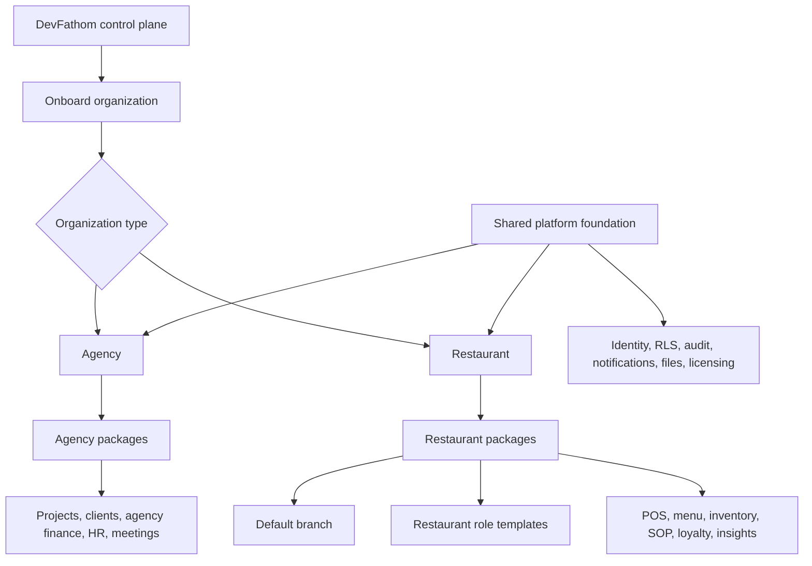

# DevFathom Restaurant Management System

| Field                         | Value                                                                                                                                                                                               |
| ----------------------------- | --------------------------------------------------------------------------------------------------------------------------------------------------------------------------------------------------- |
| Document version              | `1.6`                                                                                                                                                                                               |
| Document status               | `PLANNING AND OPERATOR CONTRACT`                                                                                                                                                                    |
| Industry                      | Restaurants, cafes, cloud kitchens, and food-service operators                                                                                                                                      |
| Product                       | DevFathom Commercial                                                                                                                                                                                |
| Delivery surface              | Responsive web and tablet browser first; native mobile is not currently planned                                                                                                                     |
| Last updated                  | 2026-09-02                                                                                                                                                                                          |
| Revision basis                | Original planning reviews, repository audit, and accepted local restaurant behavior; unverified browser steps remain validation pending                                                           |

## 1. Purpose

This document defines how DevFathom will support restaurant organizations alongside its existing agency operating model.

Restaurant support is a new product vertical built on the existing DevFathom platform. It is not an agency workspace with renamed pages, and it is not a separate SaaS application.

### 1.1 Document authority and precedence

This plan is the restaurant product's planning and architecture baseline. The canonical current
operator instructions are in [`docs/product/restaurant-administrator-guide.md`](../../docs/product/restaurant-administrator-guide.md).
The BA PRD remains a functional-workflow input. Where planning documents disagree on architecture,
identity, tenancy, authorization, money, tax, business date, numbering, audit, offline behavior,
reliability, or release scope, this plan governs until an accepted ADR explicitly supersedes it.

An accepted ADR may refine an implementation decision but must link the affected plan section and preserve the commercial and operational intent. Code, seed data, mockups, or an older PRD paragraph do not silently answer an open decision. Restaurant-specific implementation must not begin from the BA PRD alone.

The shared DevFathom platform will continue to own:

- organization tenancy and PostgreSQL row-level security;
- platform onboarding and manual activation;
- authentication, sessions, seats, roles, and permissions;
- modules, packages, contracts, limits, and organization overrides;
- audit infrastructure, notifications, files, APIs, and webhooks;
- shared and dedicated AWS deployment modes.

Restaurant-specific domains will own POS, restaurant orders, menu management, recipes, stock, procurement, shifts, SOP compliance, restaurant customers, loyalty, and restaurant analytics.

## 2. Core product decision

The first onboarding decision will be **Organization type**:

```text
Agency
Restaurant
```

The UI label will be `Organization type`. The initial code-level representation should be intentionally small:

```ts
enum OrganizationVertical {
  AGENCY
  RESTAURANT
}
```

Do not introduce a generic low-code vertical builder at this stage. Adding a new vertical still requires purpose-built routes, data models, authorization, dashboards, and workflows. A two-value enum is simpler and more honest until a third real vertical exists.

### 2.1 Separation of responsibilities

| Concept                | Responsibility                                                                             |
| ---------------------- | ------------------------------------------------------------------------------------------ |
| Organization type      | Selects the operating model: Agency or Restaurant                                          |
| Package                | Selects the purchased commercial tier within that operating model                          |
| Modules                | Selects enabled product capabilities                                                       |
| Limits                 | Controls branches, terminals, users, orders, templates, integrations, and other quantities |
| Roles and capabilities | Controls what each user may see or do                                                      |

Organization type may choose defaults and presentation, but it must never replace module entitlement or server-side authorization.

### 2.2 Organization-type behavior

Organization type will control:

- compatible packages shown during onboarding;
- onboarding fields and activation requirements;
- default module selection;
- default system-role templates;
- navigation and dashboard composition;
- business terminology;
- creation of a default restaurant branch;
- vertical-specific setup checklists.

Existing organizations and existing packages will be migrated to `AGENCY`.

An organization type may be corrected while an organization is still in early onboarding and contains no vertical data. Once activated, it must not be editable through an ordinary dropdown. An active vertical conversion requires an explicit migration workflow with preflight, audit history, and operator confirmation.

### 2.3 Package compatibility

`PlatformPackage` must carry compatible organization-type metadata. Restaurant onboarding must show restaurant packages only, while agency onboarding must show agency packages only.

The platform must reject a mismatched package on the server even if a crafted request bypasses the UI.

The current onboarding behavior also requires correction before restaurant packages launch: package modules are copied into `OrganizationModule` rows, while organization overrides take precedence over package defaults. Consequently, changing packages can leave modules from the previous package enabled. Package modules should be inherited, and organization overrides should represent exceptions only.

Vertical compatibility must be centralized in one server-owned catalog consulted by package assignment, module enablement, route/procedure/API access, navigation, and production bootstrap. Do not duplicate `AGENCY`/`RESTAURANT` conditionals across individual screens and commands.

## 3. Product architecture



The implementation remains a modular monolith in the existing DevFathom repository. Restaurant bounded contexts must stay internally separate even when multiple contexts are sold as one commercial module.

## 4. Restaurant organization and branch hierarchy

One restaurant company, chain, or centrally managed brand will normally be one DevFathom organization. Its operating locations will be branches beneath that organization.

```text
Organization: Example Restaurant Group
├── Branch: DHA
├── Branch: Gulberg
└── Branch: Islamabad
```

A franchisee becomes a separate organization when it requires separate legal control, contracts, billing, administrators, retention, or data isolation.

Separate franchisee organizations have **no cross-organization visibility or consolidated reporting by default**: organization RLS makes each franchisee's data invisible to every other organization, including the franchisor's. Any franchisor aggregation across franchisee organizations is a separately contracted, explicitly designed capability with its own security review (decision D09); it must never be approximated by widening tenant boundaries.

### 4.1 Branch-first schema

Branch support must be modeled from the first restaurant release even if the first package allows one branch only.

Every restaurant organization receives one default branch during onboarding. The branch switcher can remain hidden for a single-branch customer.

Every branch-owned operational record must contain:

```text
organizationId
branchId
```

Organization RLS remains the database tenant boundary. Branch authorization is an additional boundary implemented through explicit user-to-branch assignments. Phase 0 must decide whether sensitive branch-owned tables also receive database-enforced branch policies through a branch-scope session setting. The decision must account for multi-branch staff, organization-wide reporting, emergency support, and fail-closed behavior; it must not default silently to UI or application filtering alone.

Recommended hierarchy:

```text
Organization
└── RestaurantBranch
    ├── Operational areas and stations
    ├── Floors and tables
    ├── Registers and terminals
    ├── Orders and kitchen tickets
    ├── Inventory locations
    ├── Staff shifts
    └── SOP occurrences
```

## 5. Reuse assessment

| Area                                                   | Status                         | Direction                                                                                                        |
| ------------------------------------------------------ | ------------------------------ | ---------------------------------------------------------------------------------------------------------------- |
| Organization tenancy and RLS                           | Existing foundation            | Reuse                                                                                                            |
| Platform onboarding and activation                     | Existing foundation            | Extend with organization type and restaurant preflight                                                           |
| Packages, contracts, modules, limits                   | Existing foundation            | Reuse after package-inheritance correction                                                                       |
| Authentication, invitations, sessions, seats           | Existing foundation            | Reuse for internet-facing and back-office users                                                                  |
| Restaurant staff and shared-terminal operator identity | Absent                         | Add staff profiles that may lack email, device-bound operator credentials, rapid switching, and co-authorization |
| Custom organization roles                              | Existing foundation            | Extend with restaurant capabilities and branch scope                                                             |
| Notifications                                          | Existing foundation            | Extend with restaurant categories and durable escalation                                                         |
| Scheduler and durable background workers               | Incomplete platform foundation | Add scheduled execution before recurrence, escalation, outbox, retention, or rollup features depend on it        |
| Generic audit history                                  | Existing foundation            | Reuse as a mirror, not the sole financial/compliance ledger                                                      |
| Files and uploads                                      | Partial foundation             | Reuse with SOP-specific evidence metadata and authorization                                                      |
| API tokens and webhooks                                | Partial foundation             | Add restaurant scopes, events, durable outbox, and idempotency                                                   |
| Existing Finance                                       | Partial foundation             | Keep for back-office finance; do not use as POS source of truth                                                  |
| Existing HR                                            | Partial foundation             | Reuse people/leave where appropriate; build restaurant shifts separately                                         |
| Existing Clients                                       | Incompatible semantics         | Build restaurant customer and loyalty models                                                                     |
| Projects, tasks, and checklists                        | Prototype/reference only       | Do not make them the permanent SOP model                                                                         |
| POS, menu, stock, purchasing, kitchen, loyalty         | Absent                         | New product development                                                                                          |
| Branch/location model                                  | Absent                         | New platform foundation for Restaurant vertical                                                                  |

## 6. Commercial restaurant module map

Avoid creating a separate sellable switch for every screen. The recommended catalog is intentionally compact.

### 6.1 Restaurant Core

Restaurant Core is mandatory for every restaurant organization.

It owns:

- branches and branch settings;
- operating areas and service stations;
- server sections and table/server assignment;
- employee branch assignments;
- service modes;
- tax and service-charge configuration;
- business-day and closing-time configuration;
- business-date derivation and human order/receipt numbering policy;
- restaurant-specific dashboard foundation;
- registered-device and terminal enrollment, identity, revocation, and capacity enforcement foundation.

### 6.2 POS and Fulfilment

It owns:

- dine-in, takeaway, and delivery order channels;
- delivery-zone and delivery-fee configuration where the delivery channel is enabled;
- table and seating management;
- order taking and item modifiers;
- guest/cover count;
- item-level preparation lifecycle, course hold/fire, remakes, and post-preparation void handling;
- kitchen and bar order tickets;
- preparation and fulfilment status;
- discounts and complimentary items;
- cash, card, and online tender records;
- tips and gratuities as values separate from service charges;
- authorization, capture, adjustment, void, refund, and pre-authorization adapter capabilities where supported;
- split bills and split tenders;
- refunds and voids;
- cash-drawer opening, movements, and closing;
- daily sales closing;
- receipt generation;
- order and receipt number issuance under the Restaurant Core numbering policy;
- manager approvals and reasons.

### 6.3 Menu and Costing

The canonical product catalog is organization-owned. An organization has one or more `RestaurantBrand` records, with one default brand for ordinary restaurants and optional additional brands for approved cloud-kitchen or multi-brand operation. Products and recipes are not duplicated per branch.

A brand owns one or more menus. A branch publishes a menu through a branch-menu publication that supplies availability, channel, daypart, and approved price overrides. This preserves central catalog governance while allowing local commercial differences.

It owns:

- product and menu-item management;
- categories and subcategories;
- variants and sizes;
- modifier groups and modifier options;
- combos and meal deals composed from controlled component choices;
- ingredient and component substitutions with explicit costing and allergen consequences;
- branch and channel availability;
- effective-dated price lists;
- timezone-aware daypart availability and price windows with exception dates;
- recipes and BOM versions;
- yields and portion sizes;
- units and unit conversion;
- allergen and dietary metadata;
- localized menu and receipt content, including RTL capability where selected for launch;
- theoretical product cost.

### 6.4 Inventory

It owns:

- ingredients and stock items;
- append-only stock movements;
- stock in and stock out;
- recipe consumption;
- transfers between stock locations;
- wastage and adjustment reasons;
- physical stock counts;
- theoretical-versus-actual variance;
- low-stock thresholds and alerts;
- batch, lot, and expiry tracking where configured.

Intermediate preparation and production batches, including batch yield and shelf life, must be explicitly selected for a release or recorded as deferred scope rather than inferred from ordinary stock transfers.

### 6.5 Purchasing

It owns:

- suppliers and supplier contacts;
- supplier-item mappings;
- purchase requisitions;
- purchase orders and approvals;
- goods receiving;
- discrepancies and returns;
- supplier invoices and references;
- supplier price history;
- procurement and supplier reports.

Supplier payment execution remains in DevFathom back-office Finance or an approved accounting integration. Purchasing may record invoice and payment references but must not create a second accounts-payable ledger.

### 6.6 Restaurant Workforce

It owns:

- employee branch assignments;
- job/station assignments;
- shift scheduling;
- shift swaps and manager approval;
- clock-in and clock-out;
- break tracking;
- attendance and late arrival;
- labour-hour reporting.

Restaurant staff profiles may exist without an email address or internet login. A staff profile is not automatically a global authentication identity. Payroll processing and tip payout are outside this module unless separately approved; Workforce exports trusted labour and approved distribution facts to the responsible payroll/accounting system.

Labour-cost reporting uses a restricted effective-dated cost-rate source or imported labour-cost fact protected by a dedicated capability such as `workforce:rates`. It must not expose salary data through ordinary shift/report access and does not imply payroll calculation.

Existing employee profiles and leave management may be reused, but existing project time entries must not be reused as restaurant attendance.

### 6.7 SOP and Compliance

It owns:

- versioned SOP library;
- opening and closing checklists;
- cleaning schedules;
- barista procedures;
- kitchen procedures;
- food-safety checks;
- stock checks;
- equipment checks;
- staff hygiene and uniform checks;
- employee assignment;
- due windows;
- recurring schedules;
- photo and signature proof;
- manager verification;
- rejection and rework;
- missed and late states;
- escalation rules;
- escalation acknowledgement, quiet hours, maximum attempts, stop conditions, and recovery;
- employee, department, and branch performance scores;
- immutable occurrence and verification history;
- notifications and reports.

### 6.8 Customers and Loyalty

It owns:

- restaurant customer profiles;
- contact and marketing consent;
- order and visit history;
- saved delivery addresses;
- loyalty accounts;
- append-only points ledger;
- tiers and rewards;
- redemption history;
- branch-specific or chain-wide loyalty rules.

Customer privacy behavior must cover consent provenance, retention, export, correction, deletion or irreversible anonymization where legally permitted, and the treatment of financial records that cannot be deleted. Customer PII must not be retained merely because loyalty is disabled.

Agency `Client` records must not be reused as restaurant customers because their project, contract, and invoice semantics are incompatible.

### 6.9 Restaurant Insights

It owns read models and reports for:

- daily and hourly sales;
- sales by branch, channel, category, and product;
- average check and covers;
- table-turn time;
- discounts, complimentary items, refunds, and voids;
- tender and payment reconciliation;
- drawer variance;
- food cost and margin;
- theoretical-versus-actual ingredient usage;
- stock variance and wastage;
- supplier spend and performance;
- labour hours and labour percentage;
- SOP completion, lateness, rejection, and compliance scores;
- consolidated branch reporting.

Operational screens may query current transactional state directly, but high-volume dashboards must use a Phase 0-approved read-model strategy such as worker-maintained rollups keyed by organization, branch, and business date. Report metric definitions must identify their ledger source and reconciliation rule.

### 6.10 Integrations and Devices

Restaurant Core owns registered-device identity, enrollment, revocation, branch assignment, and capacity. Integrations and Devices owns the hardware/provider protocols and device health telemetry that operate through that identity.

It owns:

- payment provider adapters;
- card-terminal references and sanitized statuses;
- receipt and kitchen printer integration;
- cash-drawer integration;
- kitchen-display devices;
- device protocol credentials and health state;
- kitchen-display transport and recovery synchronization;
- delivery marketplace integrations;
- accounting exports;
- restaurant REST APIs and webhooks;
- provider webhook inbox;
- transactional event outbox;
- retries, delivery history, and idempotency.

## 7. Limits and usage

Multi-branch and capacity controls should usually be limits rather than standalone modules.

Suggested keys and counting contracts:

| Limit key                            | Counted unit                                                                                                                     |
| ------------------------------------ | -------------------------------------------------------------------------------------------------------------------------------- |
| `restaurant.locations.max`           | Active restaurant branches inside the organization                                                                               |
| `restaurant.brands.max`              | Active restaurant/virtual brands; ordinary customers receive one default brand                                                   |
| `pos.terminals.max`                  | Registered devices allowed to act as POS registers                                                                               |
| `pos.registeredDevices.max`          | All active POS, KDS, printer-agent, and other trusted restaurant devices                                                         |
| `pos.orders.monthly`                 | Orders created in the organization's contract billing month, including later-cancelled orders unless the contract says otherwise |
| `pos.concurrentRegisters.max`        | Simultaneously active register sessions                                                                                          |
| `restaurant.operators.max`           | Active staff profiles holding an operator credential; separate from global authenticated-user seats                              |
| `inventory.stockLocations.max`       | Active branch stock locations                                                                                                    |
| `sop.templates.max`                  | Active SOP template families, not immutable historical versions                                                                  |
| `sop.evidenceRetentionDays`          | Minimum/contracted evidence-retention window, subject to legal requirements                                                      |
| `loyalty.activeCustomers.max`        | Loyalty accounts active under the contract definition                                                                            |
| `integrations.connections.max`       | Active external provider/account connections, not individual webhook deliveries                                                  |
| `restaurantInsights.retentionMonths` | Detailed restaurant-insight retention; statutory ledgers may require longer retention                                            |

A KDS is a registered device but not a POS terminal. A printer attached through a shared local agent consumes the agent device, not one device per physical printer. Count definitions are part of the commercial contract and must be implemented identically in usage reporting and enforcement.

The platform may store new limits without a schema migration, but each enforced limit requires explicit server-side consumption and tests.

## 8. Roles and authorization

Do not expand the global role enum with every restaurant job. Use organization-role templates with capability namespaces.

Recommended templates:

- Owner / Administrator
- General Manager
- Branch Manager
- Cashier
- Server
- Kitchen
- Bar / Barista
- Inventory Controller
- Purchasing Officer
- Accountant
- SOP / Compliance Auditor

Example capabilities:

```text
restaurant:configure
branches:read
branches:manage
pos:operate
orders:read
orders:void
orders:discount
orders:complimentary
payments:collect
payments:refund
cash:open
cash:adjust
cash:close
menu:read
menu:write
inventory:read
inventory:count
inventory:adjust
inventory:waste
purchasing:create
purchasing:approve
sop:complete
sop:verify
sop:manage
customers:read
loyalty:redeem
reports:operational
reports:financial
```

Explicit deny continues to take precedence. Branch assignment must further constrain a capability that would otherwise allow an action.

Restaurant authorization deliberately separates global identity, local operational identity, device trust, and action attribution:

| Record                                               | Purpose                                                                                                                         |
| ---------------------------------------------------- | ------------------------------------------------------------------------------------------------------------------------------- |
| Global authentication identity and organization user | Internet-facing login, back-office application access, SSO/MFA, and organization membership                                     |
| Restaurant staff profile                             | Employment and operational record; may exist without email or an internet credential                                            |
| Restaurant operator credential                       | Device-bound PIN, badge, or another approved quick-unlock factor; never a general web password                                  |
| Terminal session                                     | Identifies the registered device and the currently active operator without turning a shared register into a shared user account |
| Co-authorization record                              | Records the acting operator, approving manager, approved action, target, reason, terminal, and time                             |

PINs and badges must be hashed or tokenized appropriately, rate-limited, scoped to an organization and registered device, revocable, and excluded from logs and audit payloads. A manager approval must not silently replace the cashier's identity; both identities remain attributable. Restaurant job assignments and permission roles are also separate concepts: an employee may work at a kitchen station without receiving every capability implied by the job label.

The current agency-specific department enum also requires a deliberate migration. Restaurant users cannot be forced into `ENGINEERING`, `PRODUCT`, or similar agency departments. Prefer organization-owned departments or operational areas rather than adding restaurant values to another growing global enum.

## 9. Restaurant onboarding flow

### Step 1: Organization type

- Agency
- Restaurant

### Step 2: Business identity

- legal name;
- display name;
- workspace slug;
- primary contact;
- locale;
- currency;
- data residency;
- shared or dedicated deployment.

### Step 3: Restaurant setup

- first branch name;
- branch address;
- branch timezone;
- dine-in, takeaway, and delivery modes;
- tax basis;
- tip and service-charge policy;
- business-day closing time;
- operating language and receipt-language requirements;
- delivery model: marketplace, customer pickup, or approved own-fleet scope;
- expected terminals and users.

### Step 4: Commercial package

- show restaurant-compatible packages only;
- apply package modules;
- apply branch, terminal, seat, and usage limits;
- record contract-specific additions.

### Step 5: Owner account

- owner/administrator name;
- secure credential or invitation flow;
- full organization administrator role;
- default branch access.

### Step 6: Default role templates

- create restaurant system roles;
- attach default capability rules;
- allow later customer-specific role customization where entitled.

### Step 7: Provisioning and activation

Activation requires:

- restaurant-compatible package;
- required Restaurant Core module;
- at least one enabled operational module;
- active owner/administrator;
- one valid default branch;
- explicit initial operator/device policy;
- READY production deployment;
- acknowledged tax/payment/device setup state;
- no failed onboarding preflight.

## 10. Internal bounded contexts

Commercial modules and bounded contexts are not required to match one-to-one.

| Bounded context          | Primary responsibility                                                                                                      |
| ------------------------ | --------------------------------------------------------------------------------------------------------------------------- |
| Restaurant Core          | Vertical metadata, branches, business date, numbering, stations, server sections, assignments, registered devices, settings |
| Menu and Pricing         | Brands, menus, branch-menu publications, products, modifiers, price lists, dayparts, taxes, channel availability            |
| Sales and Orders         | Order state, guest count, course behavior, item lifecycle, combos, and fulfilment                                           |
| Floor Service            | Floors, tables, occupancy, moves, merges, seating                                                                           |
| Payments and Cash        | Bills/checks, tenders, tips, pre-authorization/capture where approved, refunds, voids, drawers, reconciliation, daily close |
| Kitchen and Bar          | Ticket routing, firing, preparation, recalls, completion                                                                    |
| Recipe and Inventory     | Ingredients, BOM, stock ledger, counts, transfers, wastage                                                                  |
| Procurement              | Suppliers, purchase orders, receiving, cost history                                                                         |
| Restaurant Workforce     | Branch assignments, shifts, time clock, labour facts                                                                        |
| SOP and Compliance       | Templates, schedules, occurrences, proof, verification, escalation                                                          |
| Customer and Loyalty     | Customer identity, consent, visits, points, rewards                                                                         |
| Restaurant Analytics     | Derived facts, read models, dashboards, reports                                                                             |
| Integrations and Devices | Payment, printing, delivery, API, outbox/inbox, device registry                                                             |
| Platform Jobs            | Scheduled recurrence, late/missed detection, escalation, outbox dispatch, retention, and analytics rollups                  |

## 11. Required domain behavior

### 11.1 Orders

Orders are transactional state machines, not agency invoices.

Suggested high-level states:

```text
DRAFT
OPEN
SENT
IN_PREPARATION
READY
SERVED
PAYMENT_PENDING
CLOSED
CANCELLED
```

Transitions must be explicit, authorized, idempotent, and audited. Menu names, prices, taxes, service charges, discounts, and modifiers must be snapshotted onto the order so later catalog edits cannot rewrite history.

Order items have an independent lifecycle. The accepted state machine must cover at least:

```text
HELD
QUEUED
FIRING
PREPARED
SERVED
REMAKE_REQUESTED
VOIDED
```

Table-service workflows must be able to hold and fire courses without resending unrelated items. A remake and a void after preparation must preserve the original item history and apply the approved inventory/wastage policy. Combo/deal lines must snapshot both the sold deal and the selected components whose recipes consume stock.

The order and item machines must define their relationship explicitly:

- every KOT/KDS display status maps to the fixed item-domain states; customer-configurable labels must not create a third authoritative state machine;
- an order cannot enter a terminal state while a non-voided item remains active;
- a cancelled order cannot retain a queued/firing/prepared item without an explicit compensating transition;
- payment-before-fulfilment is allowed only for service modes whose accepted policy permits it, such as selected QSR flows;
- a remake remains linked to the original item and must resolve before the governing order/check reaches its configured terminal condition;
- order aggregates are derived from item/check facts and are never maintained as unrelated editable status flags.

Every order records:

- organization and branch;
- immutable internal identifier;
- human order number according to the branch/business-day sequence;
- business date stored explicitly from the effective branch timezone/closing rule and never recomputed later from UTC timestamps;
- service channel and guest/cover count where applicable;
- assigned server/section where applicable;
- active operator and registered terminal;
- catalog/branch-menu-publication and price/tax configuration versions used for calculation.

Receipt numbering is a separate jurisdiction-sensitive concern and must meet the accepted fiscalization and sequencing rules. Order numbers and receipt numbers must not be treated as interchangeable identifiers.

### 11.2 Payments and cash

Payment, refund, void, drawer movement, and closing records must be append-only or explicitly reversed through new records.

Never store raw card numbers, CVV, or magnetic-stripe data. DevFathom stores only provider references, sanitized method information, amounts, status, and timing.

Split bills and split tenders are separate concepts and both must be supported.

An `Order` is the kitchen and fulfilment scope. A first-class `Bill` or `Check` is its financial-settlement scope:

```text
Order
├── Order items and kitchen lifecycle
└── One or more Bills/Checks
    ├── Bill item/seat allocations
    ├── Tax, service charge, discount, rounding, and tip snapshots
    ├── One or more tenders
    └── Receipt/fiscal reference according to jurisdiction policy
```

Bills allocate the order's financial aggregate in one of the accepted split modes: by item, by seat, or by a defined fraction of the aggregate (an equal split allocates amounts, not items). In item/seat modes every financially relevant order item is allocated exactly once across active bills; complimentary items are allocated at their zero/discounted value rather than skipped, and voided items are excluded only by the accepted void policy. In every mode the bill totals must reconcile exactly to the order's financial aggregate under an effective-dated rounding policy, with any rounding remainder assigned deterministically. Each bill has its own settlement status; adding or removing a bill never rewrites a finalized sibling bill.

Tips and gratuities are not service charges. The payment model must preserve sale amount, tax, service charge, tip, currency, provider reference, and settlement status as distinct values. The payment adapter contract must be capable of representing the operations selected for the launch provider, including direct sale, authorization, capture, post-authorization adjustment, void, and refund. A provider or jurisdiction may support only a subset; the domain must not assume one universal card-tip flow.

If bar tabs or other open-account checks are included, card pre-authorization, incremental authorization where supported, expiry, close-out, walk-out handling, and recovery must be defined before implementation.

Where tax or service-charge rules depend on the tender, final calculation must be recomputed and snapshotted at settlement, including split-tender behavior. The specific legal rule must be verified from current official guidance for each launch jurisdiction.

Gift cards, stored-value instruments, and vouchers must not be modeled as ordinary discounts. If selected later, stored value requires a dedicated liability ledger, issuance/redemption rules, expiry policy, and reconciliation.

### 11.3 Daily closing

A daily close must create an immutable branch and business-day snapshot containing sales, tender totals, tax, service charge, tips, discounts, refunds, voids, cash expectation, actual cash, and variance.

Cash tips and any approved cash-on-delivery rider settlements must reconcile through explicit custody/movement records rather than informal adjustments to the drawer total.

A `DrawerSession` belongs to one registered register, one responsible operator, and one shift/open-close window. It records opening float, cash tenders, paid-in/paid-out movements, declared cash, expected cash, variance, and approvals. Multiple drawer sessions aggregate into the branch `DailyClose`; the daily close is not a substitute for operator/register accountability. Requiring an open shift and drawer before cash operation is an effective-dated branch policy.

A refund processed after the original business day closes posts as a new movement in the currently open business date and references the original bill, payment, receipt, operator, and historical business date. It does not mutate or silently reopen the historical daily close. Any jurisdiction-mandated exception must be documented from an official source and represented through an explicit reversal/correction workflow.

Reopening a closed business day must require an authorized manager, reason, and separate audit event.

### 11.4 Inventory

Never update an inventory balance as the sole source of truth. Store an append-only movement ledger and derive the balance.

Movement reasons include:

- purchase receipt;
- recipe consumption;
- sale reversal;
- transfer;
- physical-count adjustment;
- wastage;
- spoilage;
- staff meal;
- supplier return;
- manual correction.

Phase 0 must decide the posting point for recipe consumption and the policy for items voided or remade after preparation. Costing method, negative stock, unit conversions, yields, batch/lot use, physical-count reconciliation, and backdating are explicit policies rather than implementation defaults.

### 11.5 SOP execution

SOP templates are versioned. Editing a template creates a new version and never changes an occurrence already assigned or completed.

Suggested occurrence states:

```text
SCHEDULED
IN_PROGRESS
SUBMITTED
VERIFIED
REJECTED
LATE
MISSED
WAIVED
```

Proof and verification must retain uploader, verifier, capture time, completion time, evidence reference, evidence hash, verification result, and rejection reason.

Occurrence generation, late/missed transitions, escalations, retention enforcement, and notification delivery must run through durable scheduled work. Browser sessions and in-process timers are never the authority for compliance deadlines.

### 11.6 Staff, terminal, and approval attribution

A shared terminal is a registered device, not a shared employee account. The terminal session establishes device trust, and quick operator unlock identifies the active restaurant staff member. Sensitive actions may require a second manager credential without ending the operator's working session.

Every order, payment, refund, void, discount, complimentary item, cash movement, stock adjustment, and SOP verification must be attributable to the acting operator. Where approval is required, it must also retain the approving manager, approval capability, reason, terminal, target, and timestamp.

An employee without email may operate an authorized terminal but cannot automatically access the general DevFathom web application. Granting normal web access requires a separately provisioned global authentication identity and organization membership.

## 12. Reliability, realtime, offline, and hardware

### 12.1 Durable events

Kitchen displays, payment webhooks, delivery platforms, inventory consumption, and downstream integrations cannot depend on process-local fire-and-forget events.

Introduce:

- a transactional event outbox;
- an external webhook inbox;
- idempotent consumers;
- delivery attempts and backoff;
- dead-letter/recovery states;
- device/request idempotency keys.

The current chat realtime provider must not become the authoritative kitchen-order channel.

### 12.2 Scheduler and durable workers

The restaurant product requires scheduled and retryable background execution for:

- SOP occurrence generation;
- late/missed detection and escalations;
- transactional outbox dispatch;
- external webhook and notification retry;
- evidence-retention enforcement;
- inventory and operational reconciliation;
- analytics rollups.

Phase 1 must provision an owned scheduler/worker mechanism with overlap protection, idempotent jobs, execution history, retry/backoff, observability, and dead-letter recovery. A manually triggered migration job or an uninvoked cron-protected route does not satisfy this requirement.

Notification delivery requires an explicit channel matrix. In-app delivery is the platform baseline; email, browser push, SMS, or another external channel counts as supported only after credentials, provider behavior, retries, opt-out rules, and target-device/browser behavior pass production-like tests. Capture/log-only delivery is never acceptance evidence for an escalation feature.

### 12.3 POS client architecture and latency

A cashier interaction must not require a network round trip for every item tap. The accepted client model should include:

- a versioned branch catalog cached in the browser or approved local client store;
- immediate local feedback and local order composition;
- optimistic state only where recovery and conflict behavior are defined;
- idempotent submission of composed commands to the server ledger;
- explicit stale-catalog, price-change, tax-change, and reconnect behavior.

A revoked device must be rejected server-side even when it submits previously queued commands or holds a cached catalog. Client event time is untrusted metadata; authoritative creation, acceptance, transition, and completion times come from the server, while offline-origin time is retained separately for reconciliation.

Phase 0 must benchmark the intended launch locations against the selected AWS region and define measurable p50/p95 targets for tap-to-feedback, order submission, payment initiation, kitchen acknowledgement, item-availability (86) propagation to cached POS/KDS clients, and recovery. Region assumptions and approximate round-trip figures are not acceptance evidence.

### 12.4 Offline promise

The offline commitment must be decided before POS implementation:

1. **Cloud-connected pilot:** internet is required and the limitation is disclosed clearly; or
2. **Offline-capable POS:** local persistence, command sequencing, device identity, conflict rules, acknowledgements, and reconnect synchronization are product requirements.

Do not market offline capability until real disconnect, continued operation, reconnect, duplicate replay, conflict, and recovery tests pass.

### 12.5 KDS transport and recovery

The kitchen ledger remains authoritative. Phase 0 must select how a KDS receives low-latency notification, such as SSE, bounded polling, or another approved transport. Any push/realtime channel is only a nudge to read durable state and must support sequence/gap detection, reconnect, replay/resynchronization, device acknowledgement, and station-specific routing.

### 12.6 Printers and cash drawers

A browser-only application cannot assume reliable support for every printer, kitchen printer, and cash drawer.

Current repository behavior is narrower than physical hardware support: the print bridge adds a durable tenant-scoped print
route/job bridge plus ESC/POS simulation, but it does not perform physical
printer, network, operating-system, or cash-drawer I/O. Physical print agents,
printer certification, hardware support matrices, and production acceptance
remain open under D05.

Supported options must be selected deliberately:

- network-capable printers;
- manufacturer-supported browser integrations;
- or a site-local DevFathom device/print agent.

The web application remains the user-facing product. A narrowly scoped local device agent does not imply a native mobile application.

### 12.7 Web and tablet accessibility

The responsive web product must target WCAG 2.2 AA for applicable web surfaces and include restaurant-specific ergonomics:

- primary POS/KDS touch actions target at least 44 by 44 CSS pixels;
- state, urgency, allergen, and error meaning never depends on color alone;
- contrast remains usable under bright kitchen/counter lighting and dark operating modes;
- keyboard access and visible focus are preserved for back-office and supported POS workflows;
- screen-reader names, validation messages, and status announcements are meaningful;
- text scaling does not hide totals, payment state, allergen warnings, or destructive-action confirmation;
- localized and RTL layouts receive the same functional, responsive, and accessibility verification;
- errors identify the affected field/action and a professional recovery path without exposing internal data.

## 13. Preliminary commercial packages

These names and limits are provisional and require pricing work.

Packages and limits are commercial entitlements, not a promise of self-service billing. Initial restaurant organizations remain manually contracted, onboarded, activated, invoiced, and renewed through the platform control plane. Proration and automated subscription collection are outside this plan unless separately approved.

### Restaurant Essentials

- one branch;
- Restaurant Core;
- POS and Fulfilment for contracted channels, core bills/tenders, kitchen tickets, drawer sessions, and daily close;
- Menu and Costing with one default brand, branch publication, recipes, modifiers, and dayparts;
- Inventory stock ledger, counts, recipe consumption, wastage, transfers within the branch, and low-stock alerts;
- Workforce branch assignments, shifts, clock-in/out, breaks, and attendance;
- SOP library, opening/closing and operational checklists, evidence, due/late/missed state, and configured template/retention limits;
- daily sales, tender, drawer, item/category, stock, labour-hour, and SOP completion reports;
- predefined restaurant roles.

### Restaurant Operations

- multiple branches within configured limits;
- full inventory and purchasing;
- advanced SOP and verification;
- customers and loyalty;
- advanced restaurant insights;
- selected supported integrations as listed in the contract;
- extended audit and data retention.

### Restaurant Enterprise

- contracted branches, terminals, users, and order capacity;
- custom role and permission design;
- SSO and SCIM where contracted;
- APIs and webhooks;
- dedicated AWS deployment where contracted;
- custom integrations and reporting only where contracted and scoped through an approved statement of work;
- contracted support, retention, and residency terms.

Login and basic role enforcement are foundational security and must not be disabled as a module. Enterprise may receive advanced customization, SSO, SCIM, and governance controls.

## 14. Delivery plan

### 14.1 Phase-gate policy

Phase 0 may begin from this baseline. Later phases begin only when the decision register marks their blockers `ACCEPTED` and links the required evidence.

Before Phase 1 implementation merges:

- the global-identity ADR must explicitly preserve the restaurant staff/operator/device boundary. At current HEAD, ADR-003 (standard shared-host login) is accepted and implemented and ADR-004 (authentication identity plane) is proposed and unimplemented; the operator-credential design coordinates with ADR-004 and must remain correct in the implemented ADR-003 world it will initially ship into;
- the branch database-enforcement decision must be accepted;
- pull requests must run applicable lint, typecheck, unit, tenant/RLS, production-build, and end-to-end gates before merge rather than discovering failures only during deployment. At current HEAD the full suite (lint, typecheck, unit, `test:rls`, build, Playwright) runs in the staging deployment workflow, while the pull-request gate remains the image build alone; this requirement is satisfied only when those gates run at pull-request level;
- current security findings affecting identity, tenancy, authorization, entitlements, or audit surfaces being extended must be resolved or explicitly accepted by the responsible owner.

Phase 1 exits only after package inheritance, centralized vertical compatibility, operator/device foundations, branch verification, production bootstrap, and the durable scheduler/worker foundation are implemented and verified.

Before Phase 2 schema implementation, the organization-brand-catalog-menu-publication model, dayparts, substitutions, numbering configuration, and selected multi-brand/localization scope must be accepted.

Before Phase 3 schema implementation, jurisdiction, bill/check, order/item invariants, tips, payment operations, drawer sessions, cross-day corrections, offline/client behavior, KDS transport, delivery fees/COD, and supported hardware decisions must be accepted.

SOP escalation cannot pass Phase 5 acceptance until at least one contracted external notification channel works end to end in a production-like environment. Capture/log-only delivery is insufficient.

Production pilot entry additionally requires one candidate deployment plus migration, security, tenant/branch isolation, device, payment, inventory, backup/restore, observability, browser, and operating-runbook evidence.

### Phase 0: Product and architecture decisions

#### Deliverables

- restaurant architecture decision record;
- initial operating segment decision: table service, quick service, cafe, cloud kitchen, bar, or an explicitly supported combination;
- target-country tax and fiscalization requirements;
- payment and terminal strategy;
- tip capture, declaration, adjustment, pooling/export, and reconciliation policy;
- operator identity, staff-without-email, registered-device, rapid-switching, and manager co-authorization design coordinated with the global identity ADR;
- offline operating promise;
- POS client caching/local-composition model and measurable latency budget;
- KDS transport and recovery protocol;
- durable scheduler/worker platform decision;
- printer and cash-drawer strategy;
- order, item/course, payment, drawer, close, inventory, and SOP state machines;
- explicit order/item invariants and KOT/KDS display-state mapping;
- organization-brand-catalog-menu-publication entity model;
- bill/check allocation, rounding, settlement, and receipt-scope model;
- drawer-session and cross-business-date correction model;
- daypart and exception-date model;
- restricted labour-cost-rate source and authorization design;
- bar-tab/pre-authorization decision;
- combo/meal-deal model decision;
- own-fleet delivery and cash-on-delivery settlement decision;
- business-date, order-number, and receipt-number rules;
- branch database-enforcement decision;
- reporting/read-model mechanism;
- multilingual and RTL launch scope;
- external notification channel matrix;
- restaurant capability matrix;
- branch and franchise boundary rules;
- initial package and limit specification.

#### Verification

- product, engineering, security, and operations sign off on decisions;
- no unresolved payment-card storage responsibility;
- all external-provider assumptions cite provider documentation;
- failure and recovery behavior is defined before implementation;
- order, bill, item, payment, drawer, close, refund, and stock invariants reconcile on paper before schema work;
- current official jurisdiction sources support tax and receipt decisions;
- device/PIN threat model prevents an operator credential from becoming an internet-facing password;
- latency targets are backed by measurements from intended operating locations;
- all deferred front-of-house capabilities are named explicitly rather than omitted silently.

#### Anti-pattern guards

- no invented payment/provider API;
- no promise of offline or hardware support without an accepted design;
- no country-specific tax assumption applied globally;
- no global identity redesign accepted without accounting for device-bound restaurant operators;
- no server round trip required for every menu-item tap.

### Phase 1: Vertical-aware platform foundation

#### Deliverables

- organization type and package compatibility;
- additive `OrganizationVertical` migration with Agency default/backfill, package stamping, and non-null enforcement;
- migration of current organizations/packages to Agency;
- centralized vertical compatibility catalog used by package assignment, module enablement, server access, and navigation;
- type-first onboarding;
- default restaurant branch;
- branch assignments;
- restaurant role templates and capability namespaces;
- restaurant staff profile, operator credential, terminal-session, and co-authorization foundations;
- restaurant navigation and dashboard shell;
- platform-console organization list/detail support for vertical, branch/device counts, package compatibility, and current usage against restaurant limits;
- package-inheritance correction;
- restaurant modules/packages in the production bootstrap path;
- durable scheduler/worker foundation and execution observability;
- activation preflight;
- documentation and status map.

#### Verification

- agency onboarding remains unchanged;
- restaurant onboarding cannot select agency packages;
- crafted requests cannot assign incompatible packages;
- active organization type cannot be casually changed;
- every restaurant has one default branch;
- cross-organization and cross-branch tests fail closed;
- branch-scope tests prove the accepted database/application boundary rather than filtering only rendered results;
- disabled restaurant modules cannot be opened or called directly.

#### Anti-pattern guards

- do not infer organization type from package names;
- do not create each branch as an organization;
- do not treat navigation hiding as authorization;
- do not expand a global enum with every restaurant job;
- do not duplicate vertical checks as scattered route/UI conditionals.

### Phase 2: Restaurant Core, menu, and configuration

#### Deliverables

- branches, areas, tables, stations, registers, and terminals;
- registered-device enrollment, credential rotation/revocation, and health state;
- service modes;
- organization brands, canonical products, categories, variants, and modifiers;
- menus and branch-menu publications;
- combo/meal-deal schema seam where selected;
- ingredient/component substitutions;
- price lists;
- daypart/channel availability and price windows with exception dates;
- tax and service-charge rules;
- recipe/BOM versions;
- allergens and availability;
- restaurant configuration UI;
- business-date and numbering configuration;
- localized menu/receipt fields where selected for launch.

#### Verification

- all rows are organization scoped and branch relationships are organization aware;
- price/tax configuration is effective-dated;
- historical catalog versions remain readable;
- branches cannot create shadow copies of canonical products/recipes to bypass organization governance;
- duplicate and cross-branch table/terminal constraints are tested;
- RLS verifier includes every new tenant table.

### Phase 3: POS, payments, kitchen, and daily close

#### Deliverables

- order state machine;
- item/course lifecycle, hold/fire, remakes, and post-preparation void policy;
- order/item derivation invariants and fixed-domain/KDS-display state mapping;
- table and channel workflows;
- cover/guest count;
- server-section and table/server assignment;
- item modifiers and kitchen routing;
- kitchen/bar tickets and KDS;
- discounts and complimentary approvals;
- split bills and split tenders;
- first-class bills/checks, item/seat allocation, rounding, and independent settlement state;
- payment-provider adapter boundary;
- tips/gratuities and supported authorization/capture/adjustment flows;
- bar tabs/pre-authorization where selected;
- refunds and voids;
- drawer sessions and movements;
- daily close and reopen workflow;
- cross-business-date refund/correction workflow;
- receipts;
- human order and legal receipt numbering;
- POS catalog caching/local composition and accepted submit/recovery flow;
- selected KDS notification and resynchronization transport;
- device and request idempotency;
- selected connected/offline behavior.

#### Verification

- monetary calculations use decimal-safe arithmetic;
- retries cannot create duplicate orders, payments, refunds, or closes;
- retries, reconnects, and operator switches cannot duplicate or misattribute item actions;
- concurrent table/order actions are deterministic;
- all manager overrides require a reason;
- bill allocations, tenders, tips, tax, service charge, rounding, receipts, and order totals reconcile exactly;
- drawer sessions reconcile by operator/register/shift into the daily close;
- finalized snapshots survive catalog edits;
- no raw card data reaches logs or storage;
- reconnect and failure tests match the promised operating mode;
- peak-hour load tests meet the accepted target;
- tap-to-feedback and submit latency meet the measured Phase 0 budget.

### Phase 4: Inventory and purchasing

#### Deliverables

- ingredients, units, conversions, yields, and recipe consumption;
- stock movement ledger;
- counts, transfers, wastage, batches, and expiry;
- low-stock rules;
- suppliers, purchase orders, approvals, receiving, and discrepancies;
- costing and variance reports;
- production/preparation batches where selected for the release.

#### Verification

- movements balance under concurrency;
- unit conversion and recipe yield cases are covered;
- receiving and return retries are idempotent;
- stock cannot cross organizations or unauthorized branches;
- negative-stock policy is explicit and tested;
- backdated corrections preserve history.

### Phase 5: SOP and compliance

#### Deliverables

- versioned SOP templates and steps;
- recurring schedules and occurrences;
- branch/station applicability;
- employee assignment and due windows;
- photo/signature proof;
- verification, rejection, waiver, and rework;
- late/missed detection;
- escalation worker and delivery records;
- channel-specific notification delivery and escalation stop/quiet-hour rules;
- performance scoring and compliance reports.

#### Verification

- recurrence respects branch timezone and daylight-saving transitions;
- editing a template never changes historical occurrences;
- proof authorization is narrower than general tenant file access;
- submitted/verified evidence cannot be silently replaced;
- escalation is durable and retryable;
- scheduled execution proves overlap protection and recovery after downtime;
- scores can be reproduced from source occurrences.

### Phase 6: Workforce, loyalty, and insights

#### Deliverables

- shifts, assignments, clock-in/out, attendance, and labour facts;
- restricted effective-dated labour cost rates or imported cost facts;
- approved tip-distribution facts for export where selected, without implementing payroll implicitly;
- restaurant customers, consent, visits, loyalty tiers, and rewards;
- points and redemption ledger;
- restaurant KPI read models;
- branch and department filters;
- consolidated dashboards and exports.

#### Verification

- labour and loyalty ledgers are reproducible;
- refunds and cancelled orders reverse loyalty effects correctly;
- customer consent and retention rules are enforced;
- reporting totals reconcile with operational ledgers;
- rollup rebuilds reconcile to source ledgers;
- branch permissions apply to reports and exports;
- labour cost reports never disclose restricted wage/cost-rate data to ordinary operational-report roles.

### Phase 7: Production hardening and rollout

#### Deliverables

- end-to-end production-like environment;
- observability, alerting, backups, and recovery runbooks;
- device and integration support matrix;
- responsive POS/KDS accessibility and ergonomics acceptance;
- load and soak testing;
- data migration/import tools;
- restaurant onboarding guide;
- operator support guide;
- pilot rollout and rollback plan;
- final technical, API, security, QA, and business documentation.

#### Verification

- security review and tenant-isolation suite pass;
- payment and inventory reconciliation pass;
- backup restore is demonstrated;
- device disconnect/recovery is demonstrated;
- production image, migrations, and browser acceptance pass on the same SHA;
- pilot acceptance is recorded by feature and branch.

## 15. Global acceptance requirements

Every phase must meet these cross-cutting requirements:

- new tenant tables have non-null `organizationId`;
- branch-owned rows also have `branchId`;
- cross-tenant foreign keys are structurally prevented;
- forced RLS and non-superuser tests cover new tables;
- all mutations use scoped database access;
- module mapping covers routes, tRPC routers, and REST scopes;
- role capabilities are enforced on the server;
- restaurant operator credentials cannot authenticate as general web passwords;
- every sensitive shared-terminal action retains acting and approving identities where applicable;
- authoritative operational timestamps are generated by the server; client/offline event times remain separately attributable metadata;
- revoked devices cannot use cached state or queued commands to bypass current authorization, catalog, tax, price, or entitlement versions;
- disabled modules fail safely and professionally;
- domain ledgers are transactional and auditable;
- sensitive values are redacted;
- external callbacks and client retries are idempotent;
- scheduled jobs are observable, overlap-safe, retryable, and idempotent;
- business date and order/receipt sequences remain correct across midnight, timezone changes, retries, and concurrent terminals;
- client caches fail safely on catalog, price, tax, and permission version changes;
- high-volume reports reconcile to source ledgers and do not overload the transactional path;
- customer PII export, correction, retention, deletion/anonymization, and legally required retention paths are tested;
- responsive, keyboard, touch, contrast, localization/RTL, screen-reader, and error-recovery acceptance covers affected web surfaces;
- migrations are additive, reviewed, and deployable with `prisma migrate deploy`;
- current agency behavior receives regression coverage;
- documentation status never claims an unimplemented feature is available.

## 16. Explicit anti-patterns

Do not:

- reuse agency invoices as restaurant checks or bills;
- reuse agency clients as restaurant loyalty customers;
- create independent branch copies of canonical products, recipes, or brands merely to vary availability or price;
- use project tasks as the permanent SOP/compliance model;
- create one organization per ordinary branch;
- infer vertical from package names;
- store menu, recipe, stock, or payment ledgers as unstructured JSON blobs;
- update stock balances without a movement ledger;
- delete payment, refund, void, drawer, closing, stock, or SOP evidence history;
- store raw payment-card information;
- use UI filtering as a branch security boundary;
- use fire-and-forget chat realtime as authoritative kitchen delivery;
- advertise offline capability before disconnect/reconnect acceptance passes;
- promise universal printer/drawer support without a tested support matrix;
- implement taxes without a target-jurisdiction decision;
- put every restaurant job into a global role enum;
- require an email address for every restaurant floor or kitchen worker;
- treat a device-bound PIN or badge as an internet-facing DevFathom password;
- replace the acting cashier identity with the approving manager identity;
- store raw biometric templates or centralize employee biometrics without an accepted legal/security design; device-local verification is preferred where supported;
- treat tips as service charges or ordinary discounts;
- derive business date permanently from UTC timestamps after the fact;
- trust a client/tablet clock as the authoritative transaction or compliance timestamp;
- require a server round trip for every menu-item tap;
- use browser timers or process-local timers as the authority for SOP deadlines or event dispatch;
- finalize tax before tender selection where the accepted jurisdiction makes tax tender-dependent;
- implement gift cards as discounts or ordinary customer credits;
- build payroll, reservations, driver logistics, or stored-value accounting implicitly through adjacent modules;
- publish package promises using undefined labels such as `basic`, `advanced`, `selected`, or `custom` without an entitlement, limit, support matrix, contract, or statement-of-work definition.

## 17. Open product decisions

Owner roles in this register are accountable for producing or approving evidence. `Product owner` means Saad unless formally delegated. A phase shown in `Required before` is the deadline; no calendar date is invented before delivery scheduling exists.

### 17.1 Accepted baseline decisions

| ID  | Accepted decision                                                                                                                                                 | Status                                                  |
| --- | ----------------------------------------------------------------------------------------------------------------------------------------------------------------- | ------------------------------------------------------- |
| A01 | Restaurant is a vertical inside DevFathom; organization type, package, modules, limits, roles, and branch scope remain separate                                   | `ACCEPTED`                                              |
| A02 | Canonical brands, products, recipes, and menus are organization-owned; branches publish menus with controlled overrides                                           | `ACCEPTED`                                              |
| A03 | An Order is the fulfilment scope and one or more Bills/Checks are the financial settlement scope                                                                  | `ACCEPTED`                                              |
| A04 | Drawer sessions are register/operator/shift scoped and aggregate into an immutable branch/business-date daily close                                               | `ACCEPTED`                                              |
| A05 | A later refund posts in the current business date and references the original closed transaction; it does not silently rewrite history                            | `ACCEPTED`, subject to official jurisdiction exceptions |
| A06 | Global web identity, restaurant staff profile, device-bound operator credential, terminal session, and co-authorization are separate records                      | `ACCEPTED`, must be preserved by identity ADR           |
| A07 | Business date is stored explicitly from effective branch rules; order and receipt identifiers are separate                                                        | `ACCEPTED`                                              |
| A08 | Daypart/menu-publication, virtual-brand, combo, ingredient-substitution, server-section, and restricted labour-cost seams exist from the relevant initial schemas | `ACCEPTED`                                              |
| A09 | Durable scheduler/workers, outbox/inbox, server-authoritative timestamps, and idempotent recovery are platform requirements                                       | `ACCEPTED`                                              |
| A10 | Responsive web/tablet is the delivery surface; native mobile, payroll execution, reservations, stored value, and full driver logistics are deferred by default    | `ACCEPTED`                                              |
| A11 | This plan governs architecture and money paths when the BA PRD disagrees                                                                                          | `ACCEPTED`                                              |

### 17.2 Open decision register

| ID  | Required decision/output                                                                                                                                                                                                       | Accountable owner(s)                                    | Required before                | Status                | Required evidence                                                            |
| --- | ------------------------------------------------------------------------------------------------------------------------------------------------------------------------------------------------------------------------------ | ------------------------------------------------------- | ------------------------------ | --------------------- | ---------------------------------------------------------------------------- |
| D01 | Initial operating segment and launch country/countries                                                                                                                                                                         | Product owner + Restaurant operations SME               | Phase 0 exit                   | `OPEN`                | Target customer profile and pilot scope                                      |
| D02 | Tax, service charge, tender-dependent calculation, rounding, receipt scope, fiscalization, correction, and retention rules                                                                                                     | Product owner + Finance/Legal                           | Phase 3 design                 | `OPEN`                | Current official jurisdiction sources                                        |
| D03 | Payment processors, card-terminal vendors, supported sale/auth/capture/adjust/void/refund operations, and tip flow                                                                                                             | Product owner + Finance + Engineering                   | Phase 3 design                 | `OPEN`                | Provider documentation, sandbox proof, fee/settlement model                  |
| D04 | Offline POS is limited to cached-catalog composition of new orders with device-bound idempotent replay, catalog-review holds, reauthentication pause, and revocation discard; duration and measurable latency targets remain open | Product owner + Engineering                             | Phase 3 design                 | `PARTIALLY RESOLVED` | Location-to-region benchmark and disconnect/recovery prototype               |
| D05 | Supported printers, drawers, KDS devices, browser integrations, and local device-agent policy                                                                                                                                  | Product owner + Restaurant operations SME + Engineering | Phase 3 design                 | `OPEN`                | Hardware matrix and production-like device tests                             |
| D06 | Direct zones, frozen fees/address facts, connected POS, kitchen-ready PREPAID/COD handoff, and fee reporting are implemented; marketplace APIs, live tracking, routing, rider settlement, and own-fleet extensions remain open | Product owner + Restaurant operations SME               | Phase 3 design                 | `PARTIALLY RESOLVED`  | Integrated direct-delivery E2E; provider requirements remain                 |
| D07 | Inventory costing, negative stock, recipe-consumption posting, remake/void-after-preparation, batch/lot, production-batch, and backdating policies                                                                             | Product owner + Finance + Restaurant operations SME     | Phase 4 design                 | `OPEN`                | Worked costing/reconciliation examples                                       |
| D08 | Loyalty expiry, earn/reversal/redemption, consent, privacy, anonymization, and retention rules                                                                                                                                 | Product owner + Finance/Legal                           | Phase 6 design                 | `OPEN`                | Policy and worked refund/redemption cases                                    |
| D09 | Franchise/legal isolation and whether a separately contracted cross-organization franchisor aggregation is required                                                                                                            | Product owner + Commercial + Security                   | Contracting and Phase 1 design | `OPEN`                | Legal/commercial boundary and security design                                |
| D10 | Package names, prices, included modules, branch/brand/device/operator/order limits, retention, support, and SOW-only capabilities                                                                                              | Product owner + Commercial                              | Phase 1 bootstrap              | `OPEN`                | Approved package/limit matrix and contract wording                           |
| D11 | Device-bound PIN/badge/WebAuthn policy, optional device-local biometrics, rate limits, recovery, visiting-manager approval, and credential lifecycle                                                                           | Product owner + Identity/Security + Engineering         | Phase 1 design                 | `OPEN`                | Identity ADR, threat model, and official privacy/legal review where required |
| D12 | Branch enforcement: database-level branch scope for sensitive tables or application enforcement with accepted compensating controls                                                                                            | Security + Data Architecture                            | Phase 1 design                 | `OPEN`                | ADR and live non-superuser cross-branch harness                              |
| D13 | Scheduler/worker runtime, cadence, locking, retries, dead letters, observability, and ownership                                                                                                                                | Platform Engineering                                    | Phase 1 design                 | `OPEN`                | Architecture decision and failure/recovery proof                             |
| D14 | Detailed order/item/course invariants, QSR payment-before-fulfilment policy, remakes, display aliases, and terminal conditions                                                                                                 | Product owner + Restaurant operations SME + Engineering | Phase 3 design                 | `OPEN`                | State-transition tables and worked exception scenarios                       |
| D15 | Bill/check allocation, rounding, receipt-per-order versus receipt-per-bill, split-tender behavior, and cross-day correction exceptions                                                                                         | Product owner + Finance/Legal + Engineering             | Phase 3 design                 | `OPEN`                | Calculation examples and official jurisdiction sources                       |
| D16 | Drawer shift-gating, shared-drawer exceptions, manager handover, cash tips, COD custody, and variance approval thresholds                                                                                                      | Product owner + Restaurant operations SME + Finance     | Phase 3 design                 | `OPEN`                | Opening/closing/reconciliation scenarios                                     |
| D17 | Tip declaration, card adjustment, pooling/distribution export, cash custody, and settlement/reconciliation policy                                                                                                              | Product owner + Finance + Restaurant operations SME     | Phase 3 design                 | `OPEN`                | Provider/jurisdiction evidence and worked daily close                        |
| D18 | Bar tabs and pre-authorization included or excluded for the pilot segment                                                                                                                                                      | Product owner + Finance                                 | Phase 3 scope                  | `OPEN`                | Pilot-segment decision and provider capability                               |
| D19 | KDS uses station-bound bounded polling, explicit item acknowledgement, idempotent actions, cursor-gap reconciliation, oldest-first overflow handling, and last-known-state network recovery; push and offline queue remain deferred | Engineering + Restaurant operations SME                 | Phase 3 design                 | `PARTIALLY RESOLVED` | Connected browser and disconnect/reconnect validation                        |
| D20 | Multilingual/RTL languages and localized menu, KDS, receipt, tax, font, and accessibility requirements                                                                                                                         | Product owner + Commercial + UX                         | Phase 2 design                 | `OPEN`                | Pilot language matrix and browser/device proof                               |
| D21 | External notification channels, quiet hours, acknowledgement, escalation stops, opt-outs, and delivery guarantees                                                                                                              | Product owner + Operations + Engineering                | Phase 5 design                 | `OPEN`                | Provider configuration and production-like delivery/retry proof              |
| D22 | Analytics read models, freshness, rollup cadence, rebuild, reconciliation, historical retention, and restricted labour-cost source                                                                                             | Product owner + Data Architecture + Finance             | Phase 6 design                 | `OPEN`                | Metric dictionary and ledger-to-report reconciliation                        |
| D23 | Gift cards/stored value, advanced promotions, reservations/waitlist, payroll execution, tip payout, production batches, and full driver logistics remain deferred or are promoted through explicit scope approval              | Product owner + Commercial                              | Each affected phase scope      | `DEFERRED BY DEFAULT` | Approved scope amendment and commercial case                                 |

No implementation may infer an answer from seed data, existing code limitations, an older PRD sentence, or a mockup. The register must be updated to `ACCEPTED` with linked evidence before its phase gate passes.

## 18. Initial release scope and explicit deferrals

The initial release must implement the structural foundations required for safe extension even when an optional user interface is deferred. Phase 0 owns the final scope decision and must record it in the accepted ADR and package specification.

### 18.1 Structural foundations required from the beginning

- organization type, compatible packages, modules, limits, and manual activation;
- organization/branch isolation and default branch;
- registered devices, restaurant staff profiles, operator attribution, and manager co-authorization;
- business date, order/item lifecycle, bills/checks, drawer sessions, numbering, financial snapshots, and append-only ledgers;
- organization brands, canonical catalog, branch-menu publication, dayparts, modifiers, price/tax versions, recipes, units, and inventory movements;
- durable outbox/inbox, scheduler/workers, and idempotent recovery;
- responsive web/tablet operation with the accepted connected or offline promise;
- security, privacy, audit, RLS, backups, observability, and reconciliation;
- server-authoritative time, responsive accessibility, and professional error/recovery behavior.

### 18.2 Model seams to preserve even if their full UI is later

- tips and provider-specific authorization/capture behavior;
- course hold/fire and item-level kitchen states;
- combos and meal deals;
- bar tabs/pre-authorization where the launch segment may require them;
- localized/RTL content;
- server sections, ingredient substitutions, restricted labour-cost facts, and delivery-fee configuration;
- production batches and own-fleet COD settlement if selected for an adjacent phase.

### 18.3 Deferred by default unless Phase 0 explicitly selects them

- gift cards and stored-value liability accounting;
- advanced promotion engines such as BOGO and campaign scheduling;
- reservations and waitlists;
- full driver dispatch, route optimization, or customer driver tracking;
- payroll calculation and employee payout execution;
- native iOS or Android applications.

Deferred capabilities must not be marketed, represented as available in packages, or approximated through incompatible existing models.

## 19. Current codebase anchors

The following existing files provide patterns to reuse. They do not imply that restaurant functionality is already implemented.

- `prisma/schema.prisma` — organization, users, custom roles, entitlements, finance, notifications, audit, and control-plane models.
- `prisma/production-bootstrap.ts` — current platform module registry and Agency Suite bootstrap.
- `src/lib/platform/commands.ts` — organization onboarding, lifecycle, package, module, and catalog commands.
- `src/lib/entitlements.ts` — package, contract, limit, and override resolution.
- `src/lib/module-catalog.ts` — route, procedure, and REST module mapping.
- `src/lib/abac/policies.ts` — current authorization action catalogue.
- `src/lib/abac/index.ts` — custom role and explicit-deny evaluation.
- `src/lib/tenancy/scoped-db.ts` — tenant and control-plane database boundaries.
- `src/server/trpc.ts` — session, audit, capability, and module middleware.
- `src/server/audit.ts` — generic tenant audit infrastructure.
- `src/lib/notifications.ts` — generic notification delivery.
- `src/lib/webhooks.ts` — current signed webhook foundation.
- `scripts/verify-tenant-isolation.ts` — forced-RLS and tenant-isolation verification.
- `docs/admin-platform/entitlements.md` — current commercial entitlement contract.
- `docs/admin-platform/architecture-tenancy.md` — current tenant and RLS architecture.
- `docs/admin-platform/adr/003-shared-host-login.md` and `docs/admin-platform/adr/004-authentication-identity-plane.md` — the implemented shared-host login decision and the proposed identity plane that the restaurant operator-credential design must coordinate with.

## 20. Current administrator workflow contract

Use the [restaurant administrator guide](../../docs/product/restaurant-administrator-guide.md) for
step-by-step operator instructions. This section records accepted behavior and limits, not release,
deployment, browser, hardware, external-service, or production-readiness evidence. Any browser step
not explicitly covered in the guide is **Validation pending**.

- SuperAdmin/platform operators create restaurant organizations and assign packages/modules;
  restaurant administrators manage only the tenant capabilities granted to them.
- Branch, operator, order, occurrence, table, gateway, device, and existing provider-configuration
  choices use readable selectors. An unavoidable provider-issued external terminal reference is
  integration configuration, not a typed internal Terminal ID.
- Catalog/menu administration covers canonical products, modifiers, effective pricing, branch and
  channel publication, and recipe/BOM versions. OCR output is reviewed, corrected, rejected or
  merged for duplicates, then committed to draft; publication remains a separate manual action.
- Enrolled POS/KDS browsers establish their registered device, then named staff unlock with their
  own PIN. Lock and operator switching preserve individual attribution.
- Offline POS permits cached-catalog composition and queueing of new orders only. Reconnect replays
  open-order/add-item commands idempotently; catalog changes can require review, authentication can
  pause replay, and revocation discards device drafts. Payment, refund, receipt, drawer, close,
  customer, loyalty, delivery, and existing-order changes remain connected-only.
- Dine-in, takeaway, and connected direct-delivery workflows share order/menu controls. Delivery
  needs a customer, saved address, active zone, Delivery publication, and PREPAID or COD handoff.
- Bills support item, seat, fractional, and no-split allocation plus split tenders. Cash/Card/Other,
  protected void/refund actions, mock-card and simulated-print limits, drawer movements, and later
  refund treatment remain explicit.
- KDS is station-bound, connected, bounded, and oldest-first. Start, Mark ready, and Recall follow
  item state rules; gap reconciliation and last-known-state recovery do not create offline KDS work.
- Inventory uses recipe/BOM consumption, counts, transfers, adjustments, wastage, low-stock
  thresholds, purchase-order approval, and receipt movements without rewriting history.
- Tax uses effective-dated branch profiles, including Pakistan presets or accountant-supplied custom
  Cash/Card/Other rates. Applicability remains adviser-confirmed; no filing, fiscalization,
  e-invoicing, automatic legal update, or legal claim is implied.
- SOP work covers versioned templates, schedules, due windows, immutable evidence, submission,
  independent verification/rejection, rework, waiver co-authorization, escalation, and reporting.
- Staff profiles, branch assignments, least-privileged roles, credentials, and roster scheduling are
  distinct from global web identity, payroll, and tip payout.
- Customer/loyalty work covers consent-aware profiles, saved addresses, program/account state, and
  append-only earn, redemption, reversal, and liability entries.
- Finance and daily close reconcile bills, tenders/refunds, drawers, immutable close snapshots,
  actual cash, variance, and later refunds. Protected finance reads fail closed.
- Dashboard, analytics, and reports use scoped branch/date filters, closed-day rollups, permission
  gates, partial/freshness states, authorized CSV links, and multi-branch aggregation limited to
  branches the user may read.
