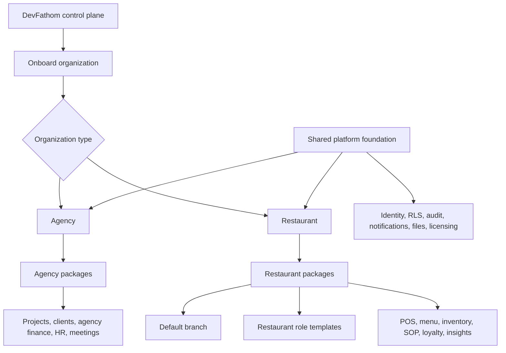

# DevFathom Restaurant Management System

| Field | Value |
| --- | --- |
| Document status | `PLANNED` |
| Industry | Restaurants, cafes, cloud kitchens, and food-service operators |
| Product | DevFathom Commercial |
| Delivery surface | Web first; native mobile is not currently planned |
| Last updated | 2026-08-16 |
| Current implementation status | Restaurant-specific operational modules have not been implemented |

## 1. Purpose

This document defines how DevFathom will support restaurant organizations alongside its existing agency operating model.

Restaurant support is a new product vertical built on the existing DevFathom platform. It is not an agency workspace with renamed pages, and it is not a separate SaaS application.

The shared DevFathom platform will continue to own:

- organization tenancy and PostgreSQL row-level security;
- platform onboarding and manual activation;
- authentication, sessions, seats, roles, and permissions;
- modules, packages, contracts, limits, and organization overrides;
- audit infrastructure, notifications, files, APIs, and webhooks;
- shared and dedicated Azure deployment modes.

Restaurant-specific domains will own POS, restaurant orders, menu management, recipes, stock, procurement, shifts, SOP compliance, restaurant customers, loyalty, and restaurant analytics.

## 2. Core product decision

The first onboarding decision will be **Organization type**:

```text
Agency
Restaurant
```

The UI label will be `Organization type`. The initial code-level representation should be intentionally small:

```ts
enum OrganizationVertical {
  AGENCY
  RESTAURANT
}
```

Do not introduce a generic low-code vertical builder at this stage. Adding a new vertical still requires purpose-built routes, data models, authorization, dashboards, and workflows. A two-value enum is simpler and more honest until a third real vertical exists.

### 2.1 Separation of responsibilities

| Concept | Responsibility |
| --- | --- |
| Organization type | Selects the operating model: Agency or Restaurant |
| Package | Selects the purchased commercial tier within that operating model |
| Modules | Selects enabled product capabilities |
| Limits | Controls branches, terminals, users, orders, templates, integrations, and other quantities |
| Roles and capabilities | Controls what each user may see or do |

Organization type may choose defaults and presentation, but it must never replace module entitlement or server-side authorization.

### 2.2 Organization-type behavior

Organization type will control:

- compatible packages shown during onboarding;
- onboarding fields and activation requirements;
- default module selection;
- default system-role templates;
- navigation and dashboard composition;
- business terminology;
- creation of a default restaurant branch;
- vertical-specific setup checklists.

Existing organizations and existing packages will be migrated to `AGENCY`.

An organization type may be corrected while an organization is still in early onboarding and contains no vertical data. Once activated, it must not be editable through an ordinary dropdown. An active vertical conversion requires an explicit migration workflow with preflight, audit history, and operator confirmation.

### 2.3 Package compatibility

`PlatformPackage` must carry compatible organization-type metadata. Restaurant onboarding must show restaurant packages only, while agency onboarding must show agency packages only.

The platform must reject a mismatched package on the server even if a crafted request bypasses the UI.

The current onboarding behavior also requires correction before restaurant packages launch: package modules are copied into `OrganizationModule` rows, while organization overrides take precedence over package defaults. Consequently, changing packages can leave modules from the previous package enabled. Package modules should be inherited, and organization overrides should represent exceptions only.

## 3. Product architecture



The implementation remains a modular monolith in the existing DevFathom repository. Restaurant bounded contexts must stay internally separate even when multiple contexts are sold as one commercial module.

## 4. Restaurant organization and branch hierarchy

One restaurant company, chain, or centrally managed brand will normally be one DevFathom organization. Its operating locations will be branches beneath that organization.

```text
Organization: Example Restaurant Group
├── Branch: DHA
├── Branch: Gulberg
└── Branch: Islamabad
```

A franchisee becomes a separate organization when it requires separate legal control, contracts, billing, administrators, retention, or data isolation.

### 4.1 Branch-first schema

Branch support must be modeled from the first restaurant release even if the first package allows one branch only.

Every restaurant organization receives one default branch during onboarding. The branch switcher can remain hidden for a single-branch customer.

Every branch-owned operational record must contain:

```text
organizationId
branchId
```

Organization RLS remains the database tenant boundary. Branch authorization is an additional application authorization layer implemented through explicit user-to-branch assignments.

Recommended hierarchy:

```text
Organization
└── RestaurantBranch
    ├── Operational areas and stations
    ├── Floors and tables
    ├── Registers and terminals
    ├── Orders and kitchen tickets
    ├── Inventory locations
    ├── Staff shifts
    └── SOP occurrences
```

## 5. Reuse assessment

| Area | Status | Direction |
| --- | --- | --- |
| Organization tenancy and RLS | Existing foundation | Reuse |
| Platform onboarding and activation | Existing foundation | Extend with organization type and restaurant preflight |
| Packages, contracts, modules, limits | Existing foundation | Reuse after package-inheritance correction |
| Authentication, invitations, sessions, seats | Existing foundation | Reuse |
| Custom organization roles | Existing foundation | Extend with restaurant capabilities and branch scope |
| Notifications | Existing foundation | Extend with restaurant categories and durable escalation |
| Generic audit history | Existing foundation | Reuse as a mirror, not the sole financial/compliance ledger |
| Files and uploads | Partial foundation | Reuse with SOP-specific evidence metadata and authorization |
| API tokens and webhooks | Partial foundation | Add restaurant scopes, events, durable outbox, and idempotency |
| Existing Finance | Partial foundation | Keep for back-office finance; do not use as POS source of truth |
| Existing HR | Partial foundation | Reuse people/leave where appropriate; build restaurant shifts separately |
| Existing Clients | Incompatible semantics | Build restaurant customer and loyalty models |
| Projects, tasks, and checklists | Prototype/reference only | Do not make them the permanent SOP model |
| POS, menu, stock, purchasing, kitchen, loyalty | Absent | New product development |
| Branch/location model | Absent | New platform foundation for Restaurant vertical |

## 6. Commercial restaurant module map

Avoid creating a separate sellable switch for every screen. The recommended catalog is intentionally compact.

### 6.1 Restaurant Core

Restaurant Core is mandatory for every restaurant organization.

It owns:

- branches and branch settings;
- operating areas and service stations;
- employee branch assignments;
- service modes;
- tax and service-charge configuration;
- business-day and closing-time configuration;
- restaurant-specific dashboard foundation;
- device and terminal registry foundation.

### 6.2 POS and Fulfilment

It owns:

- dine-in, takeaway, and delivery order channels;
- table and seating management;
- order taking and item modifiers;
- kitchen and bar order tickets;
- preparation and fulfilment status;
- discounts and complimentary items;
- cash, card, and online tender records;
- split bills and split tenders;
- refunds and voids;
- cash-drawer opening, movements, and closing;
- daily sales closing;
- receipt generation;
- manager approvals and reasons.

### 6.3 Menu and Costing

It owns:

- product and menu-item management;
- categories and subcategories;
- variants and sizes;
- modifier groups and modifier options;
- branch and channel availability;
- effective-dated price lists;
- recipes and BOM versions;
- yields and portion sizes;
- units and unit conversion;
- allergen and dietary metadata;
- theoretical product cost.

### 6.4 Inventory

It owns:

- ingredients and stock items;
- append-only stock movements;
- stock in and stock out;
- recipe consumption;
- transfers between stock locations;
- wastage and adjustment reasons;
- physical stock counts;
- theoretical-versus-actual variance;
- low-stock thresholds and alerts;
- batch, lot, and expiry tracking where configured.

### 6.5 Purchasing

It owns:

- suppliers and supplier contacts;
- supplier-item mappings;
- purchase requisitions;
- purchase orders and approvals;
- goods receiving;
- discrepancies and returns;
- supplier invoices and references;
- supplier price history;
- procurement and supplier reports.

### 6.6 Restaurant Workforce

It owns:

- employee branch assignments;
- job/station assignments;
- shift scheduling;
- shift swaps and manager approval;
- clock-in and clock-out;
- break tracking;
- attendance and late arrival;
- labour-hour reporting.

Existing employee profiles and leave management may be reused, but existing project time entries must not be reused as restaurant attendance.

### 6.7 SOP and Compliance

It owns:

- versioned SOP library;
- opening and closing checklists;
- cleaning schedules;
- barista procedures;
- kitchen procedures;
- food-safety checks;
- stock checks;
- equipment checks;
- staff hygiene and uniform checks;
- employee assignment;
- due windows;
- recurring schedules;
- photo and signature proof;
- manager verification;
- rejection and rework;
- missed and late states;
- escalation rules;
- employee, department, and branch performance scores;
- immutable occurrence and verification history;
- notifications and reports.

### 6.8 Customers and Loyalty

It owns:

- restaurant customer profiles;
- contact and marketing consent;
- order and visit history;
- saved delivery addresses;
- loyalty accounts;
- append-only points ledger;
- tiers and rewards;
- redemption history;
- branch-specific or chain-wide loyalty rules.

Agency `Client` records must not be reused as restaurant customers because their project, contract, and invoice semantics are incompatible.

### 6.9 Restaurant Insights

It owns read models and reports for:

- daily and hourly sales;
- sales by branch, channel, category, and product;
- average check and covers;
- table-turn time;
- discounts, complimentary items, refunds, and voids;
- tender and payment reconciliation;
- drawer variance;
- food cost and margin;
- theoretical-versus-actual ingredient usage;
- stock variance and wastage;
- supplier spend and performance;
- labour hours and labour percentage;
- SOP completion, lateness, rejection, and compliance scores;
- consolidated branch reporting.

### 6.10 Integrations and Devices

It owns:

- payment provider adapters;
- card-terminal references and sanitized statuses;
- receipt and kitchen printer integration;
- cash-drawer integration;
- kitchen-display devices;
- delivery marketplace integrations;
- accounting exports;
- restaurant REST APIs and webhooks;
- provider webhook inbox;
- transactional event outbox;
- retries, delivery history, and idempotency.

## 7. Limits and usage

Multi-branch and capacity controls should usually be limits rather than standalone modules.

Suggested keys:

```text
restaurant.locations.max
restaurant.departments.max
pos.terminals.max
pos.orders.monthly
pos.concurrentRegisters.max
inventory.stockLocations.max
sop.templates.max
sop.evidenceRetentionDays
loyalty.activeCustomers.max
integrations.connections.max
restaurantInsights.retentionMonths
```

The platform may store new limits without a schema migration, but each enforced limit requires explicit server-side consumption and tests.

## 8. Roles and authorization

Do not expand the global role enum with every restaurant job. Use organization-role templates with capability namespaces.

Recommended templates:

- Owner / Administrator
- General Manager
- Branch Manager
- Cashier
- Server
- Kitchen
- Bar / Barista
- Inventory Controller
- Purchasing Officer
- Accountant
- SOP / Compliance Auditor

Example capabilities:

```text
restaurant:configure
branches:read
branches:manage
pos:operate
orders:read
orders:void
orders:discount
orders:complimentary
payments:collect
payments:refund
cash:open
cash:adjust
cash:close
menu:read
menu:write
inventory:read
inventory:count
inventory:adjust
inventory:waste
purchasing:create
purchasing:approve
sop:complete
sop:verify
sop:manage
customers:read
loyalty:redeem
reports:operational
reports:financial
```

Explicit deny continues to take precedence. Branch assignment must further constrain a capability that would otherwise allow an action.

The current agency-specific department enum also requires a deliberate migration. Restaurant users cannot be forced into `ENGINEERING`, `PRODUCT`, or similar agency departments. Prefer organization-owned departments or operational areas rather than adding restaurant values to another growing global enum.

## 9. Restaurant onboarding flow

### Step 1: Organization type

- Agency
- Restaurant

### Step 2: Business identity

- legal name;
- display name;
- workspace slug;
- primary contact;
- locale;
- currency;
- data residency;
- shared or dedicated deployment.

### Step 3: Restaurant setup

- first branch name;
- branch address;
- branch timezone;
- dine-in, takeaway, and delivery modes;
- tax basis;
- service-charge policy;
- business-day closing time;
- expected terminals and users.

### Step 4: Commercial package

- show restaurant-compatible packages only;
- apply package modules;
- apply branch, terminal, seat, and usage limits;
- record contract-specific additions.

### Step 5: Owner account

- owner/administrator name;
- secure credential or invitation flow;
- full organization administrator role;
- default branch access.

### Step 6: Default role templates

- create restaurant system roles;
- attach default capability rules;
- allow later customer-specific role customization where entitled.

### Step 7: Provisioning and activation

Activation requires:

- restaurant-compatible package;
- required Restaurant Core module;
- at least one enabled operational module;
- active owner/administrator;
- one valid default branch;
- READY production deployment;
- acknowledged tax/payment/device setup state;
- no failed onboarding preflight.

## 10. Internal bounded contexts

Commercial modules and bounded contexts are not required to match one-to-one.

| Bounded context | Primary responsibility |
| --- | --- |
| Restaurant Core | Vertical metadata, branches, stations, assignments, settings |
| Menu and Pricing | Products, modifiers, price lists, taxes, channel availability |
| Sales and Orders | Order state and item lifecycle |
| Floor Service | Floors, tables, occupancy, moves, merges, seating |
| Payments and Cash | Tenders, refunds, voids, drawers, reconciliation, daily close |
| Kitchen and Bar | Ticket routing, firing, preparation, recalls, completion |
| Recipe and Inventory | Ingredients, BOM, stock ledger, counts, transfers, wastage |
| Procurement | Suppliers, purchase orders, receiving, cost history |
| Restaurant Workforce | Branch assignments, shifts, time clock, labour facts |
| SOP and Compliance | Templates, schedules, occurrences, proof, verification, escalation |
| Customer and Loyalty | Customer identity, consent, visits, points, rewards |
| Restaurant Analytics | Derived facts, read models, dashboards, reports |
| Integrations and Devices | Payment, printing, delivery, API, outbox/inbox, device registry |

## 11. Required domain behavior

### 11.1 Orders

Orders are transactional state machines, not agency invoices.

Suggested high-level states:

```text
DRAFT
OPEN
SENT
IN_PREPARATION
READY
SERVED
PAYMENT_PENDING
CLOSED
CANCELLED
```

Transitions must be explicit, authorized, idempotent, and audited. Menu names, prices, taxes, service charges, discounts, and modifiers must be snapshotted onto the order so later catalog edits cannot rewrite history.

### 11.2 Payments and cash

Payment, refund, void, drawer movement, and closing records must be append-only or explicitly reversed through new records.

Never store raw card numbers, CVV, or magnetic-stripe data. DevFathom stores only provider references, sanitized method information, amounts, status, and timing.

Split bills and split tenders are separate concepts and both must be supported.

### 11.3 Daily closing

A daily close must create an immutable branch and business-day snapshot containing sales, tender totals, tax, service charge, discounts, refunds, voids, cash expectation, actual cash, and variance.

Reopening a closed business day must require an authorized manager, reason, and separate audit event.

### 11.4 Inventory

Never update an inventory balance as the sole source of truth. Store an append-only movement ledger and derive the balance.

Movement reasons include:

- purchase receipt;
- recipe consumption;
- sale reversal;
- transfer;
- physical-count adjustment;
- wastage;
- spoilage;
- staff meal;
- supplier return;
- manual correction.

### 11.5 SOP execution

SOP templates are versioned. Editing a template creates a new version and never changes an occurrence already assigned or completed.

Suggested occurrence states:

```text
SCHEDULED
IN_PROGRESS
SUBMITTED
VERIFIED
REJECTED
LATE
MISSED
WAIVED
```

Proof and verification must retain uploader, verifier, capture time, completion time, evidence reference, evidence hash, verification result, and rejection reason.

## 12. Reliability, realtime, offline, and hardware

### 12.1 Durable events

Kitchen displays, payment webhooks, delivery platforms, inventory consumption, and downstream integrations cannot depend on process-local fire-and-forget events.

Introduce:

- a transactional event outbox;
- an external webhook inbox;
- idempotent consumers;
- delivery attempts and backoff;
- dead-letter/recovery states;
- device/request idempotency keys.

The current chat realtime provider must not become the authoritative kitchen-order channel.

### 12.2 Offline promise

The offline commitment must be decided before POS implementation:

1. **Cloud-connected pilot:** internet is required and the limitation is disclosed clearly; or
2. **Offline-capable POS:** local persistence, command sequencing, device identity, conflict rules, acknowledgements, and reconnect synchronization are product requirements.

Do not market offline capability until real disconnect, continued operation, reconnect, duplicate replay, conflict, and recovery tests pass.

### 12.3 Printers and cash drawers

A browser-only application cannot assume reliable support for every printer, kitchen printer, and cash drawer.

Supported options must be selected deliberately:

- network-capable printers;
- manufacturer-supported browser integrations;
- or a site-local DevFathom device/print agent.

The web application remains the user-facing product. A narrowly scoped local device agent does not imply a native mobile application.

## 13. Preliminary commercial packages

These names and limits are provisional and require pricing work.

### Restaurant Essentials

- one branch;
- Restaurant Core;
- POS and Fulfilment;
- Menu and Costing;
- basic Inventory;
- basic Workforce shifts;
- basic SOP checklists;
- basic restaurant reports;
- predefined restaurant roles.

### Restaurant Operations

- multiple branches within configured limits;
- full inventory and purchasing;
- advanced SOP and verification;
- customers and loyalty;
- advanced restaurant insights;
- selected integrations;
- extended audit and data retention.

### Restaurant Enterprise

- contracted branches, terminals, users, and order capacity;
- custom role and permission design;
- SSO and SCIM where contracted;
- APIs and webhooks;
- dedicated Azure deployment where contracted;
- custom integrations and reporting;
- contracted support, retention, and residency terms.

Login and basic role enforcement are foundational security and must not be disabled as a module. Enterprise may receive advanced customization, SSO, SCIM, and governance controls.

## 14. Delivery plan

### Phase 0: Product and architecture decisions

#### Deliverables

- restaurant architecture decision record;
- target-country tax and fiscalization requirements;
- payment and terminal strategy;
- offline operating promise;
- printer and cash-drawer strategy;
- domain state machines;
- restaurant capability matrix;
- branch and franchise boundary rules;
- initial package and limit specification.

#### Verification

- product, engineering, security, and operations sign off on decisions;
- no unresolved payment-card storage responsibility;
- all external-provider assumptions cite provider documentation;
- failure and recovery behavior is defined before implementation.

#### Anti-pattern guards

- no invented payment/provider API;
- no promise of offline or hardware support without an accepted design;
- no country-specific tax assumption applied globally.

### Phase 1: Vertical-aware platform foundation

#### Deliverables

- organization type and package compatibility;
- migration of current organizations/packages to Agency;
- type-first onboarding;
- default restaurant branch;
- branch assignments;
- restaurant role templates and capability namespaces;
- restaurant navigation and dashboard shell;
- package-inheritance correction;
- activation preflight;
- documentation and status map.

#### Verification

- agency onboarding remains unchanged;
- restaurant onboarding cannot select agency packages;
- crafted requests cannot assign incompatible packages;
- active organization type cannot be casually changed;
- every restaurant has one default branch;
- cross-organization and cross-branch tests fail closed;
- disabled restaurant modules cannot be opened or called directly.

#### Anti-pattern guards

- do not infer organization type from package names;
- do not create each branch as an organization;
- do not treat navigation hiding as authorization;
- do not expand a global enum with every restaurant job.

### Phase 2: Restaurant Core, menu, and configuration

#### Deliverables

- branches, areas, tables, stations, registers, and terminals;
- service modes;
- products, categories, variants, and modifiers;
- price lists;
- tax and service-charge rules;
- recipe/BOM versions;
- allergens and availability;
- restaurant configuration UI.

#### Verification

- all rows are organization scoped and branch relationships are organization aware;
- price/tax configuration is effective-dated;
- historical catalog versions remain readable;
- duplicate and cross-branch table/terminal constraints are tested;
- RLS verifier includes every new tenant table.

### Phase 3: POS, payments, kitchen, and daily close

#### Deliverables

- order state machine;
- table and channel workflows;
- item modifiers and kitchen routing;
- kitchen/bar tickets and KDS;
- discounts and complimentary approvals;
- split bills and split tenders;
- payment-provider adapter boundary;
- refunds and voids;
- drawer sessions and movements;
- daily close and reopen workflow;
- receipts;
- device and request idempotency;
- selected connected/offline behavior.

#### Verification

- monetary calculations use decimal-safe arithmetic;
- retries cannot create duplicate orders, payments, refunds, or closes;
- concurrent table/order actions are deterministic;
- all manager overrides require a reason;
- finalized snapshots survive catalog edits;
- no raw card data reaches logs or storage;
- reconnect and failure tests match the promised operating mode;
- peak-hour load tests meet the accepted target.

### Phase 4: Inventory and purchasing

#### Deliverables

- ingredients, units, conversions, yields, and recipe consumption;
- stock movement ledger;
- counts, transfers, wastage, batches, and expiry;
- low-stock rules;
- suppliers, purchase orders, approvals, receiving, and discrepancies;
- costing and variance reports.

#### Verification

- movements balance under concurrency;
- unit conversion and recipe yield cases are covered;
- receiving and return retries are idempotent;
- stock cannot cross organizations or unauthorized branches;
- negative-stock policy is explicit and tested;
- backdated corrections preserve history.

### Phase 5: SOP and compliance

#### Deliverables

- versioned SOP templates and steps;
- recurring schedules and occurrences;
- branch/station applicability;
- employee assignment and due windows;
- photo/signature proof;
- verification, rejection, waiver, and rework;
- late/missed detection;
- escalation worker and delivery records;
- performance scoring and compliance reports.

#### Verification

- recurrence respects branch timezone and daylight-saving transitions;
- editing a template never changes historical occurrences;
- proof authorization is narrower than general tenant file access;
- submitted/verified evidence cannot be silently replaced;
- escalation is durable and retryable;
- scores can be reproduced from source occurrences.

### Phase 6: Workforce, loyalty, and insights

#### Deliverables

- shifts, assignments, clock-in/out, attendance, and labour facts;
- restaurant customers, consent, visits, loyalty tiers, and rewards;
- points and redemption ledger;
- restaurant KPI read models;
- branch and department filters;
- consolidated dashboards and exports.

#### Verification

- labour and loyalty ledgers are reproducible;
- refunds and cancelled orders reverse loyalty effects correctly;
- customer consent and retention rules are enforced;
- reporting totals reconcile with operational ledgers;
- branch permissions apply to reports and exports.

### Phase 7: Production hardening and rollout

#### Deliverables

- end-to-end production-like environment;
- observability, alerting, backups, and recovery runbooks;
- device and integration support matrix;
- load and soak testing;
- data migration/import tools;
- restaurant onboarding guide;
- operator support guide;
- pilot rollout and rollback plan;
- final technical, API, security, QA, and business documentation.

#### Verification

- security review and tenant-isolation suite pass;
- payment and inventory reconciliation pass;
- backup restore is demonstrated;
- device disconnect/recovery is demonstrated;
- production image, migrations, and browser acceptance pass on the same SHA;
- pilot acceptance is recorded by feature and branch.

## 15. Global acceptance requirements

Every phase must meet these cross-cutting requirements:

- new tenant tables have non-null `organizationId`;
- branch-owned rows also have `branchId`;
- cross-tenant foreign keys are structurally prevented;
- forced RLS and non-superuser tests cover new tables;
- all mutations use scoped database access;
- module mapping covers routes, tRPC routers, and REST scopes;
- role capabilities are enforced on the server;
- disabled modules fail safely and professionally;
- domain ledgers are transactional and auditable;
- sensitive values are redacted;
- external callbacks and client retries are idempotent;
- migrations are additive, reviewed, and deployable with `prisma migrate deploy`;
- current agency behavior receives regression coverage;
- documentation status never claims an unimplemented feature is available.

## 16. Explicit anti-patterns

Do not:

- reuse agency invoices as restaurant checks or bills;
- reuse agency clients as restaurant loyalty customers;
- use project tasks as the permanent SOP/compliance model;
- create one organization per ordinary branch;
- infer vertical from package names;
- store menu, recipe, stock, or payment ledgers as unstructured JSON blobs;
- update stock balances without a movement ledger;
- delete payment, refund, void, drawer, closing, stock, or SOP evidence history;
- store raw payment-card information;
- use UI filtering as a branch security boundary;
- use fire-and-forget chat realtime as authoritative kitchen delivery;
- advertise offline capability before disconnect/reconnect acceptance passes;
- promise universal printer/drawer support without a tested support matrix;
- implement taxes without a target-jurisdiction decision;
- put every restaurant job into a global role enum.

## 17. Open product decisions

These decisions are required before Phase 2 or Phase 3 implementation is finalized:

1. Initial launch country or countries.
2. Tax, service-charge, receipt, and fiscalization requirements per country.
3. Supported payment processors and card-terminal vendors.
4. Whether the pilot requires real offline order operation.
5. Required offline duration and conflict policy.
6. Supported receipt printers, kitchen printers, cash drawers, and KDS devices.
7. Whether a local device/print agent is acceptable.
8. Delivery integrations required for the first release.
9. Inventory costing method: weighted average, FIFO, or another approved method.
10. When recipe consumption posts: send-to-kitchen, fulfilment, settlement, or configurable policy.
11. Loyalty point expiry, consent, privacy, and redemption rules.
12. Franchise/legal boundary rules.
13. Initial package names, prices, branch limits, terminal limits, and order limits.
14. Required historical retention for sales, audit, stock, and SOP evidence.

## 18. Current codebase anchors

The following existing files provide patterns to reuse. They do not imply that restaurant functionality is already implemented.

- `prisma/schema.prisma` — organization, users, custom roles, entitlements, finance, notifications, audit, and control-plane models.
- `prisma/production-bootstrap.ts` — current platform module registry and Agency Suite bootstrap.
- `src/lib/platform/commands.ts` — organization onboarding, lifecycle, package, module, and catalog commands.
- `src/lib/entitlements.ts` — package, contract, limit, and override resolution.
- `src/lib/module-catalog.ts` — route, procedure, and REST module mapping.
- `src/lib/abac/policies.ts` — current authorization action catalogue.
- `src/lib/abac/index.ts` — custom role and explicit-deny evaluation.
- `src/lib/tenancy/scoped-db.ts` — tenant and control-plane database boundaries.
- `src/server/trpc.ts` — session, audit, capability, and module middleware.
- `src/server/audit.ts` — generic tenant audit infrastructure.
- `src/lib/notifications.ts` — generic notification delivery.
- `src/lib/webhooks.ts` — current signed webhook foundation.
- `scripts/verify-tenant-isolation.ts` — forced-RLS and tenant-isolation verification.
- `docs/admin-platform/entitlements.md` — current commercial entitlement contract.
- `docs/admin-platform/architecture-tenancy.md` — current tenant and RLS architecture.

## 19. Status summary

| Area | Status |
| --- | --- |
| Restaurant product architecture | `PLANNED` |
| Organization-type onboarding | `PLANNED` |
| Restaurant package catalog | `PLANNED` |
| Branch model | `PLANNED` |
| Restaurant roles/capabilities | `PLANNED` |
| POS and kitchen | `PLANNED` |
| Menu and recipes | `PLANNED` |
| Inventory and purchasing | `PLANNED` |
| Restaurant workforce | `PLANNED` |
| SOP and compliance | `PLANNED` |
| Customers and loyalty | `PLANNED` |
| Restaurant insights | `PLANNED` |
| Integrations and devices | `PLANNED` |
| Native mobile applications | `FUTURE` |

No restaurant-specific capability should be marketed as implemented until its code, migrations, authorization, tenant isolation, QA, deployment, and documentation are complete.
