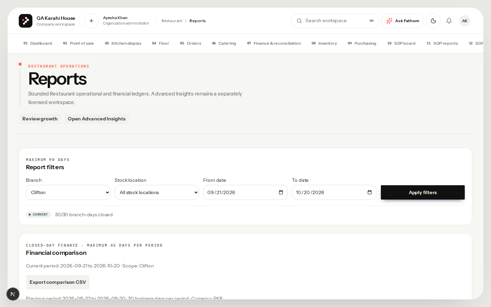
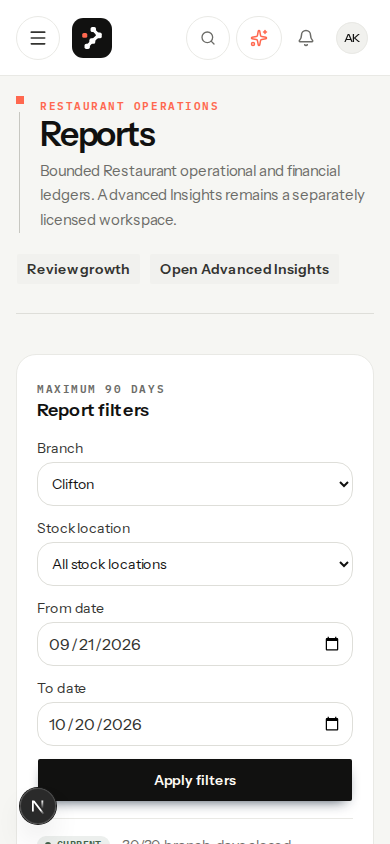
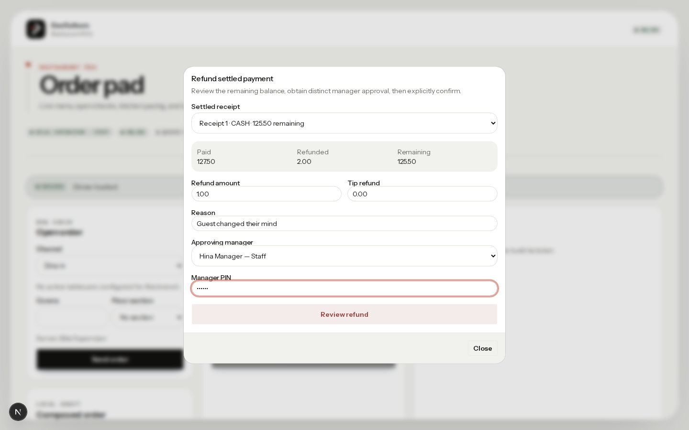
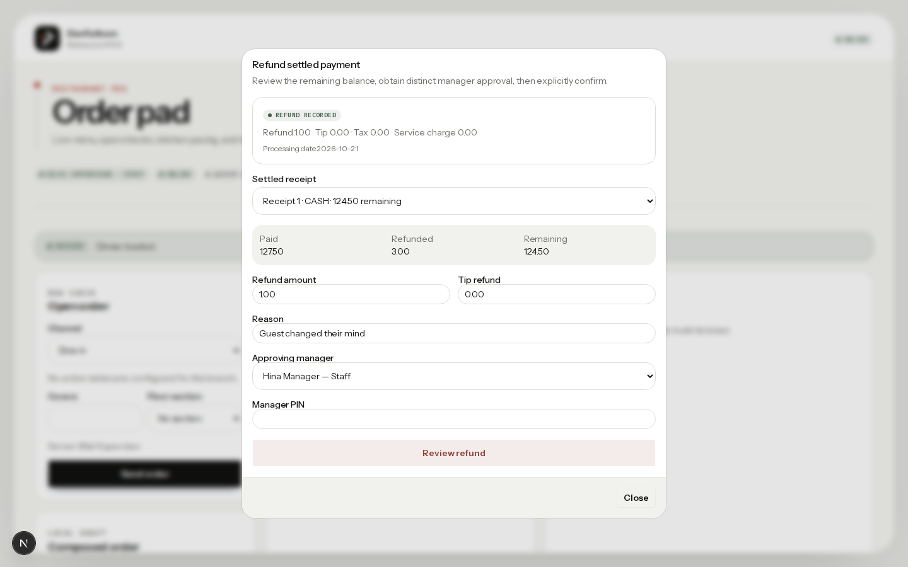
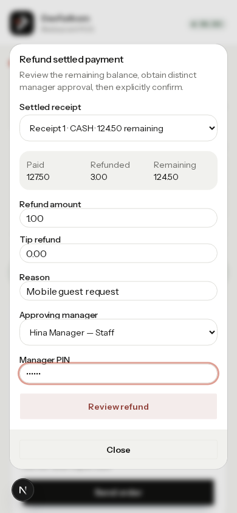
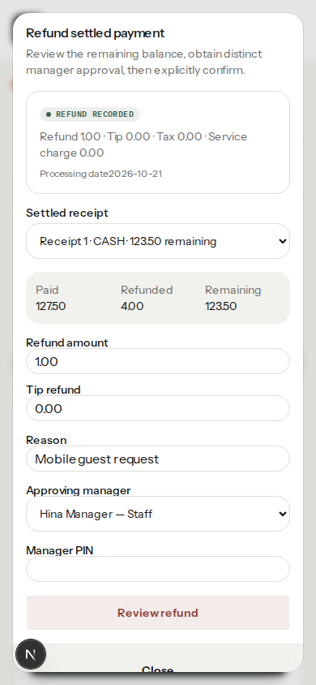
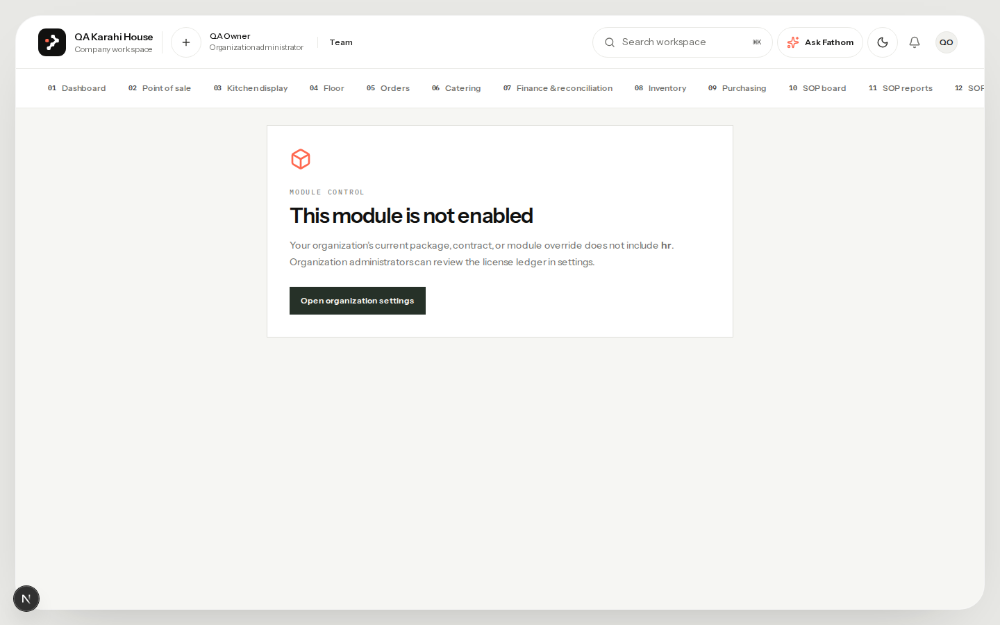
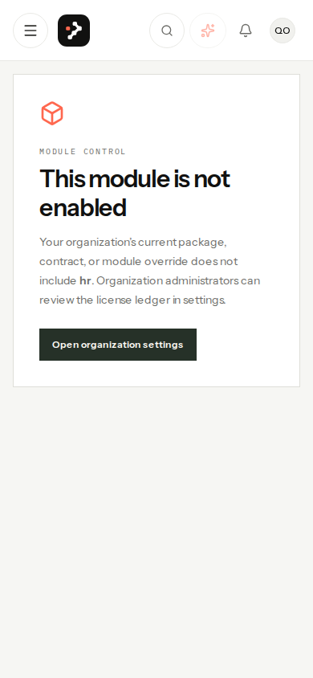
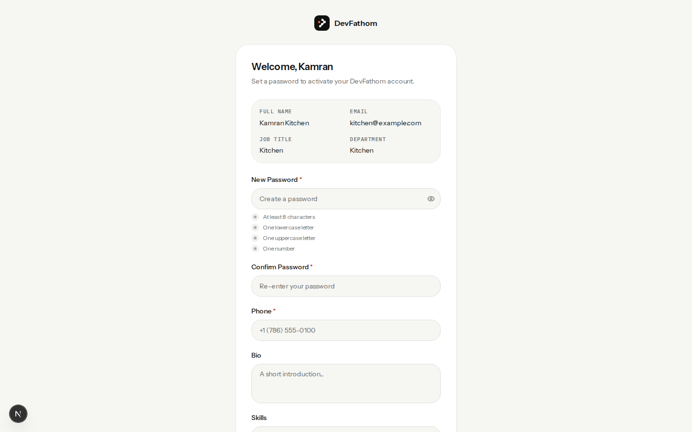

# Restaurant retest: #144, #145, #146

Executed 2026-10-21 against three detached worktrees. Product code was not modified. Nothing was posted to GitHub.

| Issue | Branch | Commit | Result |
| --- | --- | --- | --- |
| #144 audit transaction timeouts | `fix/qa-144-audit-tx-timeouts` | `c27c23ddc72178cbaae61e9905c904974a681b8c` | **PASS** |
| #145 refund co-authorization ignores job roles | `fix/qa-145-coauth-job-roles` | `59634b78b356ec76efb350c723457f1f660403c9` | **PASS** |
| #146 invite requires the HR module | `fix/qa-restaurant-sev2` | `b68f11ae5e8b8e450b8552569badba2ed8adc514` (fix `03823c8b`) | **FAIL** |

## Environment

PostgreSQL 16. Each branch got its own database because the migration histories differ: `devfathom` for #144, `devfathom_145` for #145, `devfathom_146` for #146. The application connected as `devfathom_app` (`LOGIN`, `rolsuper = false`, `rolbypassrls = false`). `organizations` has `FORCE ROW LEVEL SECURITY`. With no tenant context that role saw 0 organizations. Schema changes and the platform seed used the database owner. The Next.js dev server listened on port 3000. Tenant traffic used `http://qa-karahi-house.localhost:3000` and platform traffic used `http://admin.localhost:3000`, both pinned to `127.0.0.1`. Browser checks used Playwright Chromium at 1440×900 and 390×844.

#144 and #145 ran on Bun 1.3.14. #146’s lockfile is version 3, so that worktree ran on Bun 1.4.3 with the frozen lockfile (Prisma 7.9.1, Next.js 16.4.2).

`fix/qa-restaurant-sev2` records that only #146 was finished. #147 (duplicate slug), #148 (tax errors), #149 (POS entitlement), and #151 (host mismatch) were stopped and are not claimed by this retest.

## #144 — PASS

Original failure: audited restaurant page reads hit a transaction timeout. `GET /restaurant/reports` took 17.7 minutes.

Seed on the Karachi tenant, business dates 2026-09-21 through 2026-10-20:

- 4,200 closed takeaway orders and 4,200 served items (140 per day)
- 30 daily closes, 30 cash tender totals, 30 insight rollups
- 1,500 closed drawer sessions (50 per day)

The reports page for that window returned HTTP 200 with freshness **Current**, orders **4,200**, covers **4,200**, top item Chicken Karahi **4,200**, and cash-count coverage complete. The page text had no section-load or transaction-timeout error.

| Load | Viewport | HTTP | Time |
| --- | --- | --- | --- |
| First reports open, including route compile | 1440×900 | 200 | 11.3s to DOM, 11.8s total |
| Same window reloaded | 390×844 | 200 | 2.6s to DOM, 3.1s total |
| Default report window | 1440×900 | 200 | 1.9s to DOM, 2.3s total |
| Same 30-day window while 8 order opens ran | 1440×900 | 200 | 2.5s |

Sixteen concurrent `restaurantOrders.open` calls all returned HTTP 200 in 414–709ms. The eight opens overlapped with the report all returned HTTP 200, the slowest in 1,271ms. Orders and catalog pages also returned HTTP 200 with no error shell.

Audit rows for the tenant include `restaurantOrders.open` SUCCESS ×24 and the report sections (`overview`, `payments`, `foodCost`, `dishProfitability`, `catering`, `inventory`, `wastage`, `stockMovements`, `purchasing`, `workforceFinancial`, `sop`, `stockLocations`, `financialComparison`) written on the repeated loads. Audited mutations completed and the audit trail was still written.

## #145 — PASS

Original failure: refund co-authorization ignored job-role capabilities, so a floor manager who only had `coauth:approve` on a job role could not approve.

Two active Restaurant Enterprise tenants, Clifton branch, Asia/Karachi. Approvers were PIN-only staff with no linked web user, so the capability came from the job role. Database capabilities: `cashier` has neither `coauth:approve` nor `payments:refund`; `shift-supervisor` and `manager` have both. The acting operator was the shift supervisor. A settled cash sale (PKR 850 plus PKR 127.50 Sindh tax, receipt 1) was open on the register with a drawer.

`GET /api/restaurant/terminal/operators` before the deactivation:

| Staff | Job role | `canApprove` |
| --- | --- | --- |
| Bilal Supervisor | shift supervisor | true |
| Hina Manager | manager | true |
| Daniyal Manager | manager | true |
| Sana Cashier | cashier | false |

After Daniyal was set to `SUSPENDED`, the directory listed Bilal, Hina, and Sana only.

API, acting as Bilal, `POST /api/restaurant/checkout/refund` for PKR 1.00:

| Case | Result |
| --- | --- |
| Cashier PIN as approver | 403 `The approving manager lacks the "coauth:approve" capability.` |
| Supervisor approving himself | 400 `A co-authorization requires a second identity: the approving manager must differ from the acting operator.` |
| Manager from the other tenant, with that tenant’s PIN | 401 `Invalid approving credential.` |
| Suspended manager, with his own PIN | 401 `Invalid approving credential.` |
| Active manager | 200, refund id issued, tax refund PKR 0.15 |

A cashier who took over the terminal received 403 `This operator lacks the "payments:refund" capability.` on `GET /api/restaurant/checkout/refund`. Switching back to the supervisor returned 200.

POS UI, unlocked as Bilal, Refund dialog at 1440×900 and 390×844: the approver list contained only **Hina Manager**. Sana, Bilal, Daniyal, and the other tenant’s manager were absent. Confirming Hina’s PIN recorded the refund and showed **refund recorded** at both widths. The 390px Review refund button sat inside the viewport (y 646, height 44, viewport 844). The database ended with 5 co-authorization rows and 5 refunds totalling PKR 5.00: one API approval plus repeated UI confirmations by the same allowed manager.

## #146 — FAIL

Original failure: `team.inviteMember` returned 403 `The HR module is not enabled for this organization.` Restaurant Enterprise does not include `hr`. Fix commit `03823c8b` maps that one procedure to the `admin` module.

The API half of the original failure is fixed. The workspace screen an administrator uses to invite someone is still licensed as `hr`, so the invite still cannot be completed in the product UI. That is the fail.

Confirmed on the active QA Karahi House tenant: zero `hr` organization-module rows, and the enterprise package links do not include `hr` or `admin`. The owner signed in.

| Call | Result |
| --- | --- |
| `team.inviteMember` with the seat limit lowered to the occupied seat | 403 `Seat limit reached (1/1). Increase the organization license before inviting another member.` |
| Invite Sana Cashier (`EMPLOYEE`, Front of House, title Cashier) | 200, invite URL issued, user `INVITED` |
| Invite Kamran Kitchen (`KITCHEN`, title Kitchen) | 200, invite URL issued |
| Invite Sara Server (`FRONT_OF_HOUSE`, title Server) | 200, invite URL issued |
| Invite the cashier address again while the invite is still pending | 200, token refreshed |
| `invitations.get` and `invitations.accept` for the current cashier token | 200; user became `ACTIVE` |
| Invite the cashier address after acceptance | 409 `A user with this email already exists` |
| Accepted cashier calls `team.inviteMember` | 403 `You do not have permission for this action.` |
| Owner calls `team.getAll` and `team.getHrOverview` | both 403 `The HR module is not enabled for this organization.` |
| `restaurantStaff.create` with no `userId` | 200 |

The invite procedure no longer fails for lack of HR. Seat limits, the distinct-email conflict, the admin capability check, and the rest of the `team` namespace still require what they required before.

Browser, owner session, `/team` at 1440×900 and 390×844: HTTP 200, heading **This module is not enabled**, body says the package does not include `hr`. The Add Member button was not in the page. There is no other invite screen in this branch.

The kitchen invitation page rendered Kamran Kitchen, title Kitchen, department Kitchen. Submitting it activated the account (`kitchen@example.com` is `ACTIVE`). The browser was then left on the apex host login. A credentials sign-in sent directly to `qa-karahi-house.localhost` established that user’s session. Host redirect behavior is the open #151 area, which this branch did not change, so it is not filed again here.

### Ready to file

Title: `[QA][Restaurants][SEV2] Restaurant administrators still cannot invite from the Team screen because the page requires HR`

Labels: `qa`, `restaurants`, `sev2-major`

Area: restaurants

Repro:

1. Sign in as the organization administrator of an active Restaurant Enterprise tenant that has no HR module.
2. Open `/team` on the tenant host at desktop width and at 390px.
3. Call `team.inviteMember` for an employee in Front of House.

Expected: The administrator can open the invite form and send a web-user invitation. Restaurant Enterprise does not need the HR module for that screen. The invitation procedure stays available to an administrator and keeps rejecting a caller without admin access, a full seat limit, and a duplicate active email.

Actual: `/team` renders **This module is not enabled** and names `hr`. Add Member is absent at 1440×900 and 390×844, so the administrator cannot invite from the workspace. `team.inviteMember` itself returns 200 and issues an invite URL. `team.getAll` and `team.getHrOverview` still return 403 `The HR module is not enabled for this organization.` The route catalog entry for `/team` is still `hr` after `03823c8b`, which only changed `moduleForProcedure('team.inviteMember')`.

## Out of scope on `fix/qa-restaurant-sev2`

The branch tip says #147, #148, #149, and #151 were not finished. This retest did not treat those as regressions of `03823c8b` and did not re-run their original cases.
